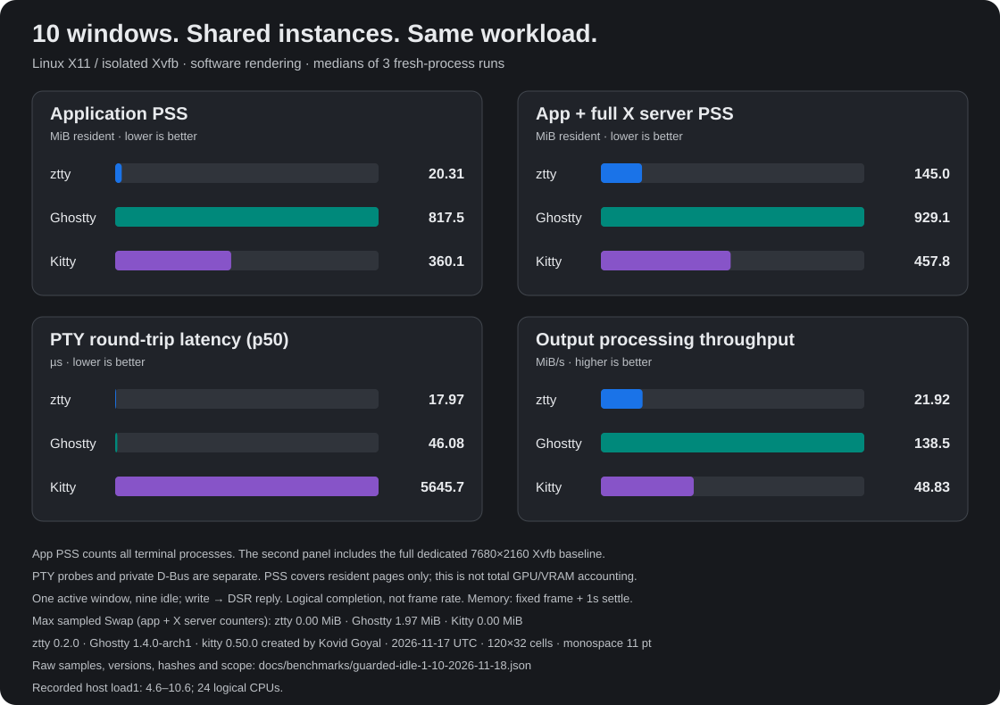
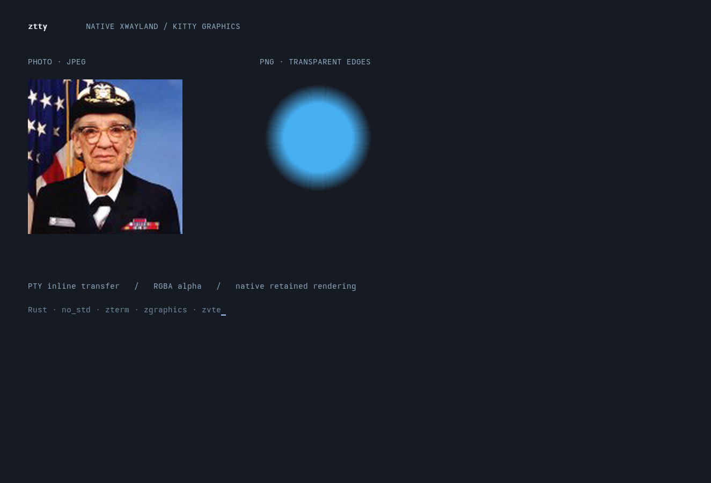

# ztty

**ztty 0.4.1** fixes numeric-keypad input under enhanced keyboard protocols
and includes the bounded Linux native UI. Download published assets from the
[official Releases](https://github.com/LIghtJUNction/ztty/releases).
[Release and installation record](docs/numpad-release-0.4.1-2026-11-19.zh-CN.md).

The current source adds an Alt+C case toggle in history search, preserves the
selected match when copying, and keeps the viewport anchored when history is
full. Counted scrolling within a terminal region moves retained rows in batches.
It also fixes keypad routing across NumLock and Shift modes, clears Sixel pixels
when text overwrites them, and selects the installed build for new independent
Linux windows while preserving existing sessions.
See the [iteration measurements and verification](docs/performance-function-2026-11-19.zh-CN.md)
for the tested source and workload.

<!-- terminal-benchmark:start -->
[](docs/benchmarks/guarded-idle-1-10-2026-11-18.md)

Three fresh-process runs per cell, at 1 and 10 shared idle windows; the figure shows 10. [Raw measurements](docs/benchmarks/guarded-idle-1-10-2026-11-18.json) · [Conditions, provenance and limits](docs/benchmarks/guarded-idle-1-10-2026-11-18.md) · rerun from current source: `make benchmark-terminals`.

Measured source: `fa2f2017`; immutable binary: `a339a7d2…1b6d4d`. All 18 scenarios verified their private Xvfb listener ownership and cleaned up their owned processes. A single ztty terminal used **22.02 MiB RSS**; the below-10-MiB target remains unmet.

Linux software-X11 results: host load1 4.46–10.58 on 24 CPUs, with 17.34–17.96 GiB host swap already in use. RSS, PSS and Swap remain separate. Real GPU memory, first presented frame and input-to-display latency were not measured; the guarded 5/20-window, independent-instance and remaining-workload matrix is still incomplete.

<!-- terminal-benchmark:end -->

**Earlier shell/resume checkpoint, 2026-11-18:** Bash loading and prompt hooks are repaired; MCP output reads can validate the original session identity and report reader termination. That candidate passed 225 Rust tests, 6 doctests, four-shell integration, 11 Bash checks, 17 real Linux workspace checks and three MCP suites. [Implementation and evidence](docs/shell-resume-2026-11-18.md) · [Previous Unicode measurements](docs/integration-unicode-2026-11-18.md).

**Output throughput checkpoint, 2026-11-18:** a separate ten-window run of
source `dfe949c7` (ztty 0.2.1) measured 227.58 MiB/s. A separate paired old/new run measured
19.48 → 200.52 MiB/s (**10.29×**) with nearly unchanged application PSS.
These are historical ASCII/color screen updates under Xvfb software rendering,
with different source and runs from the guarded chart above. The integrated
workspace candidate has its own verification record.
[Results, implementation, and correctness evidence](docs/benchmarks/throughput-2026-11-18.md).

A lean native terminal, written in Rust without the Rust standard library.

ztty runs shells and terminal applications through the operating system's
pseudo-terminal interface, with native Linux, macOS and Windows backends and
static Kitty Graphics Protocol support. Screen state, input encoding, PTY
ownership, and image processing are reusable libraries. The visual design is
deliberately quiet: a dark background, readable text, generous padding, and no
application toolbar.

On Linux, multiple windows automatically share one session process, display connection
and font cache. Each window keeps its own PTY, screen and history. In the
recorded pre-graphics eight-window comparison, total ztty PSS fell from 47.021 to 15.366 MiB,
including the waiting launchers. The single-window case rose by 0.539 MiB.
See [measurement conditions and graphics-memory accounting](docs/performance.md#multiple-window-memory).

Linux continuous PTY output now uses an 8 ms redraw batching budget while keeping
parsing and interaction active. A fixed-binary, one-window Xvfb A/B measured
median logical PTY throughput of 18.88 → 133.01 MiB/s, with identical final
pixels; the three after samples varied from 130.97 to 278.57 MiB/s. See the
[raw samples, final-frame checks and limits](docs/benchmarks/repaint-ab-2026-11-18.md).
This is a scoped scheduling result; hardware display latency and new multi-terminal
memory/performance comparisons remain unmeasured.

Responsiveness and memory work is measured against specific workloads.
Current results, their limits and remaining work are documented in
[the performance report](docs/performance.md). Linux remains the first
acceptance target; the platform table records what has actually been exercised.

[中文介绍](README.zh-CN.md)

Linux provides history search across soft-wrapped text, a temporary session
switcher and command palette, a **Back to live ↓** control while browsing
history, configurable key/mouse bindings, live configuration reload and OSC 133
command navigation.
The shell scripts support opt-in Bash, Zsh, Fish and Nushell integration.
[Experience candidate and evidence](docs/experience-release-2026-11-18.md)
· [Daily workflow and limits](docs/daily-workflow.md) · [Shell setup](shell/README.md)
· [MCP permissions and command reads](docs/sessions.md).



## Platforms and verification

Shared sessions, attach, and MCP currently use the Linux broker. Native macOS
and Windows terminals remain available through their platform backends. All
three frontends use the shared no_std core for PTY reads, bounded input and
terminal state. The library also exposes action decoding, pane layout and
workspace state; [integration evidence](docs/session-core.md) records the scope.
The shared-session UI, attach and MCP runtime remain Linux features.

| Platform | Native implementation | Source-bound verification record |
| --- | --- | --- |
| Linux | X11/XWayland, Xft text, Xrender image compositing, Linux PTY | Formal source 9b5497d passed six GUI suites, 67 groups and 27 PNG captures on each native x86_64 and ARM64 runner under guarded Xvfb; source, binary identity and cleanup verified |
| macOS Apple Silicon | AppKit window, CoreText/CoreGraphics rendering, Darwin PTY | Formal source 9b5497d passed 8 threaded-spawn checks and 24 native checks, with 13 stages, 10 PNG captures and no remaining owned processes |
| macOS Intel | AppKit window, CoreText/CoreGraphics rendering, Darwin PTY | Formal source 9b5497d passed the same 8 spawn and 24 native checks, with 13 stages, 10 PNG captures and no remaining owned processes |
| Windows x64 | Win32 window, GDI text, own RGBA compositing, ConPTY | Candidate 2f2fae44 passed eight fresh processes, each with 31 base checks, 10 warm rapid resizes and 10 back-to-back resize pairs, plus 19 workspace groups; owned-resource cleanup passed |
| Windows ARM64 | The same native Win32 / ConPTY backend | The same normal-mode 2f2fae44 candidate passed the complete eight-process and workspace gate natively on ARM64 |

macOS now uses a fresh-exec PTY helper that can create sessions after AppKit
starts threads. [Implementation and native test scope](docs/darwin-threaded-pty.md)
record the controlling-terminal, descriptor and error-handling contracts.
[Windows candidate run 44349551432](https://github.com/LIghtJUNction/ztty/actions/runs/44349551432)
used the application's default frame policy with painting and NC-policy
diagnostics disabled. The application requests disabled DWM nonclient rendering;
the final readback confirmed it on both architectures. Windows keeps the standard
system frame, with a classic light-blue title bar and minimize/maximize/close
buttons in the captured runner theme. It does not retain the modern dark DWM
frame. This candidate is separate from final-tag acceptance.

The earlier formal `v0.3.0` tag remains fixed at `9b5497d`. Its Windows ARM
rapid-resize failure prevented publication, and the Release-by-tag API returned
404. A later local Linux candidate, source `19274145`, was installed as
`ztty 0.3.0-1`; that installation used different source and was not an official
Release download. The [release record](docs/releasing.md) preserves both outcomes.
The complete `0.3.1` build-only candidate at `90ec70fe` passed all six native
architecture jobs in [run 44365691692](https://github.com/LIghtJUNction/ztty/actions/runs/44365691692).
Formal tag verification, published assets and device installation each have
their own records. macOS IME/keyboard input and physical display latency remain
outside the recorded native window checks.

Windows preserves pane history and selection when silent modifier keys are
pressed or released, so releasing Shift after Shift+PageUp keeps the scrolled
view. Actual terminal input returns to the newest output. ConPTY children also
retain their console input/output when ztty's own standard streams are
redirected. These fixes entered at `3418b82` and `e334cf7`, respectively;
the earlier [Windows candidate 44306719420](https://github.com/LIghtJUNction/ztty/actions/runs/44306719420)
exercised both on x64 and ARM64. That source's acceptance remains separate from
the later formal ARM resize failure.

The macOS and Windows backends use their native APIs. macOS does not require
X11, and Windows does not require WSL. Cross-target compilation does not establish
runtime or visual correctness. See [protocol acceptance](docs/protocols.md#acceptance-coverage)
and [the release record](docs/releasing.md) for the verified scope and available
artifacts. The [earlier candidate record](docs/native-candidates-2026-11-18.md)
retains previous ARM64 failures and their subsequent fixes. Earlier Hyprland
images remain historical evidence. The Linux native gate uses private Xvfb
displays; live desktop interaction and physical display latency have separate
acceptance scopes.

## Install on Linux

The examples below describe the current source tree. Release downloads follow
the latest published [GitHub Release](https://github.com/LIghtJUNction/ztty/releases),
not every Git tag; build from source for unreleased changes. A source version
number alone does not establish that downloadable assets have been published.

On Arch Linux, install the AUR package with `yay -S ztty`. Other Linux
distributions can install a prebuilt x86_64 or AArch64 binary with:

```sh
curl -fsSLO https://github.com/LIghtJUNction/ztty/releases/latest/download/install.sh
sh install.sh
```

The script installs the latest published release, verifies its archive, and
installs to `~/.local/bin`. The Linux binary requires glibc, X11, Xft, and Xrender.
The working tree may contain changes that have not yet reached that release.

The installer in this source tree stages and checks the executable before
replacing the installed file with an atomic rename. An upgrade retains one
previous executable at `~/.local/bin/ztty.previous`, with its SHA256 in
`ztty.previous.sha256`; reinstalling identical bytes keeps that rollback copy.
If the previous installation was a symlink, the backup preserves the link.
The desktop entry uses the absolute installed path, so an older `ztty` elsewhere
in `PATH` does not take precedence when launching from the application menu.

Set `ZTTY_INSTALL_DIR` to choose the binary directory and `ZTTY_DESKTOP_DIR` to
choose the launcher directory. The latter defaults to
`${XDG_DATA_HOME:-$HOME/.local/share}/applications`. Replacing the executable does
not restart an existing shared broker; it keeps running its loaded version
until it exits. A new independent Linux window without `ZTTY_SOCKET`
selects the currently installed build, while explicit addresses and targeted
tab/split operations keep their existing routing. See
[upgrading a running broker](docs/sessions.md#upgrading-a-running-broker).

## Build and run

The toolchain is Rust 1.100.0. On Linux, also install a C linker, X11/Xft/Xrender
development libraries, and a monospace font. The X11 frontend can run through
XWayland on Wayland desktops.

```sh
# Arch Linux
sudo pacman -S --needed base-devel libx11 libxft libxrender fontconfig

# Debian / Ubuntu
sudo apt install build-essential libx11-dev libxft-dev libxrender-dev libfontconfig1-dev

cargo build --locked --release
./target/release/ztty
./target/release/ztty --font 'monospace:size=12' --geometry 100x28
./target/release/ztty --scrollback 4000 -e /bin/bash
```

Use the checkout's installer to install a local build without downloading:

```sh
sh install.sh --from-binary ./target/release/ztty
```

`--from-binary` checks a regular native executable and its staged copy, then
uses the same replacement path as a release download. `make install` builds and
installs through this path under `~/.local`; set `PREFIX` to choose another
location, or `DESTDIR` to stage a package while retaining the final launcher
path. [Installer options](install.sh) and [offline regression scenarios](tests/install_test.py)
describe the file and rollback handling.

To roll back later, when the default backup path contains a regular executable:

```sh
sh install.sh --from-binary "$HOME/.local/bin/ztty.previous"
```

Linux and macOS use `SHELL`, with `/bin/sh` as the fallback; Windows uses
`COMSPEC`, falling back to `cmd.exe`.
Use `-e` to select a different command and `--cwd PATH` for its initial
directory. Relative commands use the selected cwd; relative config paths keep
the launcher directory. [Startup directory behavior and native acceptance](docs/startup-directory.md)
describe the platform boundary. Child sessions receive
`TERM=xterm-256color`, `COLORTERM=truecolor`, and `TERM_PROGRAM=ztty`.

macOS builds link AppKit, CoreText, CoreGraphics, and the Darwin runtime.
Windows builds use the Win32 APIs and ConPTY. The Windows packaging path includes
a pinned Microsoft ConPTY redistribution; `zpty` can also use the Windows inbox
API. The [PTY documentation](crates/zpty/README.md) explains the operating-system
requirements and lifetime differences. Native packaging and acceptance commands
are maintained in [the release workflow](.github/workflows/release.yml).

## Inline images

Run an existing Kitty-compatible tool inside ztty to display static images:

```sh
kitten icat --scale-up photo.jpg
kitten icat transparent.png
```

The tool decodes a JPEG before transmission; ztty accepts inline PNG, RGB, or
RGBA data. Automatic detection selects inline `stream` transmission; it can also
be selected explicitly with `--transfer-mode=stream`. File and shared-memory transports
are outside this version's scope. Capability queries, compressed and chunked
uploads, image IDs, placements, source cropping, scaling, alpha blending, and
deletion are implemented. Images follow terminal scrolling, and the primary and
alternate screens keep separate image scenes.

The Linux graphics suite sends data through a real PTY and reads window pixels.
It checks colors, transparent edges, clipping, image replacement, scrolling,
resize, alternate-screen isolation, deletion, and recovery after invalid input.
Its final check runs `kitten icat` 0.50 on a photo and a transparent PNG.
See [the graphics protocol scope](docs/protocols.md#kitty-graphics) for limits
and deferred features.

## Shared sessions and MCP (Linux)

Reacquiring input control preserves already accepted input and restores an explicitly observing local view; [state rules and real PTY evidence](docs/session-core.md) describe the boundary. Output cursors also retain split UTF-8 characters after malformed bytes.

On Linux, run several terminals normally; resource sharing is automatic:

```sh
ztty --name work -e /bin/bash &
ztty --name logs -e /bin/sh &
ztty attach
ztty attach work
```

`ztty attach` lists sessions when no name is given. A name opens or raises its
window and waits for it to close. Local sessions have addresses such as
`ztty://local/work`; an ambiguous short name requires the complete address.

```sh
# MCP over stdio, without opening a window
ztty mcp

# Streamable HTTP at http://127.0.0.1:8732/mcp
ztty mcp --transport http --host 127.0.0.1 --port 8732

# Optional SSE replies with keepalive comments while output waits
ztty mcp --transport http --http-response sse

# View a session created by an MCP client
ztty attach ztty://mcp/stdio/checks
ztty attach ztty://mcp/http/127.0.0.1:8732/checks
```

MCP exposes nine tools to create, list, read, write, resize and close PTYs,
manage input ownership, list shell commands and read their retained output.
MCP-created sessions keep their output when the transport exits; closing their
window detaches it. Ordinary local windows keep the usual close-to-exit
behavior. HTTP listeners outside loopback require a bearer token.

Clients can pass `expected_session` from a previous create/list/read result to
read, write, resize, control or close the same session instance. A mismatched
URI, ID, creation time or broker PID is rejected before a guarded mutation,
so a reused name cannot silently redirect the operation to a replacement PTY.

See [sessions and MCP](docs/sessions.md) for naming, lifecycle, HTTP tokens,
client setup, JSON/SSE response modes and bounded UTF-8 output cursors.

## Appearance

Linux uses `$XDG_CONFIG_HOME/ztty/ztty.conf`, defaulting to
`~/.config/ztty/ztty.conf`. macOS defaults to
`~/Library/Application Support/ztty/ztty.conf` and accepts the same explicit
`XDG_CONFIG_HOME` override. Windows uses `%APPDATA%\ztty\ztty.conf`.
Choose another file with `ztty --config PATH`. Settings load at launch; Linux
also watches the file for changes and supports explicit reload with
Ctrl+Shift+R. Omitted keys use the built-in defaults and `--font` overrides the
file.
Use UTF-8, one `key = value` per line, and whole-line comments starting with `#`.

```ini
font = monospace:size=11
window-padding = 16
background = #161a23
foreground = #e1e7f0
background-opacity = 92
background-blur = true
cursor-shape = underline
cursor-color = #b1ccff
cursor-blink = true
cursor-blink-interval = 500
selection-foreground = #f0f4fa
selection-background = #394969
# Optional ANSI palette overrides, one line per index from 0 through 15.
palette = 1=#e06c75
palette = 4=#61afef
```

Padding is in pixels (0–128), opacity is a percentage (0–100), and the blink
interval is the duration of each phase in milliseconds (100–5000). Cursor
shapes are `block`, `underline`, and `bar`. Applications can change the active
shape and blink mode through DECSCUSR and DEC private mode 12.

On Linux, opacity affects the default background. Explicit ANSI backgrounds,
selected text, and glyph colors keep their own opacity. Blur requires a
compositor. `background-blur` controls the KWin-compatible X11 blur request.
Compositors with their own rules, including Hyprland, apply their configured blur policy
to transparent windows. Set opacity to 100 for an opaque Linux window. macOS
uses a native visual-effect view for blur; Windows currently renders an opaque
GDI surface. Appearance parity across the three backends has not been validated.

## Linux controls

| Action | Control |
| --- | --- |
| Select text | Drag with the left mouse button |
| Select while a TUI captures the mouse | Shift + drag |
| Copy selection | Ctrl + Shift + C |
| Paste clipboard | Ctrl + Shift + V |
| Paste primary selection | Middle mouse button |
| Increase / decrease font size | Ctrl + Plus / Minus; Ctrl + Equal and Ctrl + Shift + Minus also work |
| Reset font size to configuration | Ctrl + 0 or Ctrl + Shift + 0 |
| Keypad zoom / reset | Ctrl + keypad Add / Subtract / 0 (Num Lock on for keypad 0) |
| Next / previous tab | Ctrl + Tab / Ctrl + Shift + Tab |
| Browse history | Mouse wheel or Shift + PageUp / PageDown |
| Return to newest output | Click **Back to live ↓** while browsing history |
| Open an OSC 8 link | Ctrl + click |
| Switch or attach a session | Ctrl + Shift + S (`sessions`) |
| Search retained text | Ctrl + Shift + F |
| Open the command palette | Ctrl + Shift + P |
| Reload configuration | Ctrl + Shift + R |

On Linux, Plus follows the active keyboard layout, including Ctrl + Shift + Equal
on common layouts and a different shifted key on others. Split resizing uses
Ctrl + Alt + Shift + Equal / Minus.
Custom bindings take priority over these defaults, including bindings to `none`.

Font zoom, tab cycling and split resizing also use these shortcuts in the native
Windows frontend. Zoom keeps the window and running PTYs; Windows applies the
new font to every pane in that workspace. Reset restores the latest successfully
loaded configuration font on Linux and the startup configuration font on Windows.
Use Ctrl+0 on Windows: the system can reserve Ctrl+Shift+0 when multiple keyboard
layouts are active, so that alias works only if delivered to ztty.
[Microsoft documents this system shortcut](https://learn.microsoft.com/en-us/windows/terminal/troubleshooting#ctrl-doesnt-increase-the-font-size).
The macOS frontend does not yet implement these zoom or workspace shortcuts;
its copy/paste shortcuts are Command+C/V or Ctrl+Shift+C/V.

The return control appears only while the view is above the newest output.
If more output arrives, it changes to **New output · Back to live ↓** with a
blue border while the rows being read stay anchored. Clicking returns to the
bottom, clears the indication and hides the control. Search and the command
palette stay open; observing views keep their input ownership and PTY size.
[Scrollback behavior and narrow-window limits](docs/daily-workflow.md#returning-to-live-output).

The session switcher filters by name, terminal title and session URI. Type words
in any order, use Up/Down to choose, and press Enter to focus the selected view.
Existing tabs and panes are selected within their own workspace; another window
is raised in place. A session without a window is labeled **Attach**, and Enter
explicitly opens its view. Attaching from an observing view, or to a session
controlled by another operator, opens a read-only view. Switching preserves the
session's PTY and input owner; taking control remains the separate
`take-control` action. Esc closes the switcher, and Enter with no match leaves
the query open for editing.

The command palette also accepts multiple words in any order and shows the
shortcuts active for that view, including custom bindings. ASCII matching is
case-insensitive; other characters match literally. The named actions are shared
with `ztty action NAME ACTION` and the `keybind` / `mousebind` settings. For example,
`keybind = alt+f12 = sessions` adds another session-switcher shortcut, and
`keybind = ctrl+shift+s = none` disables its default. Both overlays appear only
when requested and keep their query keystrokes out of the child process.

Search uses literal UTF-8 matching across retained text. It starts case-sensitive;
Alt+C toggles Unicode lowercase comparison, with the current mode shown in the
search bar. Matching preserves original spelling for copying and does not
normalize accents or perform full Unicode case folding. Automatic
wrapping at the window edge keeps a logical line together; an explicit line
break ends it. Enter / Shift+Enter moves to the next / previous match, Ctrl+U
clears the query, and Ctrl+Shift+C copies the selected match. Copying joins
soft-wrapped rows without adding line breaks; ordinary selections preserve
explicit line breaks. When output or a resize invalidates an active search hit,
copying searches again before reading the selection. Queries are limited to
1,024 UTF-8 bytes, and regular expressions and full history reflow remain outside
the implemented search scope. The current column width bounds the searchable
part of older rows. [Search and switcher regression scenarios](tests/session_switcher.py)
exercise the keyboard and clipboard paths.

When an application captures mouse events, hold Shift to use local selection,
wheel scrolling, or primary-selection paste.

Caps Lock, Num Lock and Scroll Lock change keyboard state without sending key
bytes to a legacy shell. In normal keypad mode with Num Lock off, keypad zero
still sends the standard Insert key; applications that explicitly request
enhanced Kitty keyboard reporting can receive lock-key events.
[Input compatibility](docs/input-compatibility.md)
describes the protocol boundary.

Links are opened only after an explicit click, using argv rather than a shell.
Supported link schemes are HTTP, HTTPS, and mailto. Clipboard input is bounded;
ESC and non-text controls are removed before bracketed-paste wrapping.

## Reusable Project Z components

Each package has its own manifest, license, documentation, and public API. They
can be used without the graphical application.

| Package | Source version | Responsibility | Direct Rust dependencies |
| --- | --- | --- | --- |
| [zinput](crates/zinput) | 0.1.2 | Legacy / Kitty keyboard, mouse, focus, and paste encoding | None |
| [zpty](crates/zpty) | 0.2.1 | Linux/macOS PTY, Windows ConPTY, explicit child lifecycle | None |
| [zterm](crates/zterm) | 0.4.0 | Screen, scrollback, VT and native UI state, image anchoring, queries, damage | zinput, zvte, zgraphics, ztty-ui, unicode-width |
| [ztty-ui](crates/ztty-ui) | 0.1.0 | Bounded ZUI/1 scenes, updates and action events | None |
| [zgraphics](crates/zgraphics) | 0.1.1 | Bounded Kitty graphics, PNG/RGB/RGBA decoding, image storage and placement | zune-core, zune-png, zune-inflate |
| [zvte](https://github.com/LIghtJUNction/zvte) | 0.1.3 | Allocation-free streaming ANSI/VT parser | None |

The reusable packages are available from crates.io:

```sh
cargo add zinput@0.1.2 --no-default-features
cargo add zgraphics@0.1.1 --no-default-features
cargo add zpty@0.2.1 --no-default-features
cargo add ztty-ui@0.1.0 --no-default-features
cargo add zterm@0.4.0 --no-default-features
# For applications that need only the parser:
cargo add zvte@0.1.3 --no-default-features
```

The workspace release uses zinput 0.1.2, zgraphics 0.1.1, zpty 0.2.1,
ztty-ui 0.1.0 and zterm 0.4.0. Library publication is independent of the
ztty 0.4.0 application release. The
[release record](docs/releasing.md) identifies published versions and verifies
isolated registry consumers without local path dependencies.

Production Rust compiles without `std`. The Project Z crates use `#![no_std]`;
the PNG, DEFLATE, checksum, and Unicode-width dependencies are selected with
their `no_std` feature configuration. All direct normal dependencies disable
default features. The libraries use `alloc` where variable storage is necessary,
with the allocator supplied by their host. `zgraphics` uses shared immutable
pixel buffers and requires pointer-width atomics.

Native platform libraries remain part of the runtime: X11/Xft/Xrender and the C
runtime on Linux, Apple frameworks on macOS, and Win32/ConPTY on Windows. They
are accounted for separately from the Rust dependency graph. Tests and benchmark
runners use `std`. [The dependency audit](tools/check_no_std.py) checks the
enabled production feature graph.

## Terminal behavior

- Streaming UTF-8, CJK double-width cells, and two inline combining scalars per
  cell; input works across arbitrary byte boundaries.
- Main and alternate screens, cursor save/restore including G0/G1 designations
  and the selected character set, scrolling regions, tabs, insert/delete/erase,
  DEC line drawing, 16/256 colors, and RGB colors. Leaving mode 1047 clears its
  cached alternate text and images; height-only resize preserves pending wrap.
- Kitty keyboard progressive enhancement flags 1, 2, 4, 8, and 16, including
  independent main/alternate flag stacks and event reports.
- SGR and legacy mouse reports, focus events, bracketed paste, and synchronized
  output with a 150 ms recovery timeout.
- OSC 0/2 titles, OSC 7 working-directory metadata, OSC 8 hyperlinks, palette
  queries, character/cell/pixel size reports, DSR, DA, DECRQM, and a bounded
  subset of XTGETTCAP.
- Static Kitty graphics and streaming Sixel decoding with bounded image storage
  and transfer buffers. Sixel shares the existing image store and render paths;
  native acceptance boundaries are recorded in [the protocol matrix](docs/protocols.md).
- On Linux: XIM input, font fallback, selection, clipboard/primary selection,
  and INCR clipboard reception.

The screen model stores 28 bytes per cell on the tested x86_64 target. Full-screen
scrolling rotates row indices; retained history grows lazily, is limited to
8 MiB of retained cells and soft-wrap metadata, and reuses old rows once full.
The Linux event loop waits in
`poll` and redraws damaged rows. Image storage is separate and allocated only
when images are received; its quotas are documented in
[the architecture](docs/architecture.md#image-lifecycle-and-memory).

## Current boundaries

The Linux backend uses X11/XWayland. Native Wayland, a dedicated GPU renderer,
Kitty file/shared-memory transport and animation, OSC 52 clipboard access,
complex text shaping / full emoji ZWJ layout, and history reflow are future work.
Kitty Unicode placeholders and relative placements are also deferred.
Resizing preserves and crops existing rows; shrinking vertically keeps the
cursor visible and retains displaced main-screen rows in history. Italic
attributes are retained by the core; the Linux renderer uses the selected font
face. Text blink attributes are not animated.
Cursor blinking is independent and runs only while the visible cursor is focused.

Capability replies advertise the implemented subset. Static images are supported;
complete Kitty/Ghostty feature parity and a performance lead remain goals.

## Verify

At source `8a2f4be`, the Linux development-machine `ZTTY_BARE_METAL=1 make check`
passed 271 ordinary Rust tests, 6 doctests and 8 separate SessionCore PTY checks,
alongside its Clippy, build, installer, shell, MCP and no_std gates.
The new return-to-live control separately passed all 18 daily GUI groups with
runtime source `3730b28` and harness source `aef55d9`, using private Xvfb displays.
[Source identities, raw results and limits](docs/experience-release-2026-11-18.md)
keep these checkpoints distinct from final-tag verification.

```sh
sh tools/check.sh
cargo test --workspace --doc
cargo run -p zpty --example capture
cargo run --release -p zterm --example benchmark
python3 tests/gui_smoke.py --binary ./target/release/ztty
python3 tests/shared_gui_smoke.py --binary ./target/release/ztty
python3 tests/session_switcher.py --binary ./target/release/ztty
python3 tests/repaint_gui.py --binary ./target/release/ztty
python3 tests/test_throughput_benchmark.py
python3 tests/mcp_transport.py --binary ./target/release/ztty
python3 tests/mcp_sessions.py --binary ./target/release/ztty
python3 tests/graphics_smoke.py --binary ./target/release/ztty
# Optional: real Fcitx 5 XIM with the Pinyin addon and a private D-Bus session.
python3 tests/gui_smoke.py --fcitx --binary ./target/release/ztty
python3 tools/verify_registry.py

# Optional portability gate for the platform-independent libraries:
rustup target add x86_64-unknown-none
ZTTY_BARE_METAL=1 sh tools/check.sh
```

The Linux GUI and graphics tests start their own Xvfb sessions and use real
X11 input, clipboard, resize, PTY, and frame presentation paths. They require
Xvfb, python-xlib, and Pillow; the graphics suite also requires `kitten`.
They leave the current desktop session untouched and write JSON results and
screenshots under `artifacts/`. The native macOS and Windows gates are
[macos_native.py](tests/macos_native.py), retaining the original eight
[protocol checks](tests/macos_smoke.py), and
[windows_native.py](tests/windows_native.py). Their recorded results and remaining
acceptance gaps are listed in [protocol acceptance](docs/protocols.md#acceptance-coverage).

See [architecture](docs/architecture.md), [protocol references](docs/protocols.md),
and [release instructions](docs/releasing.md).

## Tabs and panes on Linux

Shared sessions now support tabs, splits, pane focus and moves between native windows.
Use `ztty --split-right NAME`, `ztty --tab NAME`, or Ctrl+Shift+E/T.
`ztty detach NAME` preserves its PTY; `ztty attach --observe NAME` opens an observing view.
[Commands, ownership and verified behavior](docs/workspaces.md).

`ztty save-layout NAME > workspace.json` records the live workspace.
`ztty restore-layout workspace.json` restores only matching, still-attached
session incarnations; it does not restart exited commands.

`ztty --observe -e COMMAND` starts a standalone read-only command window without
requesting focus. Closing that window ends the child it created.
`ztty attach --observe NAME` observes an existing session; closing that view
preserves its live PTY. External tools using `TERMINAL -e COMMAND`, including
`ssmcp --tty`, can use [tools/ztty-observer](tools/ztty-observer).
[Real integration, lifecycle and remaining platform boundaries](docs/ssmcp-observer.md).

MIT © LIghtJUNction
