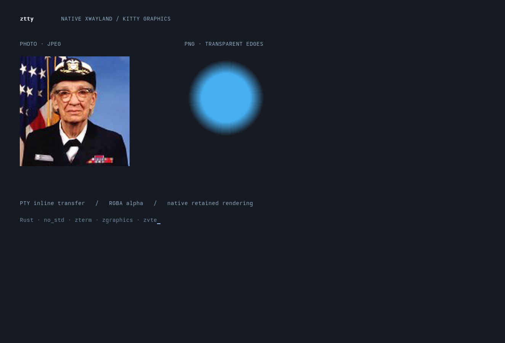

# ztty

一个界面简洁的原生终端，支持 Linux 共享会话，并提供可复用的 Rust 终端核心。
ztty 通过操作系统的 PTY 运行 shell，用有明确容量上限的缓冲区保存屏幕和历史，
再由原生窗口系统绘制内容。

[English](README.md) · [下载](https://github.com/LIghtJUNction/ztty/releases)
· [日常使用](docs/daily-workflow.md) · [会话与 MCP](docs/sessions.md)



## 安装

Arch Linux：

```sh
yay -S ztty
```

安装已经发布的 Linux 二进制：

```sh
curl -fsSLO https://github.com/LIghtJUNction/ztty/releases/latest/download/install.sh
sh install.sh
```

安装器默认写入 `~/.local/bin`，校验下载文件，并保留一个旧版本供回退。
升级影响新启动的进程；正在运行的共享会话继续使用原来加载的程序。
[安装选项与运行中会话的升级](docs/sessions.md#upgrading-a-running-broker)。

本文描述当前源码。下载链接指向最近一次正式发布；尚未发布的改动需要从源码构建。

## 在 Linux 构建

使用 `rust-toolchain.toml` 固定的 Rust 工具链。Debian / Ubuntu 先安装原生依赖：

```sh
sudo apt-get install build-essential pkg-config libx11-dev libxft-dev libxrender-dev \
  libfontconfig1-dev libfreetype-dev libharfbuzz-dev libegl1-mesa-dev libgles2-mesa-dev \
  libwayland-dev libwayland-bin wayland-protocols libxkbcommon-dev \
  fonts-dejavu-core fonts-noto-cjk fonts-noto-color-emoji
git clone https://github.com/LIghtJUNction/ztty.git
cd ztty
cargo build --locked --release --features wayland
```

```sh
./target/release/ztty
./target/release/ztty --backend wayland
./target/release/ztty --font 'monospace:size=12' --geometry 100x28
./target/release/ztty --cwd /path/to/project -e /bin/bash
```

Linux 默认使用 X11，也可运行在 XWayland 中。原生 Wayland 通过
`--backend wayland` 显式选择；只需要 X11 时，可在构建命令中省略该 Cargo feature。
安装自行构建的程序：

```sh
sh install.sh --from-binary target/release/ztty
```

## 主要功能

- Unicode 字素、按软换行重排的历史、选择和历史搜索。Linux GPU 文字通过
  FreeType 与 HarfBuzz 完成字体回退、整段塑形和彩色 emoji，并支持斜体和定时闪烁。
- X11 支持 GPU 或软件绘制；原生 Wayland 使用 EGL/GLES。脏行更新、有界缓存和
  批量重绘减少重复工作。
- Kitty 图形支持文件及共享内存传输、动画、Unicode 占位符和相对放置，
  并支持 Sixel 与 OSC 52 剪贴板处理。
  [图形验收与平台边界](docs/reports/graphics-extensions-20261120/report.zh-CN.md)。
- Linux 共享会话、连接和只读观察，以及操作同一可见 PTY 的原生 MCP 服务。
- 临时命令面板、会话切换器、自定义键鼠绑定、配置热重载和可选 shell 集成。

### 常用操作

| 操作 | Linux 快捷键 |
| --- | --- |
| 复制 / 粘贴 | Ctrl+Shift+C / Ctrl+Shift+V |
| 搜索历史 | Ctrl+Shift+F |
| 下一个 / 上一个搜索结果 | Enter / Shift+Enter |
| 切换搜索大小写敏感 | Alt+C |
| 命令面板 / 会话切换器 | Ctrl+Shift+P / Ctrl+Shift+S |
| 放大 / 缩小 / 重置字号 | Ctrl++ / Ctrl+- / Ctrl+0 |
| 浏览历史 | Shift+PageUp / Shift+PageDown，或滚轮 |
| 打开链接 | Ctrl+单击 |

应用捕获鼠标时，按住 Shift 可使用终端本地选择。
macOS 使用 Command+C / Command+V 复制粘贴。
更多操作见[日常使用](docs/daily-workflow.md)和 [shell 集成](shell/README.md)。

### 配置

默认配置文件为 `${XDG_CONFIG_HOME:-~/.config}/ztty/config`。
渲染器通过配置选择：

```ini
renderer = auto
```

X11 可选 `auto`、`gpu` 或 `software`。原生 Wayland 需要 `auto` 或 `gpu`
以及可用的 EGL/GLES 实现，也可以使用 Mesa 软件 GL。
实际渲染器会报告所用驱动与回退情况；命令行没有 `--renderer` 参数。

### 共享会话与 MCP

```sh
ztty --name work
ztty attach work
ztty attach --observe --backend wayland work
ztty mcp stdio
```

Linux 会话服务持有 PTY、屏幕状态和历史。多个窗口可以连接同一个会话，
X11 与 Wayland 窗口也可以共用同一个服务进程。
MCP 提供九个终端工具，包含会话身份校验、有界读取及明确的输入和控制权限。
连接客户端前请阅读[会话与 MCP](docs/sessions.md)。

## 平台范围

| 平台 | 窗口与绘制 | 当前范围 |
| --- | --- | --- |
| Linux X11 / XWayland | X11；GPU 或软件 | 共享会话、连接、MCP、标签页和分屏 |
| Linux 原生 Wayland | Wayland；EGL/GLES | 共享会话、连接和只读观察、剪贴板及输入法；独立窗口，暂不支持标签页和分屏 |
| macOS | AppKit；CoreText / CoreGraphics | 原生终端，尚无 Linux 会话服务功能 |
| Windows | Win32；ConPTY | 原生终端，尚无 Linux 会话服务功能 |

功能和性能结论都对应具体源码、二进制与测试负载。测试条件和剩余边界见
[性能说明](docs/performance.md)、[共享会话核心](docs/session-core.md)及
[原生 Wayland](docs/native-wayland.zh-CN.md)。
逻辑 PTY 吞吐量衡量输入被解析的速度，不能代表按键到物理屏幕显示的延迟。

## 开发

```sh
cargo test --locked --workspace
cargo clippy --locked --workspace --all-targets --features wayland -- -D warnings
```

workspace 包含 `ztty`、`zterm`、`zpty`、`zinput`、`zgraphics`、
`ztty-ui` 和 `ztty-plugin-api`。可复用终端库支持 `no_std`，
平台 I/O 与原生应用负责连接操作系统。本地 GUI 验收入口为
`tools/native_ui_acceptance.py`。

MIT 许可证，详见 [LICENSE](LICENSE)。
