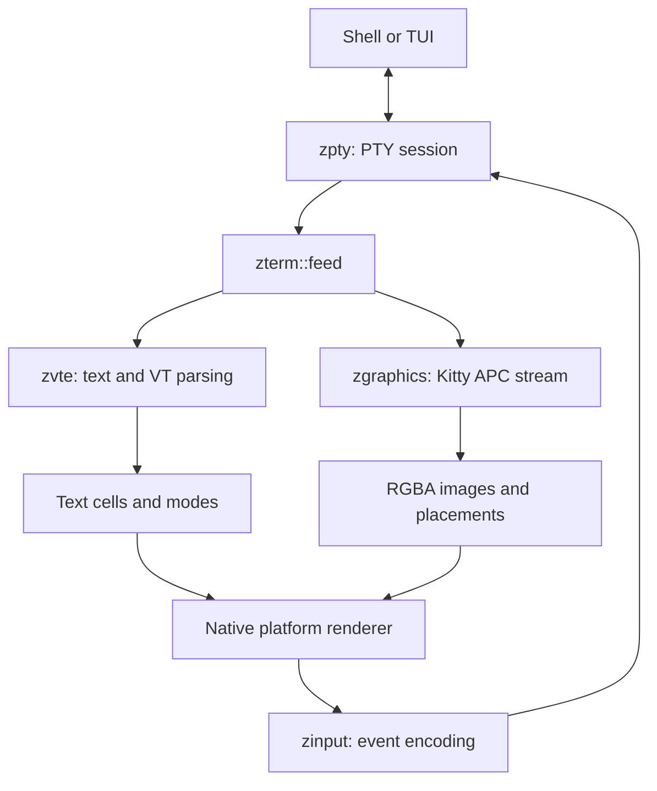

# Architecture

ztty separates terminal state from operating-system integration so its libraries
can be embedded in other applications. `zpty` owns a child process and native
PTY resources, `zterm` owns text and screen state, `zgraphics` owns images and
placements, and `zinput` encodes events without owning a session. The platform
frontend supplies native input, cell metrics, window management, and rendering.

Ordinary text and control sequences use `zvte`. Kitty APC sequences take a bounded
streaming path into `zgraphics`; they do not accumulate in the title/OSC buffer.
Both paths update terminal state, and protocol replies return through the same
ordered PTY write queue as keyboard input. Source entry points are
[`zterm::Terminal`](../crates/zterm/src/terminal.rs) and
[`zgraphics::CommandStream`](../crates/zgraphics/src/stream.rs).

## Screen state

A screen is a contiguous array of fixed-size cells. A row origin index maps
logical rows onto that array. Full-screen upward scrolling changes the origin
and clears the newly exposed row; it does not move the entire visible screen.
Partial scrolling regions copy only the affected rows.

Each cell stores a Unicode scalar, two optional combining scalars, foreground
and background RGB values, attributes, width, and a hyperlink identity. The
tested x86_64 layout is 28 bytes. There is no per-cell heap pointer. Wide glyphs
have a leading width-two cell and a width-zero continuation cell; edits repair
any pair cut by their boundaries.

History is lazy and bounded by both the requested number of rows and 8 MiB of
cell storage. Once the bound is reached, old row allocations are reused. The
alternate screen is allocated on demand and cached for reuse. Titles, links,
control strings, and protocol reply queues have explicit finite bounds. These
properties are implemented in [`zterm`](../crates/zterm/src/terminal.rs) and
covered by its [core tests](../crates/zterm/src/tests.rs).

## Image lifecycle and memory

An image transfer is invisible until it completes and validates successfully.
The APC receiver holds at most a 512-byte header and 4096 encoded bytes, decoding
larger payloads incrementally. The pending binary transfer has a separate
16 MiB limit. This accepts both protocol chunks and larger APCs emitted by current
`kitten icat` clients without retaining the full base64 representation.

`zgraphics` converts RGB, RGBA, and PNG input into straight-alpha RGBA8 pixels.
It validates dimensions, container structure, and PNG checksums before invoking
`zune-png`; optional zlib transmission compression uses `zune-inflate`.
Nonessential PNG metadata is removed before decoding. An invalid transfer is
discarded while previously stored images remain usable. The implementation is
in [`decode.rs`](../crates/zgraphics/src/decode.rs).

Each screen has its own graphics scene. The default limit is 16 MiB per decoded
image and 32 MiB of retained decoded storage per scene, counting vector capacity,
with at most 128 images and 512 placements. Width and height are each limited to
8192 pixels and must also satisfy the byte limit. A scene allocates no image
storage until needed. The independent primary and alternate scenes prevent an
alternate-screen application from showing or deleting primary-screen images.

Placements store an image identity, a cell anchor, source rectangle, requested
size, pixel offset, and z-order. Scrolling updates anchors, history trimming
removes expired placements, and cell-size changes recompute display geometry.
Draw iteration borrows a sorted placement list and does not allocate or sort a
new list on each damaged row. Source cropping and aspect-preserving scaling are
resolved by the scene; the frontend clips each destination to the text viewport.
The [protocol scope](protocols.md#kitty-graphics) specifies the supported commands.

Pixel buffers use `Arc<Vec<u8>>` so a native graphics API can retain immutable
pixels until it has finished drawing, even if the terminal deletes or replaces
the image. The scene revision signals mutations; each image also has a generation
value so replacement under the same ID invalidates converted pixels. Generations
are local to a scene, so frontend caches are cleared when switching scenes.
The Linux Xrender upload cache has a separate 64 MiB bound and releases obsolete
server resources. macOS retains an `Arc` through its CoreGraphics data-provider
release callback; Windows composites from canonical RGBA into its display buffer.

Quota accounting covers the decoded pixels retained by a scene. It does not
include decoder temporaries, retained external `Arc` references, converted
renderer pixels, or native graphics resources. A host embedding `zgraphics`
must release its own references and caches when they are no longer needed.

## Input and output

The platform frontend maps native input into shared event types. Linux uses XIM
commits, macOS implements AppKit's text-input interface, and Windows receives
Win32 key and text messages. `zinput` combines text, key identity, and modifiers
according to the negotiated protocol. Main and alternate screens have separate
Kitty keyboard flag stacks; mouse tracking and mouse encoding are independent
modes.

PTY writes keep an offset into a bounded queue. Partial writes advance the
offset; EAGAIN waits for writability. Reads are drained with a per-iteration
budget so heavy output cannot indefinitely starve window events. Query replies
share the same ordered write path as keyboard input.

The platform event loops wait on native readiness mechanisms rather than
continuously polling the terminal model:

| Platform | PTY readiness and input | Rendering path |
| --- | --- | --- |
| [Linux](../src/platform/linux.rs) | `poll` over X11 and PTY descriptors; XIM commits | Xft text and Xrender images into a retained X pixmap |
| [macOS](../src/platform/macos.rs) | AppKit events and a Core Foundation file-descriptor source for the Darwin PTY | CoreText text and CoreGraphics images in an AppKit view |
| [Windows](../src/platform/windows.rs) | Win32 messages plus ConPTY output/process events in `MsgWaitForMultipleObjectsEx` | GDI text and direct RGBA compositing into a retained DIB |

Linux Expose events can present the retained pixmap without rebuilding screen
state. Synchronized output delays drawing until completion, with a 150 ms
recovery timeout. Cursor blink and synchronization deadlines can wake an
otherwise idle event loop. Native frontend correctness is a separate question
from shared-core correctness; [acceptance coverage](protocols.md#acceptance-coverage)
records the environments actually exercised.

Windows ConPTY uses synchronous pipe endpoints. `zpty` services them with two
native worker threads and bounded queues, each limited to 1 MiB plus a 16 KiB
worker buffer. Public reads and writes remain nonblocking with respect to pipe
I/O, and callers retain unwritten bytes. This is distinct from the descriptor
readiness model on Linux/macOS. The [PTY API documentation](../crates/zpty/README.md)
also describes platform-specific process shutdown behavior.

## Runtime boundary

The application and Project Z libraries compile with `#![no_std]`. `alloc`
remains available through the host allocator. The third-party PNG, DEFLATE,
checksum, and Unicode-width dependencies compile with their `no_std` features;
none of the enabled production dependencies requires Rust `std`. Tests and
benchmark harnesses use `std` for orchestration.

| Rust dependency | Purpose |
| --- | --- |
| `zvte 0.1.3` | Streaming ANSI/VT parsing |
| `unicode-width 0.2.3` | Character-cell width rules |
| `zune-core 0.5.3`, `zune-png 0.5.2` | PNG decoding primitives and decoder |
| `zune-inflate 0.2.54` | DEFLATE/zlib decoding |
| `simd-adler32 0.3.10` | Transitive checksum implementation |

The exact resolved graph is in [`Cargo.lock`](../Cargo.lock); manifests disable
default features on direct normal dependencies. The
[`no_std` audit](../tools/check_no_std.py) checks enabled features and crate
attributes, including conditional `no_std` declarations. The platform-independent
libraries can also be checked for `x86_64-unknown-none`, which has no Rust standard
library. `zgraphics` requires pointer-width atomics because it uses `Arc`.

The native frontend still links operating-system C ABIs. Linux uses libc/libutil,
X11, Xft, Xrender, and the compiler unwinder required by the stable Rust `alloc`
archive. macOS uses the Darwin runtime and Apple frameworks; Windows uses Win32
and ConPTY. Panic handling terminates the process. These dependencies belong
in runtime and memory accounting even though Rust `std` is absent.

On Linux and macOS, the PTY library exposes `spawn` as unsafe because `forkpty` has
process-wide safety preconditions. The application prepares argv, environment,
and PATH resolution before the fork. The child then performs only descriptor
closure, `execve`, a bounded error write, and `_exit`.

## Memory accounting

Core heap measurements describe the terminal model. Process RSS additionally
includes code, shared libraries, font data, allocator bookkeeping, and temporary
decoding allocations. Decoded image quotas and renderer cache quotas describe
retained resources, not peak RSS. A large image can temporarily require its
compressed bytes, decompressed bytes, canonical RGBA, and a native upload at the
same time.

The retained X pixmap and Xrender image uploads belong to the X server and must
be counted separately. Apple and Windows graphics resources likewise have native
lifetimes beyond the core heap. Full history, both screens, and image-heavy use
are different workloads from an empty startup window. The
[performance report](performance.md) distinguishes these measurement boundaries;
the [graphics core comparison](measurements/graphics-core-overhead-2026-11-18.json)
records a local paired benchmark with its own host and compiler metadata.
