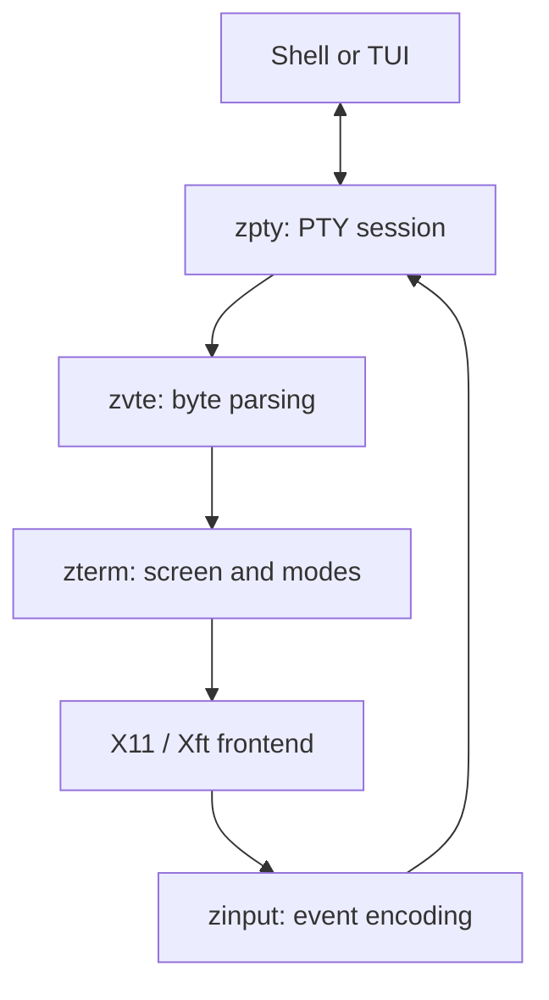

# Architecture

ztty separates terminal semantics from its desktop frontend so the useful parts
can be embedded in other applications. The division follows data ownership:
`zpty` owns a process and file descriptor, `zterm` owns screen state, and `zinput`
turns typed events into protocol bytes without owning a session.

## Screen state

A screen is a contiguous array of fixed-size cells. A row origin index maps
logical rows onto that array. Full-screen upward scrolling changes the origin
and clears the newly exposed row; it does not move the entire visible screen.
Partial scrolling regions copy only the affected rows.

Each cell stores a Unicode scalar, two optional combining scalars, foreground
and background RGB values, attributes, width, and a hyperlink identity. The
tested x86_64 layout is 28 bytes. There is no per-cell heap pointer. Wide glyphs
have a leading width-two cell and a width-zero continuation cell; edits repair
any pair cut by their boundaries.

History is lazy and bounded by both the requested number of rows and 8 MiB of
cell storage. Once the bound is reached, old row allocations are reused. The
alternate screen is allocated on demand and cached for reuse. Titles, links,
control strings, and protocol reply queues have explicit finite bounds.

## Input and output

The frontend forwards XIM's complete UTF-8 commit, along with key identity and
modifier state, to `zinput`. Applications can negotiate Kitty enhancement flags;
main and alternate screens have separate flag stacks. Mouse tracking and mouse
encoding are independent modes.

PTY writes keep an offset into a bounded queue. Partial writes advance the
offset; EAGAIN waits for writability. Reads are drained with a per-iteration
budget so heavy output cannot indefinitely starve window events. Query replies
share the same ordered write path as keyboard input.

The single-threaded event loop waits in `poll`. Dirty rows are drawn to an X
pixmap with Xft and copied to the window. Expose events can present the retained
pixmap without rebuilding screen state. Synchronized output delays rendering
until completion, with a 150 ms timeout to recover from a missing end marker.

## Runtime boundary

The shipped binary, `zterm`, `zinput`, `zpty`, `zvte`, and `unicode-width` all
compile without Rust `std`. `alloc` remains available through the application's
allocator. Test programs and benchmark harnesses use `std` for orchestration.

The Linux frontend uses the existing C ABI for the platform and font stack.
This includes libc/libutil, X11, Xft, and the system compiler unwinder required
by the prebuilt stable Rust `alloc` archive. Panic handling terminates the
process; no Rust unwinding runtime or Rust `std` is linked.

The PTY library deliberately exposes `spawn` as unsafe because `forkpty` has
process-wide safety preconditions. The application prepares argv, environment,
and PATH resolution before the fork. The child then performs only descriptor
closure, `execve`, a bounded error write, and `_exit`.

## Memory accounting

Core heap measurements describe the terminal model. Process RSS additionally
includes code, shared libraries, font data, and the allocator. The retained X
pixmap is owned by the X server and must be accounted for separately; process
RSS alone does not describe total graphics memory. Full history and alternate
screen use also differ from an empty startup window.
