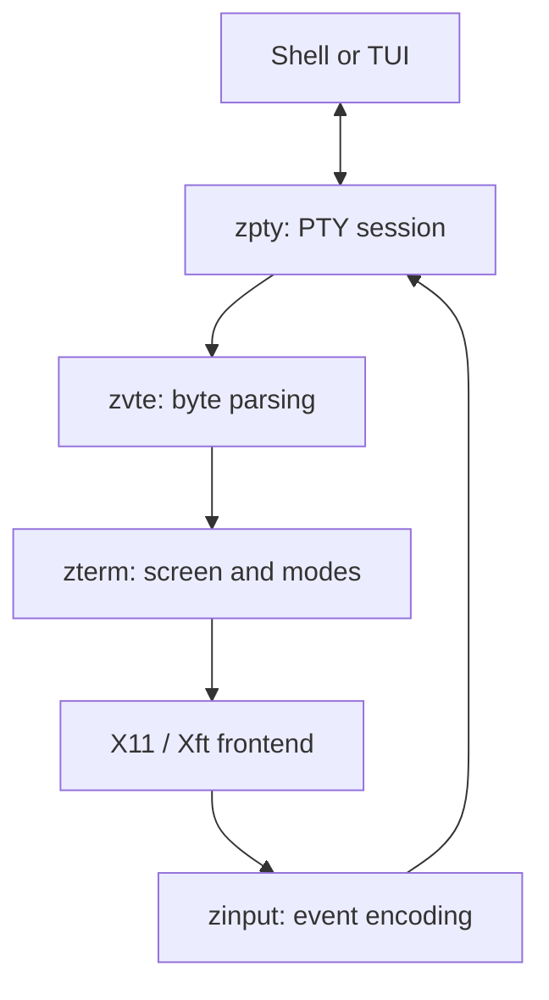

# Architecture

ztty separates terminal semantics from its desktop frontend so the useful parts
can be embedded in other applications. The division follows data ownership:
`zpty` owns a process and file descriptor, `zterm` owns screen state, and `zinput`
turns typed events into protocol bytes without owning a session.

## Shared process ownership

Ordinary launches and MCP servers connect to one session broker for the current
user. The broker owns the PTYs and terminal state; each foreground launcher
waits on its session without creating another display or font stack.
MCP stdio and HTTP listeners remain separate protocol processes and use the
same broker. [Session implementation](../src/session.rs),
[local IPC](../src/broker.rs) and [X11 resources](../src/x11.rs) define these boundaries.

| Owner | Resources |
| --- | --- |
| Broker | Session registry, event loop and shared read/encoding scratch buffers |
| Display connection | X11 connection, atoms and XIM context, shared by its windows |
| Font selection on a display | Base and fallback Xft fonts and their glyph caches |
| Terminal session | PTY child, screen, history, input queue and retained output |
| Visible window | Xft draw target, pixmap, input context, selection and cursor state |
| Launcher | Caller metadata and foreground completion wait |

The broker opens a display only when a window is needed. Windows with the same
font selection reuse its font set. Closing the last window releases unused
font sets. The broker keeps its opened X11 connection until it exits, so headless
MCP sessions can later be attached without rebuilding Xlib state. The per-window
pixmap and each session's contents remain independent allocations.

One single-threaded loop polls PTYs, display connections and local IPC peers.
XIM filters an event before its destination window selects the session.
Output-heavy sessions have a read budget per iteration so other windows and
control requests receive service.

The local protocol uses an abstract Unix socket and checks the connecting
user with `SO_PEERCRED`. `ZTTY_SOCKET=@name` selects an isolated broker
namespace, which the test tools use. Creator argv, working directory and
environment are carried with each launch; the first creator's environment
does not become the default for all later sessions.

## Session control

An ordinary window owns a local session whose lifetime ends when its window
closes or its child exits. MCP-created sessions retain their output and exit
status until explicitly closed; a window can attach to and detach from that
state. The broker exits after its last session and pending work are gone.
[Sessions and MCP](sessions.md) documents the exact names and lifecycle.

The MCP transports translate six terminal tools into the same broker operations.
They use bounded `no_std` JSON handling. Stdio uses newline framing; Streamable
HTTP uses JSON responses with independent transport sessions. Session reads
return byte cursors and UTF-8-safe text pages, with retained output bounded
separately from terminal history.

## Screen state

A screen is a contiguous array of fixed-size cells. A row origin index maps
logical rows onto that array. Full-screen upward scrolling changes the origin
and clears the newly exposed row; it does not move the entire visible screen.
Partial scrolling regions copy only the affected rows.

Each cell stores a Unicode scalar, two optional combining scalars, foreground
and background RGB values, attributes, width, and a hyperlink identity. The
tested x86_64 layout is 28 bytes. There is no per-cell heap pointer. Wide glyphs
have a leading width-two cell and a width-zero continuation cell; edits repair
any pair cut by their boundaries.

History is lazy and bounded by both the requested number of rows and 8 MiB of
cell storage. Once the bound is reached, old row allocations are reused. The
alternate screen is allocated on demand and cached for reuse. Titles, links,
control strings, and protocol reply queues have explicit finite bounds.

## Input and output

The frontend forwards XIM's complete UTF-8 commit, along with key identity and
modifier state, to `zinput`. Applications can negotiate Kitty enhancement flags;
main and alternate screens have separate flag stacks. Mouse tracking and mouse
encoding are independent modes.

PTY writes keep an offset into a bounded queue. Partial writes advance the
offset; EAGAIN waits for writability. Reads are drained with a per-iteration
budget so heavy output cannot indefinitely starve window events. Query replies
share the same ordered write path as keyboard input.

The shared event loop waits in `poll`. Dirty rows are drawn to an X
pixmap with Xft and copied to the window. Expose events can present the retained
pixmap without rebuilding screen state. Synchronized output delays rendering
until completion, with a 150 ms timeout to recover from a missing end marker.

## Runtime boundary

The shipped binary, `zterm`, `zinput`, `zpty`, `zvte`, and `unicode-width` all
compile without Rust `std`. `alloc` remains available through the application's
allocator. Test programs and benchmark harnesses use `std` for orchestration.

The Linux frontend uses the existing C ABI for the platform and font stack.
This includes libc/libutil, X11, Xft, and the system compiler unwinder required
by the prebuilt stable Rust `alloc` archive. Panic handling terminates the
process; no Rust unwinding runtime or Rust `std` is linked.

The PTY library deliberately exposes `spawn` as unsafe because `forkpty` has
process-wide safety preconditions. The application prepares argv, environment,
and PATH resolution before the fork. The child then performs only descriptor
closure, `execve`, a bounded error write, and `_exit`.

## Memory accounting

Core heap measurements describe one terminal model. The multi-window report
sums PSS and private memory across the broker and all waiting launchers. PSS
apportions shared mappings; adding process RSS values would count many shared
pages repeatedly. Code, system libraries, font data and allocator state remain
part of process memory. The retained X
pixmap is owned by the X server and must be accounted for separately; process
RSS alone does not describe total graphics memory. Full history and alternate
screen use also differ from an empty startup window.
