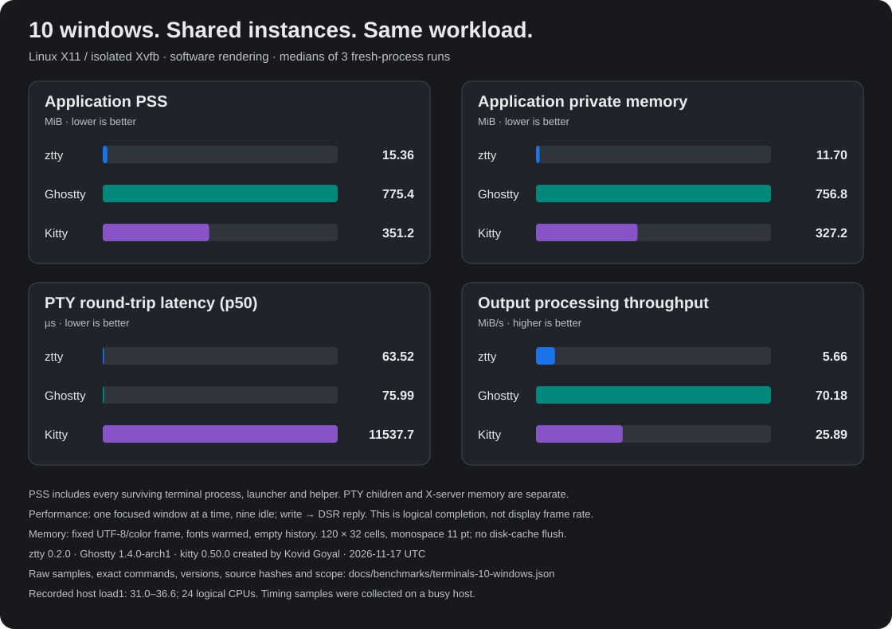

# Ten-window terminal benchmark

## 2026-11-20 GPU text-run buffer reuse

The [text-run buffer report](text-run-scratch-20261120/report.zh-CN.md) records
zero warmed Rust allocation calls in three fixed 96×24 scenes, nine exact RGBA
comparisons, bounded retention, error recovery, and five paired CPU-affinity
timing checks. It follows the [search and row-buffer audit](performance-audit-20261120/report.zh-CN.md).
Raw observations and the source revisions are included with each report.

## 2026-11-20 performance, reload and clipboard fixes

The [current development report](performance-reload-2026-11-20.md) contains the
fixed-source software A/B results, three-terminal software-OpenGL comparison,
Unicode pipeline measurements, complete-frame tab-switch validation, runtime
reload checks and the later image-only clipboard fix. It preserves all raw
samples and negative results. Performance samples bind to `f7e0196`; clipboard
validation binds to `2aa561b`. This is a source update, not a new formal release.

This benchmark compares **ten real windows** of ztty, Ghostty, and Kitty on one
Linux machine. Each terminal uses its available shared-instance mode. The figure
reports application and dedicated display-server memory plus PTY processing
performance; it does not measure
native GPU rendering, display frame rate, or keyboard-to-photon latency.



The figure links to the complete ztty 0.2.1 collection at source
`dfe949c7`, measured with host load1 6.20–9.10. Its original JSON and SVG
are preserved together. The [throughput report](throughput-2026-11-18.md)
records those binaries, samples, and measurement conditions; these results
describe that source rather than the subsequently integrated feature branch.

The separate [guarded roadmap comparison](guarded-idle-1-10-2026-11-18.md)
records 18 successful one- and ten-window cases at source `fa2f2017`.
The project READMEs retain that dated chart and its source identity.
The [earlier verification record](verification-2026-11-18.md) describes the
previous busy-host baseline and its own workload checks.

The [roadmap idle matrix](roadmap-idle-verification-2026-11-18.md) records a
separate 24-case validation run at 1, 5, 10 and 20 windows in both process modes,
using the newer immutable roadmap binary. It is smoke evidence from a busy host,
not a replacement for the baseline or a controlled performance ranking.
Its per-process [smaps attribution](roadmap-idle-smaps-2026-11-18.json) explains
why the measured single-window RSS still exceeds 10 MiB.

## Reproduce

From the repository root:

```sh
make benchmark-terminals
```

The target first builds the current release source, then runs all measurements, writes
[the raw JSON](terminals-10-windows.json), regenerates
[the SVG](terminals-10-windows.svg), and maintains the image reference immediately
below the project title in both READMEs. The script publishes the comparison only
after all nine runs succeed. A failed run leaves prior results intact and writes
its diagnostic JSON under `artifacts/`.

Required tools are Python 3 with `python-xlib`, Xvfb, `dbus-daemon`, Kitty,
Ghostty, and a release build at `target/release/ztty`. The script uses Linux
`/proc` memory accounting. It creates private X11 and D-Bus sessions and removes
only processes belonging to its unique run marker. It does not change the
default terminal, load personal terminal configuration, or install packages.

To measure an already-built executable directly, including other binary locations:

```sh
python3 tools/benchmark_terminals.py \
  --ztty /path/to/ztty --ghostty /path/to/ghostty --kitty /path/to/kitty
```

On the recorded development machine, Ghostty was extracted from Arch Linux's
`extra` package `ghostty 1.4.0-1` into the ignored
`artifacts/benchmark-cache/ghostty-1.4.0-1/` directory, along with its shell
integration and terminfo packages. The script checks an explicit path, then `PATH`, then this pinned cache.
It also recognizes the parent repository's cache when
run inside this project's artifact worktree. It records the exact executable
version, executable SHA-256, package URLs, package SHA-256 values, and the
repository metadata used to verify those packages. These are Arch distribution
packages, not an upstream Ghostty Linux binary release.

To recompute the summary and SVG from the completed raw JSON without rerunning
terminals or changing its collection time, source revision, script hash, or samples:

```sh
python3 tools/benchmark_terminals.py --render-only
```

Missing runtimes or incomplete data cause a clear error. Missing values are
never rendered as zero-length performance or memory bars.

## Window counts, process modes and loaded histories

The default command retains the ten-window, shared-instance comparison. To run
the requested 1, 5, 10 and 20-window comparison in both process modes:

```sh
python3 tools/benchmark_terminals.py --matrix
```

This runs 72 fresh-process cases: four counts, two modes, three applications and
three repetitions. `--counts 1,5,10,20 --modes shared,independent` is the explicit
equivalent. Each case verifies the number of distinct GUI owner processes:
one in shared mode, and one per window in independent mode. ztty uses one
private broker socket per window for the independent case; Kitty omits
`--single-instance`; Ghostty sets `gtk-single-instance=false` in its file and command line and gives each window a distinct application class.
The selected mode and actual owner/process counts are saved in each raw run.

The same command can exercise memory after different terminal workloads:

```sh
python3 tools/benchmark_terminals.py --matrix \
  --workloads idle,history,images,hidden
```

| Workload | Preparation before memory and CPU sampling |
| --- | --- |
| `idle` | The fixed UTF-8/color page, with no scrolling. |
| `history` | 100,000 numbered 117-column rows, streamed in bounded batches: 11.9 MB of input. The terminals retain their configured 2,000-line or 10,000,000-byte history limits. |
| `images` | One deterministic 256 × 256 raw RGBA image per window, transmitted in Kitty protocol chunks. A successful image reply is required. |
| `hidden` | All OS windows except one are unmapped after initialization. Their PTYs remain active; the performance probe does not raise hidden windows. This does not exercise a terminal's tab UI. |

History inputs are identical, but the history capacity units and retained
representations differ. The benchmark records that distinction instead of
claiming equal retained rows. Image measurements include retained decoded
pixels and renderer resources; they do not capture the peak during decoding.

Each run also records application RSS, idle CPU as a percentage of one CPU core,
thread counts, X-server deltas and available XRes pixmap allocations. CPU samples
use Linux process start times and become unavailable when the process set changes.
Missing optional kernel memory counters remain `null`; missing required RSS,
PSS or private-memory fields fail the run. Duplicate process IDs fail accounting.

`launch_to_dsr_ready_seconds` measures launch through the initialized PTY's DSR
reply, including the selected workload preparation. The raw report explicitly
marks native GPU memory, first presented frame and input-to-display latency
unavailable in this Xvfb harness. These metrics require a native display backend
and a presentation fence or an external latency measurement.

The command also regenerates `terminals-10-windows-scaling.svg` from every selected
matrix cell. Each panel distinguishes workload and process mode; its points show
measured PSS versus window count. Panel scales are independent. The README
overview continues to show only the ten-window shared idle subset. Incomplete
matrix cells, failed runs, duplicate repetitions and non-finite values cannot be
published as a completed comparison.

Comparison mode checks available memory and one-minute host load before each case. It defers the run below 2 GiB or 10% available RAM, or above half the available logical CPUs in load average. These are reproducibility guards, not proof of an otherwise idle host. Every case records available RAM, swap use, load and Linux pressure-stall counters. Existing builds and user processes are left running. For functional validation on a busy host, use `--purpose smoke --no-readme`; those results are labeled validation data and cannot update the README comparison.

Small validation runs can select applications and write separate artifacts:

```sh
python3 tools/benchmark_terminals.py \
  --apps ztty,ghostty,kitty --counts 2 --modes shared,independent \
  --workloads idle,images,hidden --repetitions 1 --purpose smoke --no-readme \
  --json artifacts/benchmark-smoke.json --svg artifacts/benchmark-smoke.svg
python3 tests/test_benchmark_terminals.py
```

Custom output paths require `--no-readme` so partial or experimental data does not
replace the README's evidence links. The complete raw JSON includes executable
hashes, harness/dependency source hashes, startup commands, configurations and
measured process identities. The rendering command accepts both the original
ten-window JSON schema and the matrix schema.

## Paired ztty throughput comparison

The [0.2.1 optimization report](throughput-2026-11-18.md) compares retained old
and new binaries on the same machine. Its [raw A/B record](throughput-ab-2026-11-18.json)
contains one- and ten-window runs, three rounds each, in AB/BA/AB order.
Each pair uses the same payload, timer, terminal configuration, and collector.
It records process memory, host load, available memory, Swap, and swap-I/O
counters before and after each run.

To reproduce with two already-built binaries:

```sh
python3 tools/benchmark_throughput.py \
  --before /path/to/old-ztty --after /path/to/new-ztty \
  --before-source OLD_COMMIT --after-source NEW_COMMIT \
  --counts 1,10 --rounds 3 --json artifacts/throughput-ab-new.json
```

Replace the source placeholders with the actual revisions. The output path
must not already exist. A single-round run is marked as exploration.
The collector checks binary and helper-script identities, all window samples,
raw-rate calculations, terminal-state integrity, and process cleanup before
accepting a comparison. It does not update the three-terminal SVG; run
`make benchmark-terminals` for that complete comparison.

The [independent recomputation record](throughput-evidence-2026-11-18/verification.json)
and [runtime validation evidence](throughput-evidence-2026-11-18/runtime-checks.json)
bind the committed results to the tested binary. Old README measurements
from different host conditions are not used as the denominator of the A/B gain.

## Controlled setup

Each run starts fresh terminal processes on a private Xvfb display at 96 DPI.
The display is 7680 × 2160 pixels, large enough to tile ten windows in two
non-overlapping rows. The harness verifies that all ten windows are mapped, that
each PTY has exactly **120 × 32 cells**, and that the ten windows have one GUI
owner process. It records window dimensions, X11 class, process identities,
commands, configuration, and available mapped font files.

All applications request `monospace` at 11 points, opaque backgrounds, disabled
cursor blinking, and the same static UTF-8/color page. Renderer-specific font
metrics and fallback selection can still differ; the raw record preserves the
observed geometry and font mappings. No desktop window manager or compositor
runs in the private display. `LIBGL_ALWAYS_SOFTWARE=1` selects software rendering
for the OpenGL terminals; Ghostty uses its X11 GTK backend.
All three applications also receive `GTK_A11Y=none` and `NO_AT_BRIDGE=1`: the
isolated display has no desktop accessibility session. This avoids activating
unavailable AT-SPI/systemd services and is an explicit benchmark configuration,
not a measurement of accessibility-enabled desktop operation. Other surviving
application helpers remain included; unreadable application memory aborts the run.
The private D-Bus uses EXTERNAL authentication and no service activation
directories. It supports shared-instance coordination without launching desktop
portals, document-portal FUSE mounts, or systemd services. The exact bus
configuration is included in each raw run. This scope excludes desktop-service
overhead for all three applications.

| Application | Sharing mechanism | History setting |
| --- | --- | --- |
| ztty | Default shared session broker | 2,000 lines |
| Ghostty | `gtk-single-instance=true`, unique application class, private D-Bus | 10,000,000 bytes, including the active screen |
| Kitty | `--single-instance` and a unique `--instance-group` | 2,000 lines |

Ghostty's `-e` option forces an independent application instance, so the harness
uses a fixed executable as its `command` setting instead. The same probe
executable is used as the child command in the other terminals. It replaces its
small launcher shell with Python, so the workload does not leave a shell waiting
behind it. No interactive shell startup files run.

Kitty receives `--config NONE` plus the listed settings as `-o` overrides,
so neither system nor personal configuration files affect this run. Any
surviving Kitty helper processes are included in application memory.

In the default idle workload, histories are empty when memory is sampled. The output workload updates
the visible screen in place and does not scroll. The different history capacity
units therefore remain explicit; this comparison does not claim equal memory
cost after filling all applications' history limits.

## Memory accounting

The application total is the sum of `/proc/<pid>/smaps_rollup` **PSS** across
every surviving terminal process, launcher, and helper belonging to the run.
A unique inherited environment marker finds detached shared hosts; descendant
enumeration also includes helpers that remove that marker. The harness verifies
that every GUI owner is included. Process start times keep cleanup scoped to the
same process even if Linux reuses a PID.

PSS apportions a shared page among its mappings. Private memory is
`Private_Clean + Private_Dirty`. Both are summed once per process. RSS is saved
as descriptive raw data but is not used for the comparative bars because adding
RSS would repeatedly count shared pages. Private memory remains in the raw
record and derived summary; the second figure panel uses full display-server PSS.

| Recorded group | App PSS panel | App + full X server PSS panel |
| --- | --- | --- |
| GUI host, surviving terminal launchers, terminal helper processes | Included | Included |
| Ten Python PTY probes and their descendants | Separate child totals | Separate child totals |
| Private D-Bus daemon | Separate infrastructure record | Separate infrastructure record |
| Full Xvfb process after fixed frame + 1 s settle | Separate X-server record | Included, with its full server baseline |
| XRes server pixmap resources | Separate resource record | Already within server accounting; not added again |

The child sends the static page and waits for a DSR reply to confirm logical
processing. It then waits **one second** before three process-memory snapshots
100 ms apart. That fixed settling interval allows resource initialization but
is not a physical-frame completion fence or a guarantee of fully warmed
renderer state. The run value is the median of its three snapshots; the figure
uses the median of three independent runs. This is fresh-process resident
memory after a **fixed frame plus a 1 s settling interval**. The OS page cache
and disk cache are not flushed.

The second memory panel is calculated **within each run** as application PSS
plus the full Xvfb process PSS measured after the fixed frame and settling interval; the figure then takes
the median of those three paired sums. It is not the sum of independently
selected medians. The dedicated server's 7680 × 2160 baseline is included.
This describes resident pages in this isolated application-and-server setup,
not the marginal cost of opening terminals on an existing desktop.

The raw record retains Xvfb's before/after values and their difference. A
difference can be negative when shared-page attribution or swapping changes;
it is neither truncated to zero nor used as a memory-cost ranking. PSS does
not include swapped-out pages. The summary records application Swap ranges
across all memory snapshots, and paired application-plus-server Swap ranges
and maxima. Each application snapshot is paired with the Xvfb after-snapshot
from the **same run** before taking the range or maximum; maxima from different
runs are never added together. These are near-consecutive process samples,
not an atomic system-wide snapshot. Swap counters remain separate from PSS
and are not presented as a deduplicated physical-memory total.

The same paired calculation is performed separately for every selected window
count, process mode, workload and application. Missing optional server or Swap
counters produce null derived values; incomplete snapshots cannot silently
shrink a range or maximum. The overview refuses to draw its full-server PSS
panel when that required metric is unavailable. The scaling figure retains
application-only PSS and explicitly states whether sampled Swap is available.

The figure includes the largest sampled paired Swap counter for each terminal.
The committed run was collected on the 24-logical-CPU development machine
under shared load, without stopping unrelated work. Its load averages and
observed swapping are part of the result, not discarded outliers. They limit
how far these performance numbers can be generalized.
XRes reports pixmaps for an X client, not for one window. The script queries a
representative window for each GUI owner and records that scope, avoiding
multiplication of a shared client's total by ten. X-server deltas include
other server allocations; XRes pixmaps do not describe total GPU, driver, or
font memory. Application PSS percentages must not be interpreted as reductions
in these separate graphics allocations.

## Performance accounting

Performance runs after the memory sample. All ten windows remain open. The
harness focuses one window, measures it, and proceeds to the next; the other
nine windows are idle. This measures an active command in a ten-window session,
not throughput from ten concurrent output producers.

### PTY round-trip latency

The child writes `ESC[HqESC[6n`: move to the home position, write one character,
and request the cursor position. Timing stops when the terminal returns
`ESC[1;2R`. The reply verifies that the terminal has processed the write in
order. It includes PTY transport, process scheduling, parser work, and reply
delivery. It does not wait for a displayed frame or a physical monitor.

Each window performs 50 warm-up exchanges and 300 measured exchanges.
The run statistic is the p50 across its 3,000 samples. The figure shows the
median of the three run p50 values. Raw samples, per-window p50/p95/p99 values,
run p95/p99 values, and observed run ranges remain in the JSON.

### Output processing throughput

The child writes approximately 1 MiB of deterministic ASCII/color screen
updates, then requests a cursor-position reply. Every update addresses a row
explicitly and writes 119 cells, avoiding scrolling and delayed line wrapping.
Letters and colors change across frames. Timing starts before the first PTY
write and ends on the DSR reply after the entire burst. The JSON records the
exact payload byte count and SHA-256.

Each window performs one warm-up burst and three measured bursts. Its value is
the median of the three rates. The run value is the median across ten windows;
the figure uses the median of three run values. The units are MiB/s, where one
MiB is 1,048,576 bytes. The measure describes terminal processing under this
workload; a terminal may batch or skip intermediate physical frames.

### Completion and screen-integrity checks

The timed payload and its original HOME/DSR completion barrier are unchanged.
After the timed bursts, the probe replays the same payload **outside the timer**
and asks for the cursor position directly, without a HOME reset. The reply must
be row 32, column 120. ztty additionally verifies all 32 final text rows through
the private session broker, then restores the fixed idle frame. The JSON retains
the expected and observed text hashes as well as the direct cursor reply.

This validates logical processing and final text; separate real X11 tests check
visible pixels, a quiet final frame, interaction during another window's output,
and synchronized-output boundaries. See the
[repaint acceptance record](throughput-evidence-2026-11-18/repaint-gui.json).
A failure during measurement, integrity checking, or teardown marks the run
unsuccessful, so incomplete results cannot replace the published comparison.

## Repetitions, environment, and limits

The harness performs three fresh-process runs per terminal. Application order
rotates each round: ztty/Ghostty/Kitty, Ghostty/Kitty/ztty, then Kitty/ztty/Ghostty.
Only one application's ten windows run at a time. It records CPU model, kernel,
CPU governor, affinity, load averages before and after each run, binary versions
and hashes, source revision, dirty paths, and exact launch commands. Existing
unrelated development tasks are not stopped.

The raw collection identity remains unchanged when summaries or the SVG are
regenerated. A separate derived-metadata section records the current renderer
hash, formulas, and a hash of the raw run objects.

These are observations from one machine, one geometry, one font request, and
one software-rendered environment. Repeated runs expose some scheduling noise;
three repetitions do not establish a cross-machine ranking or a statistical
confidence interval. DSR is a logical processing barrier, not a promise that
pixels have reached the screen. Native GPU rendering, desktop compositors,
large histories, images, and concurrent output are outside this comparison.

The existing [one/four/eight-window ztty before-and-after measurements](../performance.md) answer a different question: how much
sharing changed ztty itself. Their paired JSON, workload, and denominator are
separate from this three-terminal, ten-window comparison.

## Sources

- [Linux `proc_pid_smaps(5)`](https://man7.org/linux/man-pages/man5/proc_pid_smaps.5.html): PSS and private-memory fields.
- [Kitty invocation](https://sw.kovidgoyal.net/kitty/invocation/): single-instance groups and launcher lifetime.
- [Ghostty configuration reference](https://ghostty.org/docs/config/reference): single-instance behavior, `command`, `-e`, geometry, history, and disabled default config files.
- [D-Bus daemon configuration](https://dbus.freedesktop.org/doc/dbus-daemon.1.html): private Unix bus, authentication, and service activation directories.
- [GTK runtime environment](https://docs.gtk.org/gtk4/running.html): X11, OpenGL, and accessibility backend settings.
- [Ghostty binary installation](https://ghostty.org/docs/install/binary): distribution package scope.
- [XRes client pixmap accounting](https://xorg.freedesktop.org/releases/X11R6.9.0/doc/html/XResQueryClientPixmapBytes.3.html): server-side resource scope.

本图比较的是同一机器上 10 个窗口的应用驻留 PSS、加上完整独立 X server 的驻留 PSS，
以及实际 PTY 写入到 DSR 回复的逻辑处理时间。图中列出最大采样 Swap 计数；
子进程和私有 D-Bus 单列。软件渲染结果不代表日常 GPU 桌面的帧率。
在仓库根目录运行上方的一条命令即可重新实测并更新 JSON、SVG 和 README 引用。

