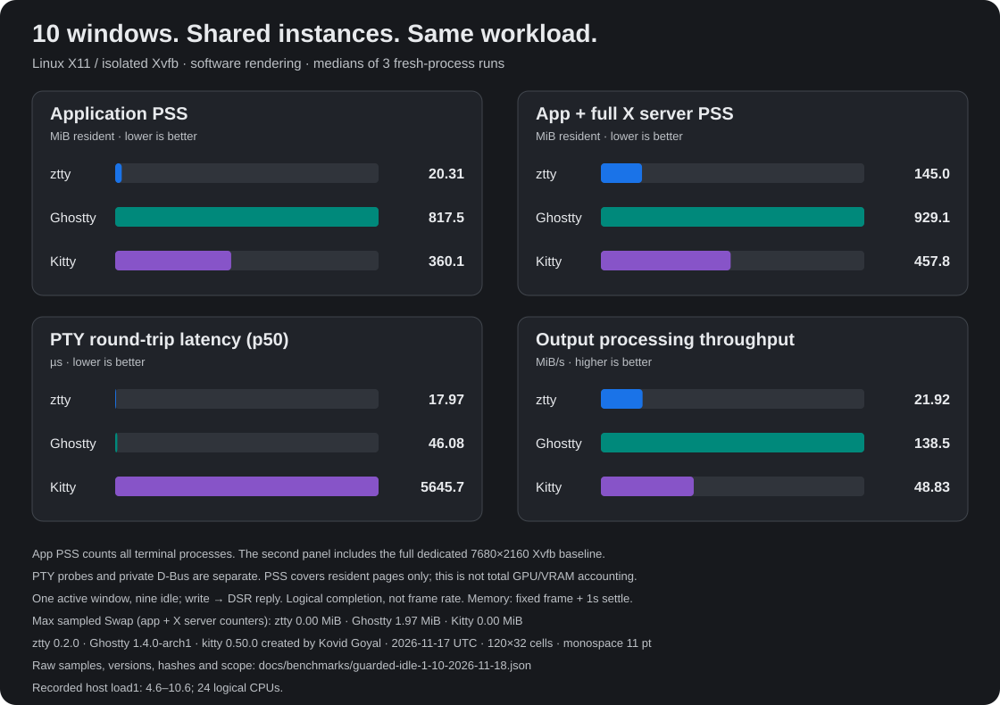

# Guarded shared idle comparison — 2026-11-18

All **18 fresh-process scenarios passed**: 1 and 10 terminal windows, three
applications, and three repetitions in shared-instance mode. Every scenario
verified that its X11 listener belonged to its own Xvfb process, and every
scenario finished with no owned processes remaining. The ztty single-terminal
RSS target below 10 MiB was **not met**: the measured application process set
used a median **22.02 MiB RSS**. See the [raw observations](guarded-idle-1-10-2026-11-18.json)
and [verification record](guarded-idle-1-10-2026-11-18-verification.json).

Collection ran on **2026-11-17, 23:18:25–23:20:48 UTC**. The filenames use the
roadmap delivery date. This report describes the pinned `fa2f2017` candidate;
subsequent development or release binaries are not implicitly covered.



## Memory results

All values below are MiB. Each row is the median of three independent process
runs; each run first takes the median of three nearby memory snapshots.
Application totals include the terminal's waiting launchers and helpers,
excluding identified PTY workload children, private D-Bus and Xvfb. The separate
combined PSS column adds the **full dedicated Xvfb PSS from the same run** before
taking the median. It includes the software display server's baseline.

| Windows | Application | Application RSS | Application PSS | Application + full Xvfb PSS | Maximum sampled application Swap |
| ---: | --- | ---: | ---: | ---: | ---: |
| 1 | ztty | 22.02 | 14.88 | 109.64 | 0.00 |
| 1 | Ghostty | 340.38 | 321.31 | 407.12 | 0.00 |
| 1 | Kitty | 209.52 | 182.75 | 267.50 | 0.00 |
| 10 | ztty | 60.85 | 20.31 | 145.03 | 0.00 |
| 10 | Ghostty | 835.98 | 817.51 | 929.13 | 1.97 |
| 10 | Kitty | 401.15 | 360.05 | 457.77 | 0.00 |

RSS counts resident pages in each process, so summing process RSS counts a
shared resident page once for each process mapping it. PSS apportions that page
among its mappings. These answer different questions; the PSS result does not
satisfy an RSS target. Swap is reported separately and is not added to PSS as a
unique physical-memory total. Missing optional counters remain unavailable.

The three-run ztty RSS ranges were **21.99–22.05 MiB** for one window and
**60.66–60.89 MiB** for ten. The corresponding PSS ranges were 14.62–15.02 MiB
and 20.28–20.54 MiB. The
[scaling figure](guarded-idle-1-10-2026-11-18-scaling.svg) contains only the two
window counts measured in this guarded run.

## CPU and PTY observations

These are ten-window results from the same three repetitions. DSR is the
terminal's answer to a protocol query: it provides a boundary for logical PTY
processing, not proof that a frame has reached a monitor.

| Application | Brief idle CPU sample (%) | DSR round trip p50 (µs) | DSR round trip p95 (µs) | Output processing (MiB/s) |
| --- | ---: | ---: | ---: | ---: |
| ztty | 0.00 | 17.97 | 41.39 | 21.92 |
| Ghostty | 25.99 | 46.08 | 608.78 | 138.50 |
| Kitty | 0.00 | 5645.74 | 8822.37 | 48.83 |

CPU values come from the short sampling window after the configured warm-up;
they do not establish sustained idle power consumption. A sampled 0.00% means
no measurable CPU tick increase in that interval. One PTY producer is exercised
at a time; other terminal windows stay idle. The script records the sample
duration, process identities and individual timing samples in the raw JSON.

ztty's measured output-processing throughput was below both comparators in
this workload. Its lower memory use does not establish performance or feature
parity. Native GPU memory, first presented frame and input-to-display latency
remain explicitly unavailable in the report.

## Conditions and limits

The host was Linux x86_64 with an Intel Core i9-12900HX, 24 available logical
CPUs and the `powersave` governor. The versions were ztty 0.2.0, Ghostty
1.4.0-arch1 and Kitty 0.50.0. The collector requested X11 software rendering,
120×32 cells, monospace 11 pt at 96 DPI, opaque windows, no background blur,
no cursor blinking, a fixed multilingual/color warm-up frame and one second
of settling. Each scenario used a fresh guarded Xvfb and private D-Bus.
Application order rotated between repetitions; OS page and font caches were
not flushed. Exact configurations and executable hashes are retained in JSON.

All start-of-cell comparison gates passed. Across cell start/end snapshots:

- One-minute load ranged from **4.46 to 10.58** on 24 logical CPUs.
- Available memory ranged from **2365.78 to 3262.27 MiB**.
- Host swap already in use ranged from **17.34 to 17.96 GiB**.
- Ghostty's ten-window application samples reached **1.97 MiB Swap**; the other
  application cells and all sampled Xvfb instances recorded zero Swap.

The gates reduce obvious resource contention; they do not turn a shared
development host into a controlled laboratory. These observations apply to
this workload, software rendering configuration and machine. They do not
describe a native GPU/compositor session or prove universal rankings.

## Why the 10 MiB RSS target remains open

The new raw process snapshots identify the broker through the observed X11
window owner PID. Taking separate role medians gives **17.875 MiB broker RSS**
and **4.113 MiB waiting-launcher RSS** for one window. At ten windows the broker
used 19.211 MiB and the ten launchers together used 41.582 MiB. Role medians are
computed independently, so their sum need not equal the median application
total. The exact per-run values and derivation are in the verification record.

The broker alone exceeds 10 MiB. The measured executable directly links
X11, Xft and Xrender and uses eager symbol binding. Source inspection shows
that launchers parse configuration and perform broker IPC; they do not open
X displays or initialize fonts. Font faces are shared in the broker by
display and font name, with weak cache entries. Reducing the resident cost
therefore requires measured changes to library/font/rendering lifetime or
allocation, rather than treating PSS as RSS or removing the CLI's wait behavior.

The [earlier mapping investigation](roadmap-idle-verification-2026-11-18.md#why-rss-exceeds-10-mib)
identified library, font-cache and font-file residency in another binary.
Its allocation-category byte counts are not measurements of this candidate.
This run did not perform a new mapping-level or allocation-profiler study, and
no unmeasured saving is claimed.

## Source and rendering provenance

The worktree was clean at collection. The immutable measured binary was
`artifacts/observer-watch-candidate-ztty`, 676936 bytes:

- Source commit: `fa2f2017b2c54ede7887de4e3ae05d63582efbff`.
- Binary SHA256: `a339a7d258ad313379b5cfea40d8b125aa8c810ecaebd40005b489413a1b6d4d`.
- Guard helper SHA256: `9baf8e2d731be49ed57eefbaa48e15ba30fe581839d0ad1738a5cc4a19ceeb0a`.
- Canonical raw-runs SHA256: `f05a9fe5eea168fc3f47833ee7b49e3895772cd605ff55fe4c426a7b6da24681`.

The verifier checked the complete 18-cell matrix, three memory snapshots per
run, three independent repetitions per application/count, the four collector
source hashes, every guarded display's PID lock/listener/peer PID, and empty
owned-process cleanup. Production source and the binary stayed unchanged
during collection.

Visual review found that the overview renderer displayed a hardcoded default
JSON path even for custom output files. A later renderer-only fix passes the
actual `--json` path through the existing XML escaping. The original 23
benchmark tests passed, including the extended custom-path/escaping assertion.
Only `--render-only` was executed after that change: all raw observations,
collection timestamps, binary/source identity, original collector hashes,
settings and numerical summaries remained equal. The verification JSON
preserves original collection output hashes and records the changed renderer
version and derived output hashes separately. Both figures were rasterized and
visually inspected; the corrected overview names this dated JSON.

## Reproduce without overwriting this evidence

Use the exact candidate or build the pinned source separately, recording any
different binary hash. The benchmark automatically captures executable and
collector identity. Dependencies and other workload options are documented in
the [benchmark guide](README.md). This command runs the same matrix with fresh
output paths:

```sh
python3 tools/benchmark_terminals.py \
  --ztty ./artifacts/observer-watch-candidate-ztty \
  --counts 1,10 --modes shared --workloads idle \
  --apps ztty,ghostty,kitty --repetitions 3 \
  --purpose comparison --no-readme \
  --json artifacts/guarded-rerun.json \
  --svg artifacts/guarded-rerun.svg
```

This guarded run covers neither 5/20 windows nor independent instances,
full-history/image/hidden workloads, native GPU/Wayland, macOS or Windows.
Historical measurements remain separate, including their explicit display
attribution qualifications. Those remaining matrix cells and platforms still
require their own successful executions.
