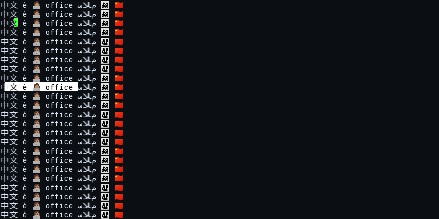
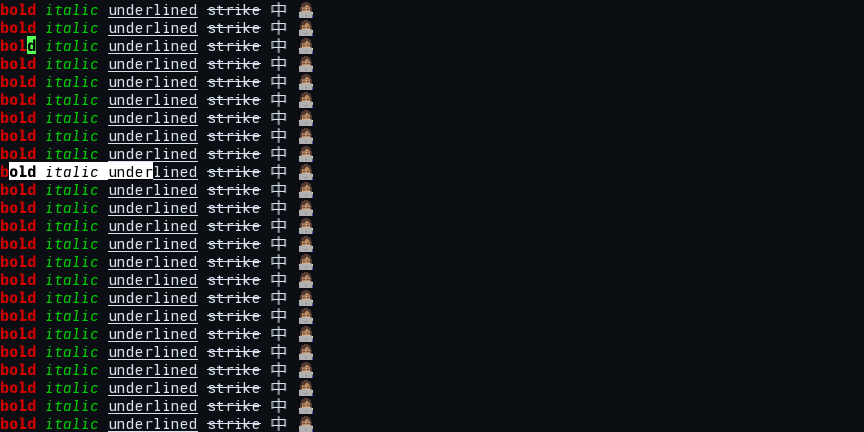

# ztty 性能迭代与不足审计

日期：2026-11-20（Asia/Taipei）

## 结论

本轮完成两项有回归证据的优化：搜索跳过无效的匹配位置记录；GPU 渲染器复用有界的行文本与单元格映射缓冲。在依赖与正式构建一致的最终对照中，稀疏 ASCII 搜索的成对耗时中位数降低 **11.52%**，Unicode 宽字符与组合字符场景降低 **12.74%**；其余场景与波动见下表。GPU 三类静态画面的 Rust `alloc + realloc` 调用减少 **54.8%–91.1%**，九组成对 RGBA 输出逐字节相同。

这些改动减少了实际工作量，但 ztty 还远没有到性能极限。更大的空间在于：避免整屏重复绘制、避免搜索结果导航反复扫描历史、避免缓存达到上限时整批失效。GPU 提交计时没有稳定改善，本轮不据此宣称实际显卡帧率、输入延迟或整进程 RSS 改善。

本轮基线是 `76fa2cfd13b776c027d5a86fadafde8e035f88f2`。经过验收的运行时代码是 `acd11a337004a190ad4818e9bf3e5c4297bfcec6`；本轮同时补齐了基准依赖固定、锁文件归档和重放入口。版本号仍为 **0.5.2**，本轮源代码提交不代表另一个正式版本已经发布。上一正式版本见 [v0.5.2](https://github.com/LIghtJUNction/ztty/releases/tag/v0.5.2)。

## 1. 本轮实际修改

### 1.1 搜索：跳过不可能参与匹配的位置写入

匹配器维护一个循环数组，记录查询对应的终端坐标。过去，无论当前字节是否能参与匹配，都先写入坐标。最终实现先执行原有 KMP 回退和字节相等判定，只有字节能够延长匹配前缀时才记录位置。它复用原有判定，避免在密集匹配路径额外增加一次前缀状态检查。

正确性依据是：一个完整结果必须连续匹配查询长度个字节，这些字节会覆盖整个坐标环。被跳过的无效位置不会参与完整结果的坐标恢复。复杂度仍然是扫描文本长度的 O(N)，本轮只减少常数开销。64 位构建中的每个 Position 包含四个 usize；省掉的是这条路径上的写入，不能把它直接换算成减少了同等数量的 DRAM 流量。

初版新增的前置快路径在生产依赖对照中出现过长失败前缀约 15.04% 的成对中位数回退，因此没有保留该结构。最终改为上述分支重排。两轮机器负载不同，不能把跨轮差异全部归因于代码；所有候选数据均保留。

新增回归覆盖穷举短串与独立 `str::match_indices` 结果对照，以及稀疏 Unicode、大小写展开、宽字符、组合字符、软换行和历史坐标。搜索测试共 20 项通过。

代码：[search.rs](https://github.com/LIghtJUNction/ztty/blob/acd11a337004a190ad4818e9bf3e5c4297bfcec6/src/search.rs)；[测试](https://github.com/LIghtJUNction/ztty/blob/acd11a337004a190ad4818e9bf3e5c4297bfcec6/tests/search.rs)。

### 1.2 GPU：复用逐行临时缓冲

原实现每次绘制一行，都重新创建文本 String 和单元格映射 Vec。现在由 Renderer 持有缓冲，用完清空长度后复用。即使行绘制返回错误，也会归还缓冲；窗口缩窄后，过大的单元格容量会被释放。

在当前 1024 列上限下，最多保留约 **28 KiB 数据容量**：16 KiB 文本 + 1024 × 12 B 单元格映射，另有容器头与分配器开销。这是容量上限，不是实测 RSS 增量。它以少量有界持有内存，换取反复绘制时更少的分配操作。

新增 EGL 回归检查像素一致、缓冲复用、闪烁、真实错误后的恢复，以及从 40 列缩到 8 列时的容量回收。所有七项原生 EGL 测试均通过。

代码：[grid.rs](https://github.com/LIghtJUNction/ztty/blob/acd11a337004a190ad4818e9bf3e5c4297bfcec6/src/gpu/grid.rs)、[Renderer](https://github.com/LIghtJUNction/ztty/blob/acd11a337004a190ad4818e9bf3e5c4297bfcec6/src/gpu/mod.rs)、[EGL 测试](https://github.com/LIghtJUNction/ztty/blob/acd11a337004a190ad4818e9bf3e5c4297bfcec6/src/gpu/tests.rs)。

### 1.3 文档与现状对齐

修正三份过时文档，避免继续把已经完成的能力列为缺失：重排、字素簇、OSC 52、已支持的 Kitty 扩展、Sixel 局部擦除和已发布的插件 API。文档继续保留真实的平台差异和未覆盖边界。

见 [protocols.md](../../protocols.md)、[daily-workflow.md](../../daily-workflow.md)、[configuration.md](../../configuration.md)。

## 2. 搜索 A/B 实测

### 方法

- 开发机：Intel Core i9-12900HX，Linux 7.3.4-arch1-1，Rust 1.100.0；进程固定到 CPU 2。
- 同一临时基准程序内编译基线和候选 search.rs，使用相同、干净的 zterm `b5adc3dbc5ca5f28a3ea7e45650a45245be9dc2d`，以及与正式构建相同的本地 zgpui 0.1.2、zgraphics 0.2.0、zinput 0.1.3。
- 先以正式构建 Cargo.lock 为种子生成并归档基准实际锁文件，逐项确认所有共同依赖的完整 package 记录（含版本、来源及依赖）与正式构建一致。最终测量直接提供该归档锁文件，使用 `cargo build --locked`；源码与依赖工作树均干净。
- release 使用 fat LTO、codegen-units=1、panic=abort；七组成对采样，每组每场景执行 25 次，交替旧新运行顺序。
- 每场景注入 100,000 个逻辑行，但历史预算实际只保留 **3,249 个物理行 × 80 列**。测量的是这些保留行上的完整 find；不包含历史注入和编译时间。
- 环境存在其他负载，原始数据保留负载信息和全部样本。没有把单次最快结果作为结论。

| 场景 | 基线中位数 / ms | 优化后中位数 / ms | 成对耗时变化中位数 | 匹配数 |
|---|---:|---:|---:|---:|
| 长前缀最终失败 | 3.487 | 3.357 | −5.54% | 0 |
| ASCII 完全不命中 | 4.516 | 3.939 | −9.59% | 0 |
| ASCII 稀疏命中 | 3.397 | 3.088 | −11.52% | 33 |
| ASCII 密集重复 | 3.562 | 3.670 | −3.62% | 64,960 |
| Unicode 宽字符与组合字符 | 3.627 | 3.171 | −12.74% | 33 |
| Unicode 小写展开 | 5.636 | 4.961 | −12.24% | 33 |
| 软换行与宽字符填充 | 3.445 | 3.088 | −12.24% | 16 |

毫秒列分别取七个批次平均耗时的中位数；百分比列先计算每组成对的 `100 × (新 / 旧 − 1)`，再取中位数，因此不等于两列总体中位数的比值。部分单独样本出现回退。特别是密集重复场景，两列总体中位数显示小幅变慢，而配对统计显示下降，说明该负载存在较大波动，不能据此认定它已稳定提速。这里说明实际样本的统计结果，不证明所有查询、所有机器都必然更快。

原始记录：[search-ab.json](search-ab.json)、[实际依赖锁文件](search-ab.Cargo.lock)。首轮未保存锁文件的记录保留为 [search-ab-initial.json](search-ab-initial.json)；补锁后的探索轮解析到 registry zgpui 0.1.5，保留在 [exploratory-registry/search-ab.json](exploratory-registry/search-ab.json)。出现回退的前置快路径候选保留在 [exploratory-guard/search-ab.json](exploratory-guard/search-ab.json)，该轮已使用生产依赖。正文只采用最终分支重排实现的一轮对照，没有把新锁文件或新代码结论回填到旧测量。

基准工具：[benchmark_search.py](../../../tools/benchmark_search.py)、[search_benchmark.rs](../../../tools/search_benchmark.rs)。

## 3. GPU 分配 A/B 实测

### 方法与边界

固定 96×24 网格，预热五帧，然后计数 100 帧；场景为 ASCII、Unicode 混合文本和多样式文本，包含块光标与选择区。每场景做三次前后配对，交换执行顺序。

实际 EGL 驱动为 **llvmpipe (LLVM 23.1.5, 256 bits)**，设置 `LIBGL_ALWAYS_SOFTWARE=1`、`LP_NUM_THREADS=2`。这是软件 OpenGL 离屏测试。Rust 全局分配器计数不覆盖原生字体库、GL 驱动或 GPU 显存。

下表统一为**每帧平均值**；三次重复的分配计数完全相同。

| 场景 | alloc 次数：旧 → 新 | realloc 次数：旧 → 新 | alloc + realloc 减少 | 累计申请字节：旧 → 新 | 申请字节减少 |
|---|---:|---:|---:|---:|---:|
| ASCII | 77 → 27 | 225 → 0 | 91.06% | 84,392 → 2,592 B | 96.93% |
| Unicode | 77 → 27 | 298 → 49 | 79.73% | 104,552 → 16,608 B | 84.12% |
| 混合样式 | 252 → 202 | 250 → 25 | 54.78% | 105,992 → 24,192 B | 77.18% |

每帧少 50 次 alloc，恰好对应 24 个可见行加一个块光标重绘行，每行两个缓冲。申请字节是所有 alloc/realloc 请求量的累计，不能解释为存活内存、峰值内存、实际复制字节或 RSS。

### 输出与计时

三场景 × 三次配对，共 **9 组**新旧 RGBA 数据逐字节相同，每张图为 1,492,992 B。其 SHA-256 记录在原始数据中。Unicode 与混合样式 PNG 已进行视觉检查，未观察到本轮修改造成的差异。这只能覆盖已执行的画面与环境，不能替代所有文字、字体和驱动的兼容性测试。

提交计时的部分样本变慢，没有稳定改善。虽然计时阶段关闭计数，但分配器包装仍保留原子读取，且 EGL 提交时间不是输入到物理屏幕的延迟，因此本轮**不作整体渲染速度提升结论**。原始记录保留全部计时，未删除回退样本。

原始记录：[gpu-ab.json](gpu-ab.json)；基准：[gpu_row_scratch_benchmark.rs](../../../examples/gpu_row_scratch_benchmark.rs)。





## 4. 还有哪些性能空间

以下按建议实施顺序排列。源码事实与性能影响推断分开列出；没有把尚未测量的候选点称为已经证实的最大瓶颈。

| 优先级 | 已确认的工作或限制 | 下一步及验收办法 |
|---|---|---|
| P1：减少整屏重复工作 | GPU draw_terminal 仍遍历可见行并重建背景、文本绘制工作；缓冲复用只去掉了其中一部分申请。 | 先测单字符输入、光标闪烁、单行日志的 CPU/帧工作量，再实现脏行与保留绘制数据。必须维持完整帧、同步输出、选择区、滚动和光标的正确性；不能引入半屏更新或波纹。 |
| P1：复用剩余的文本段数组 | Renderer::runs 每次创建 Vec<TextRun>。预热 ASCII 每帧仍有 27 次 alloc、2,592 B 申请，恰好与该数组的数量和初始容量吻合；这是源码与计数一致的归因推断，尚无分配调用栈。 | 验证调用栈后考虑有界复用。继续记录 alloc/realloc、超长行与多样式退化情况，避免为省分配保留无界内存。 |
| P1：搜索结果复用 | find 仍扫描整个保留历史；下一条/上一条导航和计数会重复触发扫描。高亮也有匹配器、位图等工作，长软换行会扩大扫描范围。 | 用查询、大小写模式和终端内容修订号建立有界结果缓存，或分批增量扫描；验证新输出、历史淘汰、重排和模式切换后结果不会过期。测 UI 事件处理的 p95/p99。 |
| P2：降低缓存失效突刺 | 字形图集为 1024×1024 RGBA；达到容量或字形上限时清空图集，包含约 4 MiB 的清零/上传工作。排版缓存达到 512 项或 512 KiB 上限时整批 clear。 | 构造持续新 CJK、emoji、字体样式切换负载，测未命中率、清空频率和 p99，再比较分代、分页图集或有界淘汰策略。不能只测试反复显示同一屏文字。 |
| P2：验证多窗口资源与公平性 | 原生 Wayland 每窗口各有连接及 EGL 资源；当前新基准没有测多窗口共享资源或多个 PTY 同时高压输出。 | 测 1/10 个窗口、多个并发生产者，以及一个窗口刷屏时另一个窗口输入的延迟；再决定是否共享字体、图集或调整调度预算。 |
| P2：原生平台绘制 | Windows 绘制仍包含单元格遍历与较大表面复制；macOS 全视口绘制，图片放置会重复构建原生图像包装。macOS 已有 CTLine 缓存，不能笼统称为“没有缓存”。 | 分别在 Windows/macOS 真机测量，验证局部失效、保留图像对象的收益；不能直接外推 Linux/llvmpipe 数据。 |

定位依据：[GPU 行绘制](https://github.com/LIghtJUNction/ztty/blob/acd11a337004a190ad4818e9bf3e5c4297bfcec6/src/gpu/grid.rs)、[图集与绘制段](https://github.com/LIghtJUNction/ztty/blob/acd11a337004a190ad4818e9bf3e5c4297bfcec6/src/gpu/mod.rs)、[排版缓存](https://github.com/LIghtJUNction/ztty/blob/acd11a337004a190ad4818e9bf3e5c4297bfcec6/src/gpu/font.rs)、[会话搜索调用](https://github.com/LIghtJUNction/ztty/blob/acd11a337004a190ad4818e9bf3e5c4297bfcec6/src/session/view.rs)、[Wayland 桥接](https://github.com/LIghtJUNction/ztty/blob/acd11a337004a190ad4818e9bf3e5c4297bfcec6/native/wayland_bridge.c)、[Windows 绘制](https://github.com/LIghtJUNction/ztty/blob/acd11a337004a190ad4818e9bf3e5c4297bfcec6/src/platform/windows/painting.rs)、[macOS 绘制](https://github.com/LIghtJUNction/ztty/blob/acd11a337004a190ad4818e9bf3e5c4297bfcec6/src/platform/macos/drawing.rs)。

## 5. 功能与兼容性不足

1. **原生 Wayland 的工作区能力尚未齐全。** 当前明确拒绝多标签、分屏和 workspace 容器；现有运行时重载路径覆盖 Linux X11/XWayland/headless，未覆盖原生 Wayland。
2. **Wayland 缩放缺少协议接线。** 桥接尚未接入 wl_output 缩放、fractional-scale 和 viewporter；跨不同缩放显示器的清晰度与尺寸行为不能视为已经完成。桌面激活流程也仍待补齐。
3. **平台能力不一致。** macOS/Windows 尚未具备 Linux 的共享会话 broker、attach/MCP、搜索、命令面板和会话切换器。Windows 已有本地标签/分屏及字体缩放；macOS 的工作区 UI 和字体缩放仍不齐全。
4. **文字路径尚未统一。** GPU 使用 HarfBuzz 的文本段排版；Xft 后备路径和 macOS 单元格级 CTLine 路径不能直接获得相同的跨单元格复杂文字行为。macOS 已实现 NSTextInputClient，不能说它“没有输入法”；仍需桌面输入法与候选窗定位的真机覆盖。
5. **搜索功能边界仍窄。** 目前为字面量搜索，查询长度上限 1024 B；忽略大小写采用小写转换，不等价于完整 Unicode case folding 或规范化；没有正则搜索。
6. **真实性能证据还不足。** 本轮未测物理 GPU、实际输入到显示的 p50/p95/p99、多个窗口并发输出和长期图集抖动。已有功能测试与离屏像素比较不能代替这些测量。

功能状态以本轮修正的 [协议清单](../../protocols.md)、[日常工作流清单](../../daily-workflow.md)、[配置说明](../../configuration.md) 及上述固定源码为依据。重排、OSC 52、Kitty 已实现扩展、Sixel 局部擦除和 0.5.2 六平台正式产物不再列为“尚未实现”。

## 6. 验收与复现

### 实际验收结果

| 检查 | 结果 |
|---|---|
| cargo test --locked --offline --workspace --features wayland | 193 项通过，0 失败；7 项原生 EGL 测试默认忽略 |
| 显式运行 gpu::tests 的 ignored 测试 | 7 项全部通过，0 失败 |
| SessionCore 自定义检查 | 10 项通过，所有测试子进程已回收 |
| 搜索回归 | 20 项通过，已包含在上述工作区测试中 |
| 搜索基准依赖与重放 | 实际锁文件中所有共同依赖的完整 package 记录与正式构建一致；最终基准使用归档锁文件及 --locked 构建通过 |
| clippy --workspace --all-targets --features wayland -- -D warnings | 通过 |
| release --features wayland 构建 | 通过 |
| tools/check_no_std.py | 通过；release 可执行文件未检出 Rust std 符号 |
| cargo fmt --all -- --check；git diff --check | 通过 |
| GPU 新旧 RGBA 比较 | 9/9 逐字节相同 |

记录：[gates.json](gates.json)、[workspace-tests.log](workspace-tests.log)、[gpu-native-tests.log](gpu-native-tests.log)、[search-tests.log](search-tests.log)、[no-std.log](no-std.log)、[证据清单](manifest.json)。本轮验收依据为本地结果，未等待或依赖常规 CI/CodeQL。

### 搜索复现

在完整仓库及相同子模块版本下，运行：

```bash
CARGO_BUILD_JOBS=2 python3 tools/benchmark_search.py \
  --baseline-ref 76fa2cfd13b776c027d5a86fadafde8e035f88f2 \
  --lines 100000 --samples 7 --iterations 25 --cpu 2 \
  --lockfile docs/benchmarks/performance-audit-20261120/search-ab.Cargo.lock \
  --output artifacts/search-ab.json
```

CPU 编号应替换为当前机器允许使用的编号。首次记录可以不提供 `--lockfile`，工具会以仓库 Cargo.lock 为种子，并将实际生成的锁文件保存在 JSON 旁；重放应提供已归档锁文件，同时保持源码、子模块与 Rust 工具链一致。注入行数不是保留行数，必须查看 JSON 中实际参与搜索的行数。

### GPU 复现

使用基线 GPU 源码（`1c23d97d050360eadaf3b551afc9c0d7f2e1a4f3`，其 GPU 实现与本轮初始 main 相同）和候选 `acd11a337004a190ad4818e9bf3e5c4297bfcec6` 分别构建。将候选中的同一份 `examples/gpu_row_scratch_benchmark.rs` 复制到基线树，使用相同 Cargo.lock、子模块与编译参数。

```bash
CARGO_BUILD_JOBS=2 cargo build --locked --offline --release \
  --features wayland --example gpu_row_scratch_benchmark
LIBGL_ALWAYS_SOFTWARE=1 LP_NUM_THREADS=2 \
  target/release/examples/gpu_row_scratch_benchmark 100 artifacts/gpu-pixels
```

对三种场景分别比较输出的 RGBA 原始字节，并交替运行新旧二进制三次。统计器只使用 Rust 标准库，不需要额外基准依赖。原始 JSON 记录二进制 SHA-256、环境、分配计数和全部提交时间；证据清单保留源码哈希及命令。离线构建要求本机已缓存依赖与子模块。

## 7. 证据与结论自检

| 维度 | 本轮依据与界限 |
|---|---|
| 贡献 | 两个具体热路径改动；没有把原有功能或历史发布结果记成本轮新增。 |
| 可复现性 | 固定提交、依赖、编译参数、基准源码、原始样本和像素哈希；最终搜索测量在干净提交上完成，并使用归档锁文件。GPU A/B 测量来自较早提交，最终提交的 GPU 源码与其逐字节相同；证据清单记录对应关系。 |
| 实验强度 | 搜索使用配对重复和交替顺序；GPU 分配计数三次一致，包含错误恢复和逐字节像素回归。 |
| 覆盖不足 | 合成负载、软件渲染、有限窗口尺寸；没有真实显卡帧率、跨平台真机延迟或长期内存结论。 |
| 方法取舍 | 行缓冲复用保留少量有界容量；搜索仍为 O(N)；所有时延回退样本保留，性能候选点按事实与推断区分。 |
