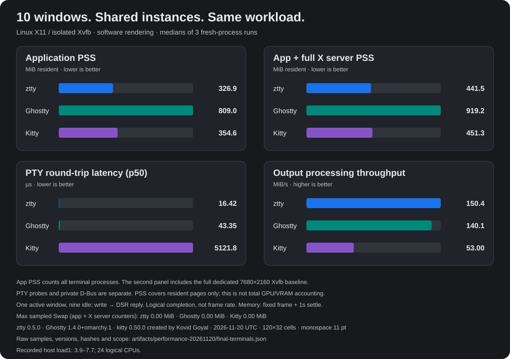
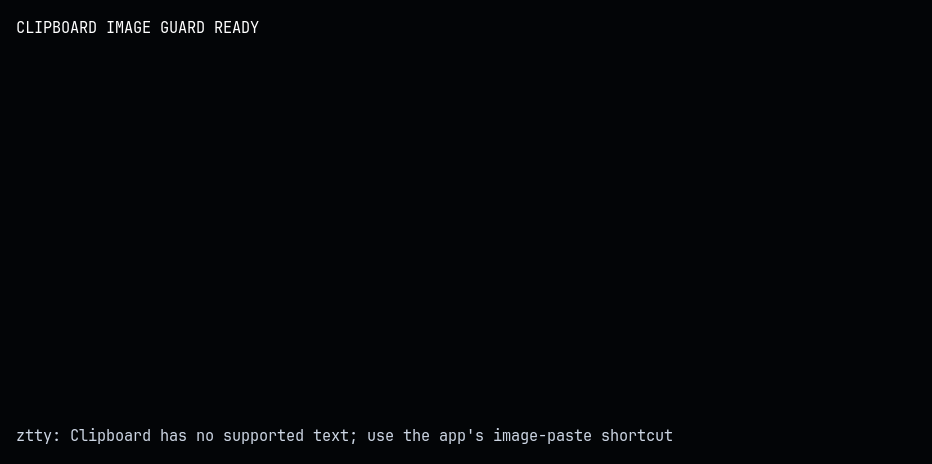

# ztty 性能、会话重载、切换与剪贴板修复

日期：2026-11-20（Asia/Taipei）。本报告对应开发源码，不代表新的正式版本已经发布或已替换用户正在运行的终端。

## 结果

本轮改善了两条已定位的开销路径：Unicode 字素边界判断，以及输出过程中重复扫描闪烁文字。最终集成版本在软件渲染的旧新对照中，单窗口原地 ASCII/彩色输出吞吐中位数提高 **49.9%**，10 个窗口逐个测量时提高 **44.6%**。独立的滚屏测试中，带窗口的 Unicode 日志吞吐按三轮成对比值取中位数提高 **53.4%**。这些数值衡量 PTY 输入到终端完成逻辑处理的速度，不是物理屏幕帧率。

同一台机器的三应用比较也已完成。强制使用 OpenGL/EGL 路径并统一设置 Mesa 软件 GL 环境时，10 窗口 ztty、Ghostty、Kitty 的输出吞吐中位数分别为 **150.4、140.1、53.0 MiB/s**；应用驻留 PSS 分别为 **326.9、809.0、354.6 MiB**。ztty 在此组的三轮 10 窗口测量都快于 Ghostty，但差距有限，不能据此宣布所有负载或真实 GPU 桌面都更快。

同时实现了 `ztty reload`：由已经支持此协议的 Linux broker 换入新可执行文件，保留原 broker PID、子进程和 PTY，并恢复终端与工作区状态。标签页切换改为在新页面完成绘制后再隐藏旧页面；私有 Xvfb 下的软件、GPU 两条路径都通过了完整画面采样。后续还修复了图片专用剪贴板被终端文本粘贴错误读取的路径。以下分别列出测量、实现和边界。

## 固定源码与可执行文件

| 用途 | 固定身份 |
| --- | --- |
| 本轮旧版基线 | [ztty `755c2c01c2a3eb535088a6f06d1655aaef97d931`](https://github.com/LIghtJUNction/ztty/commit/755c2c01c2a3eb535088a6f06d1655aaef97d931) |
| 闪烁文字扫描调度 | [ztty `dfc9a639a58675ecec570586048c732f128557c2`](https://github.com/LIghtJUNction/ztty/commit/dfc9a639a58675ecec570586048c732f128557c2) |
| 集成性能、reload、完整帧切换与鼠标释放修复 | [ztty `f7e019654684ceae4b0cb64d47d651ebed99bc35`](https://github.com/LIghtJUNction/ztty/commit/f7e019654684ceae4b0cb64d47d651ebed99bc35) |
| Unicode 缓存与完整终端 checkpoint | [zterm `25b57fae7e544f0fe6762011508ba1438a26aca1`](https://github.com/LIghtJUNction/zterm/commit/25b57fae7e544f0fe6762011508ba1438a26aca1) |
| 同进程 exec 后的 PTY 所有权接管 | [zpty `519968d04c26bdbb00b3dedd9464609bfcf02b82`](https://github.com/LIghtJUNction/zpty/commit/519968d04c26bdbb00b3dedd9464609bfcf02b82) |

基线 ELF SHA-256：

```text
25157d0cef430c5d2e2355304e56c7f2a6abbe3aeb7f52072eebe643091615ca
```

集成性能测试 ELF SHA-256：

```text
1e282546e621539a48855b54543e16acc5c7e1bc68be93b9b514877980f9d368
```

两者的 `--version` 都显示 `ztty 0.5.0`，因此本报告以源码提交与 ELF 哈希区分，不把开发提交冒充新的发行版本。测量时工作树干净，25 个变更路径（含两个子模块 gitlink）已与远端提交逐项核对。[源码清单](performance-reload-20261120/final-source-manifest.json)记录了对应关系。性能样本固定于 `f7e0196`。后续剪贴板修复对应[产品源码 `2aa561bbf51e894756cd4bc5fec00db63107bdd0`](https://github.com/LIghtJUNction/ztty/commit/2aa561bbf51e894756cd4bc5fec00db63107bdd0)，ELF SHA-256 为 `e222e34918d7e9a25b4c8ad910652990de81d19cd56f8bc7257bc5a7f6ef92d6`；其验证另见[剪贴板源码清单](performance-reload-20261120/clipboard-source-manifest.json)。后续剪贴板和文档提交没有重新生成上述性能样本，不将它们改标为另一次测量。

## 为什么这些修改能减少开销

一次终端输出至少经过四步：程序把字节写入 PTY；终端解析字节并更新单元格；调度器决定何时绘制；渲染器提交像素。前三步结束并不意味着显示器已经显示了结果。测试中的 DSR 光标位置回复来自逻辑终端状态，因此适合测处理速度，但不能代替画面完成栅栏或高速摄像测量。

### 只在需要绘制时扫描闪烁文字

原路径在频繁收到 PTY 输出时就可能遍历可见区域，寻找需要闪烁的文字。同一帧之间可能到达很多输入块；反复扫描同一屏幕增加了 CPU 工作，却没有产生更多有效画面。

修改将每次唤醒的时钟更新保持为常数时间，把需要读取单元格的扫描放到实际 `Plan::Render` 阶段。输入优先级、同步输出边界和停止输出后的最后一帧仍由原调度逻辑控制；没有通过丢弃最终状态或省略必要绘制取得数字。[实现与调度测试](https://github.com/LIghtJUNction/ztty/commit/dfc9a639a58675ecec570586048c732f128557c2)可直接审阅。

### 缓存重复的单字符边界判断

Unicode 的“一个显示字符”可能由多个码点构成。组合音标、emoji 序列、区域指示符和部分文字连接规则都需要上下文，不能简单按字节或码点切开。

新路径对可由两个独立标量判断的情况，把 UTF-8 编码放入 8 字节栈缓冲，调用原边界规则，并用每终端 64 项、512 字节的精确缓存保存结果。缓存使用完整有序码点对作键；碰撞只导致替换，不会把不同字符对当成相同结果。需要更多上下文的字素仍走完整规则。缓存是可重新计算的数据，不进入 checkpoint。

这解释了为什么重复 Unicode 日志的收益大于低重复文本，也解释了为什么 ASCII 不应被宣传为这项缓存的直接受益者。[源码与相应测试](https://github.com/LIghtJUNction/zterm/commit/25b57fae7e544f0fe6762011508ba1438a26aca1)保留了上下文、缓存碰撞和文本一致性检查。

## 旧版与集成版本：软件渲染

### 原地 ASCII/彩色更新

使用未改变的 `benchmark_throughput.py`，1、10 窗口各三轮，顺序为 AB / BA / AB。每窗口一轮预热、三次约 1 MiB 的原地屏幕更新。每轮取窗口统计，再取三轮中位数。全部 `renderer=auto` 实际选择软件渲染；这一组不能与下一节强制 GPU 路径的数字混用。

| 窗口数 | 旧吞吐 MiB/s | 新吞吐 MiB/s | 吞吐变化 | 旧 DSR p50 μs | 新 DSR p50 μs | 旧/新应用 PSS MiB |
| --- | ---: | ---: | ---: | ---: | ---: | ---: |
| 1 | 171.73 | 257.50 | +49.9% | 12.42 | 9.60 | 13.49 / 13.72 |
| 10 | 158.52 | 229.21 | +44.6% | 17.20 | 14.41 | 22.26 / 22.42 |

这里的延迟是每轮 DSR p50 再取中位数，不是键盘到屏幕延迟。10 个窗口都保持打开，但每次只有一个窗口产生测试输出，其余窗口空闲。

完整三轮吞吐如下，不删除偏慢样本：

| 窗口数 | 旧版三个样本 MiB/s | 新版三个样本 MiB/s | 成对比值 |
| --- | --- | --- | --- |
| 1 | 178.21 / 52.04 / 171.73 | 190.57 / 301.68 / 257.50 | 1.069 / 5.797 / 1.499 |
| 10 | 133.72 / 158.52 / 174.62 | 220.53 / 229.21 / 241.68 | 1.649 / 1.446 / 1.384 |

单窗口第二轮旧版明显偏慢，不能用这一轮的 5.8 倍作为总体收益。10 窗口三轮均改善，成对增益仍存在范围。PSS 有约 0.16–0.23 MiB 的小幅增加；本轮没有宣称旧新内存下降。[完整 A/B 原始数据](performance-reload-20261120/final-throughput-ab.json)含计时样本、最终文本校验、光标位置、进程身份和清理结果。

### 滚屏与 Unicode：独立固定 CPU 对照

第二组 collector 将 broker、输出进程、X server 分别固定在 CPU 23、22、21。每个负载每次输入约 8 MiB，三次样本，保留 2,000 行历史；三个独立 AB / BA / AB 轮次分别测 headless 和软件窗口。该 collector 的窗口实际为 1112×800，另一组 A/B 为 1112×768，不能跨 collector 合并为同一组样本。

| 负载 | 模式 | 旧吞吐中位数 MiB/s | 新吞吐中位数 MiB/s | 三轮成对比值中位数的变化 |
| --- | --- | ---: | ---: | ---: |
| ASCII 滚屏日志 | 无窗口 | 130.61 | 131.79 | +2.7% |
| ASCII 滚屏日志 | 软件窗口 | 99.48 | 123.02 | +19.4% |
| Unicode 滚屏日志 | 无窗口 | 26.65 | 39.89 | +44.7% |
| Unicode 滚屏日志 | 软件窗口 | 24.51 | 37.28 | +53.4% |
| ASCII 原地更新 | 无窗口 | 196.50 | 186.39 | **−3.7%** |
| ASCII 原地更新 | 软件窗口 | 138.40 | 163.99 | +17.8% |

最后一列是 `median(new_i / old_i) − 1`，不是用表中两个独立中位数相除，因此百分比不必等于前两列的比值。无窗口 ASCII 原地更新出现小幅负向结果；不能据此写“所有路径都加速”或“完全没有退化”。窗口路径三种负载均在三轮中改善，表明本轮收益也进入了实际 PTY 与窗口处理路径。[汇总](performance-reload-20261120/final-pipeline-summary.json)和六份逐轮记录保留输入大小/哈希、预期屏幕指纹和实际全可见文本一致性检查结果。

## 与 Kitty、Ghostty 的同条件比较

这组使用同一份 `benchmark_terminals.py`，18 个新进程案例：三应用 × 1/10 窗口 × 三轮。每轮改变应用执行顺序。`idle` 是内存采样前的准备负载；采完内存后，每个窗口仍执行 DSR 往返和 ASCII/彩色吞吐测试，所以它不只是空闲内存测试。

配置为共享实例、120×32 单元格、`monospace` 11 pt、不透明背景、关闭光标闪烁、私有 D-Bus 和 Xvfb。所有 OpenGL 路径使用 `LIBGL_ALWAYS_SOFTWARE=1`；ztty 显式选择 `renderer=gpu`，ztty 逐窗观测到的实际驱动为 llvmpipe（LLVM 23.1.1，256 bits）。Ghostty 有 OpenGL/Mesa 日志，Kitty 的实际 driver 名称未单独记录。这是 CPU 执行 OpenGL 的可复现实验，不是物理 GPU 排名。

| 窗口数 | 应用 | 应用 PSS MiB ↓ | 应用 + 完整 X server PSS MiB ↓ | DSR p50 μs ↓ | 输出 MiB/s ↑ |
| --- | --- | ---: | ---: | ---: | ---: |
| 1 | ztty | 136.22 | 221.53 | 8.99 | 263.60 |
| 1 | Ghostty | 313.57 | 398.30 | 42.18 | 174.17 |
| 1 | Kitty | 177.37 | 260.85 | 5,296.39 | 51.16 |
| 10 | ztty | 326.86 | 441.50 | 16.42 | 150.41 |
| 10 | Ghostty | 809.02 | 919.18 | 43.35 | 140.11 |
| 10 | Kitty | 354.59 | 451.28 | 5,121.81 | 53.00 |



结果有几个必须保留的限定：

- **单窗口 ztty 对 Ghostty 不稳定。** ztty 三轮吞吐为 295.07、111.67、263.60 MiB/s，Ghostty 为 137.59、174.17、275.25 MiB/s。按轮次对照，ztty 只有第一轮更快；两个范围明显重叠。各自中位数较高不能转述成“稳定快 51%”。
- **10 窗口的差距较小。** ztty 三轮为 145.13、158.94、150.41 MiB/s，Ghostty 为 141.81、140.11、126.77 MiB/s。三轮均更快，但独立中位数之比只有约 +7.4%，应限定在这项工作负载。
- **逻辑网格相同，像素尺寸并不相同。** 实测 ztty 为 1112×768，Ghostty 为 1080×640，Kitty 为 1081×641。相同字体请求并不保证相同字体度量或每帧像素工作量。
- **PSS 不等于所有图形内存。** 应用 PSS 按进程分摊共享驻留页；PTY 测试子进程和私有 D-Bus 单列。第二列合并内存是在每轮内将应用与完整私有 X server 相加后再取中位数，不能解释为日常桌面中新开一个终端的边际内存。
- **不从短空闲采样推断耗电。** Ghostty 的短窗口空闲 CPU 样本波动较大；报告保留原数据，没有把它写成普遍耗电结论。Kitty 的 DSR 回复延迟也只代表此配置下的协议往返，不能说成用户按键需要等待同样时长。

实测版本为 Kitty 0.50.0、Ghostty 1.4.0+omarchy.1；准确二进制 SHA、完整启动参数和逐轮范围见[三应用原始记录](performance-reload-20261120/final-terminals.json)。旧新软件组的 13–23 MiB PSS 与此处 136–327 MiB 的 GPU 路径成本属于不同渲染配置，不应用来互相证明内存变化。

## Unicode 微基准与负向结果复核

核心库另做五组独立进程 AB / BA 交替测试，固定 CPU 23。下表统一使用每组新旧吞吐比值的中位数。

| 核心负载 | 成对变化 |
| --- | ---: |
| 重复 Unicode | +54.3% |
| 低重复 Unicode 日志 | +10.0% |
| 同一低重复日志，按 1–31 字节碎片送入 | +4.2% |
| emoji 与组合字符 | +6.8% |
| 同一 emoji/组合内容，碎片输入 | +6.7% |
| SGR | +1.6% |
| ASCII | −7.2% |
| ASCII，历史已满 | −9.2% |

低重复和复杂字符输入的 payload 与保留屏幕/历史语义指纹在旧新版本一致；稳态分配统计为零。输入中不同字符对的数量不是缓存未命中率，不能把它当命中率结果。[五轮原始样本](performance-reload-20261120/cache-paired.json)与[汇总](performance-reload-20261120/cache-summary.json)保留了正、负结果。

针对 ASCII 负向样本，追加了专门诊断：每进程固定 78 MiB、CPU 23、ABBA 顺序，历史容量分别为 0 和 2048，两个独立进程/版本/容量，使用实际工作的 `cpu_atom` 硬件计数器。有效的第二组结果中，0 历史容量的 instructions/byte 基本不变、cycles/byte 约 +0.015%、吞吐约 −1.12%；2048 历史容量的 instructions/byte 基本不变、cycles/byte 约 +1.26%、吞吐约 +2.22%。原先 7–9% 的墙钟退化没有在该诊断中稳定复现，但这不能证明 ASCII 在所有环境都零退化。

第一次诊断因临时源码恢复时间戳导致 Cargo 复用同一个 ELF，已经明确标为无效，不能参与性能结论。有效第二组重新构建、检查到 `Compiling zterm`，并确认新旧 ELF 哈希不同。保留[无效记录及原因](performance-reload-20261120/ascii-profile-invalid.json)与[有效记录](performance-reload-20261120/ascii-profile-v2.json)，避免把构建缓存错误掩盖为漂亮数字。这个问题发生在追加诊断，不影响此前五轮缓存测试。

## 标签页切换的画面与鼠标状态

旧路径先隐藏旧页面、释放部分渲染资源，再映射并绘制新页面。在两步之间，父窗口可能露出背景或尚未完成的内容。修复后，新页面先在旧完整页面后方准备，直到相关分屏全部完成软件复制或 GPU 提交，再隐藏旧页。同步输出未提交时继续保留原完整画面；提交或已有超时边界到达后再更新。

这不会为每个隐藏标签永久保留一份完整画面缓存。旧页只在交接期间作为过渡画面，随后仍释放应释放的资源。切换期间隐藏页也不应继续处理普通鼠标输入。

独立 X11 采样线程持续读取父窗口或根窗口像素，用已确认的完整页面 RGB 哈希做判据。测试含 24 次 RPC 切换、24 次真实 XTEST 快捷键切换、隐藏页输出、同步输出保持/提交，以及独立顶层窗口的 focus/raise。校准遮挡样本单独标记，不计入应用错误。

| 场景 | 修复前软件路径 | 修复后软件路径 | 修复前 GPU 路径 | 修复后 GPU 路径 |
| --- | ---: | ---: | ---: | ---: |
| 标签切换中的无效画面采样数 | 5 | 0 | 400 | 0 |
| 独立顶层窗口 focus/raise 无效采样数 | 0 | 0 | 0 | 0 |

这里统计的是有限时段内的**采样数**，不是显示器物理帧数。独立顶层 focus/raise 在旧版也没有复现异常，因此本轮可证修复针对标签页面交接；不能扩写成已修复所有窗口管理器或合成器的闪烁。

随后真实鼠标测试还发现：绑定 `ctrl+button8 = next-tab` 后，X11 的隐式抓取可能把 release 发给正作为过渡画面的旧页。若直接忽略该事件，会留下已按住按钮的状态。修复先清理按钮快捷键状态，再忽略旧页输入；原版本真实复现缺少 release，最终版本软件/GPU 均得到完整按下与释放对。

证据：[软件最终像素报告](performance-reload-20261120/final-switch-software/report.json)、[GPU 最终像素报告](performance-reload-20261120/final-switch-gpu/report.json)、[软件鼠标回归](performance-reload-20261120/mouse-final-software.json)、[GPU 鼠标回归](performance-reload-20261120/mouse-final-gpu.json)。同目录保留修复前报告。

## `ztty reload` 怎样保留工作进度

```sh
ztty reload
ztty reload --binary /absolute/path/to/new-ztty
```

命令作用于 `ZTTY_SOCKET` 指定的 broker。不指定 `--binary` 时，使用当前执行这条 CLI 的可执行文件；它不会下载或安装新版本。`Ctrl+Shift+R` 仍然只是重新加载配置。

实现用同进程 `exec` 换入新 ELF，所以 broker PID 保持不变，原 shell/命令还是它的子进程，原 PTY 文件描述符继续存在。更换前将终端状态、broker 连接和工作区关系编码到私有密封 memfd；没有把用户屏幕或历史写到磁盘快照文件。

新 ELF 先作为独立验证进程解析完整 checkpoint，返回绑定本次随机 nonce 的专用确认。仅“进程成功退出”不算确认，真实 `/bin/true` 已作为拒绝测试。通过验证后，broker 才使用已经打开并固定身份的 ELF 描述符交接；执行失败会恢复原描述符标志。

保留范围包括：

- 原 broker、shell/命令 PID 与 PTY，子进程的内存状态和退出状态处理关系。
- 会话地址和身份、输入所有权、尚未发送的输入、已保留输出及绝对字节游标。
- 主屏、备用屏、历史、滚动位置、光标、样式、终端模式和制表位。
- X11 标签页与分屏关系、等待中的 broker 连接和已挂起的读取请求。

原生测试实际执行了两个不同 ELF 之间的双向替换，检查运行中程序的内存 nonce、PID/start ticks、PTY 设备和尺寸、持续输出的精确字节账本、等待中的读取 socket、两个标签与分屏、备用屏/主屏切换、滚动历史以及真实 XTEST 方向键输入。软件与 GPU 两条路径各通过 9 项验证，两次替换均成功。[软件记录](performance-reload-20261120/final-reload-software.json)、[GPU 记录](performance-reload-20261120/final-reload-gpu.json)包含身份与结果。

### 明确支持范围与拒绝行为

支持 Linux X11、XWayland 和无窗口 broker。原生 Wayland、macOS、Windows 尚不支持这项状态交接。任一会话含尚未支持的状态，整个请求会在替换前拒绝，原会话继续运行。

| 状态 | 行为 |
| --- | --- |
| 未完成的 UTF-8、CSI、OSC 等解析输入 | 最多继续处理 250 ms 等待完整边界；仍未完成则拒绝，保留待续输入 |
| 曾处理 Kitty graphics、Sixel 或 native UI | 当前保守拒绝，即使已删图或终端 reset |
| 待处理 OSC 52、粘贴传输、活动 overlay、文本插件任务或待回收子进程 | 待相关操作正常结束后再重试 |
| 超过 128 会话或 checkpoint 总量 128 MiB | 在替换前拒绝 |
| 目标不支持格式、无专用确认或验证超时 | 保留原程序；验证期限 10 秒，CLI 等待上限 60 秒 |

未完成 UTF-8/CSI/OSC 的实测结果是“明确拒绝且后续输入仍可继续”，不是“成功迁移半条控制序列”。缺失路径、不可执行 ELF、错误 ELF、`/bin/true` 和 FIFO 都验证了拒绝后状态不变。

成功换入后，窗口与渲染资源会重新创建，可能短暂消失；不保证合成器保持位置或物理帧绝不中断。如果新程序能恢复会话但显示连接失败，返回 `window_error`、CLI 非零退出，而 PTY 与 broker 保持存活；恢复显示连接后可在同一 `ZTTY_SOCKET` 下重新 `ztty attach`。这是实现支持的恢复路径，本轮没有实际注入显示故障来验收它。

### 已经运行的正式 0.5.0 需要一次过渡

旧的已发布 0.5.0 broker 没有 checkpoint/restore 协议。新 CLI 无法倒过来为这个旧进程增加能力，实测为安全拒绝。保留旧窗口直到其中的工作完成，新任务使用与旧二进制池分离的新构建 broker；若同一新 ELF 的 broker 已存在，会复用它：

```sh
env -u ZTTY_SOCKET /absolute/path/to/new-ztty --name new-work -e /bin/bash
```

新窗口以后可使用 `ztty reload` 换入兼容构建；旧窗口与其中的命令在一次性过渡期间继续运行。[旧 broker 拒绝记录](performance-reload-20261120/final-legacy-refusal.json)保留了实际结果。

## 图片剪贴板变成字符：后续修复

用户随后反馈，剪贴板明明是图片，粘贴到 Codex 输入框却出现原始字符。本机确认 Codex CLI 为 0.170.0；只读取格式清单的 `wl-paste --list-types` 返回 `image/png`，没有读取真实图片内容。真实桌面的 X11 TARGETS 查询被 Xauthority 拒绝，因此不能声称已经观察到该桌面桥接器如何转换 PNG。

源码检查和合成复现确认了 ztty 的一条错误接受路径：X11 文本粘贴原来直接请求 `UTF8_STRING`，失败后请求 `STRING`，没有先检查 selection 的 `TARGETS`。当提供方错误地对未广告的文本请求返回 PNG 字节时，UTF-8 宽容解码或 Latin-1 转换会把这些字节变成字符送入 PTY。这条路径在修复前二进制上已精确复现；它解释一种可能机制，并不替代对用户真实剪贴板提供方的观察。

[修复提交 `2aa561b`](https://github.com/LIghtJUNction/ztty/commit/2aa561bbf51e894756cd4bc5fec00db63107bdd0)现在先读取有界格式清单，只请求已提供的 `UTF8_STRING`、`text/plain;charset=utf-8`、`text/plain` 或 `STRING`，并要求返回的 property 类型与请求一致。UTF-8 在完整传输结束后验证，因此不会错误拒绝被 INCR 拆开的码点，也不会先把有效前缀送入 PTY。`STRING` 仍保留 Latin-1 转换。OSC 52 使用相同门禁，Wayland 已有 MIME 选择并补上完整 UTF-8 校验。

合成图片测试使用私有 Xvfb、真实 XTEST 按键和 raw PTY，以实际收到的字节和请求顺序判断结果：

| 验证 | 实际结果 |
| --- | --- |
| 旧版 image-only owner 返回 PNG 的两条兼容路径 | 收到与旧解码方式一致的泄漏字节，精确复现 |
| 修复版同样的 image-only owner | 只请求 `TARGETS`，不请求图片或文本转换；PTY 图片输入 **0 字节** |
| 非法 UTF-8 直接回复、完整 INCR、返回错误 property 类型 | 整条拒绝，没有提前发送前缀 |
| 正常 UTF-8、Latin-1，直接及 INCR 传输 | 字节与预期一致 |
| 默认 Ctrl+V | PTY 收到 `0x16`，selection owner 收到 0 个读取请求 |
| 既有文本粘贴回归 | 25 项通过，包括大传输、容量限制与失败后恢复 |
| OSC 52 软件 / GPU 路径 | 各 13 项通过，权限、取消和超时语义保留 |
| 含修复的 ELF 再做会话重载 | 软件路径 9 项、两个不同 ELF 之间的两次替换通过 |

首次拒绝的真实窗口截图已人工检查，显示明确的 no-text / application image-paste 提示：



**默认快捷键的用途不同。** ztty 的 `Ctrl+Shift+V` 是文本粘贴；普通 `Ctrl+V` 交给前台应用。Codex CLI 0.170.0 的[对应版本源码](https://github.com/openai/codex/blob/29eb79e9866b3262a777fdf8195c1b9e63684c91/codex-rs/tui/src/chatwidget/clipboard.rs)把 `Ctrl+V` 交给自己的图片附件读取流程；它也可[识别粘贴的已有图片文件路径](https://github.com/openai/codex/blob/29eb79e9866b3262a777fdf8195c1b9e63684c91/codex-rs/tui/src/bottom_pane/chat_composer.rs)。因此在 Codex 输入框粘贴图片应使用 `Ctrl+V`，不加 Shift。自定义快捷键、前台应用和剪贴板访问权限仍会影响这条路径。

这次测试证明了终端格式门禁、按键透传与 PTY 字节结果；没有启动用户的 Codex 会话并读取真实剪贴板来声称完成附件上传。原生 Wayland 图片专用 MIME 的拒绝原本已存在，本轮相关变化是 UTF-8 完整性检查；新 GUI 回归实际执行在 X11/Xvfb。证据为[旧版复现](performance-reload-20261120/clipboard-image-before.json)、[修复版十项检查](performance-reload-20261120/clipboard-image-after.json)、[25 项文本传输](performance-reload-20261120/clipboard-transfer-after.json)、[软件 OSC 52](performance-reload-20261120/clipboard-osc52-software/osc52.json)、[GPU OSC 52](performance-reload-20261120/clipboard-osc52-gpu/osc52.json)和[重载复核](performance-reload-20261120/clipboard-reload-software.json)。

## 验证与测量局限

本地验证包含 zterm 的 180 个单元测试与 3 个文档测试、边界 oracle 的单独穷举测试、no_std 目标检查、Clippy；zpty 的完整本地 gate、包检查和真实同 PID exec/child exit fixture；host workspace 测试、Wayland 构建特性、Clippy 与 release 构建。最终软件/GPU repaint 各 11 项、GPU 文字显示 8 项、reload、像素切换和鼠标回归通过，测试拥有的进程均完成清理。

一次 GPU repaint 检查曾因测试日志读取竞争失败：画面已经完成，但 interposer 在 swap 返回后才写 trace，测试可能先读到空 trace。修复在读取 trace 前执行同 broker 的只读 `info` 屏障；该单线程 broker 回复前，前一次 swap wrapper 已完成日志写入。仍严格要求恰好一次复制，没有过滤重复记录或放松帧检查。[初次失败记录](performance-reload-20261120/final-repaint-gpu.json)与[修正后记录](performance-reload-20261120/final-repaint-gpu-barrier.json)都予以保留。

测试机为 i9-12900HX、24 个逻辑 CPU、约 15.35 GiB RAM、Linux 7.3.4-arch1-1，Rust 1.100.0，CPU governor 为 powersave。其他开发任务保持运行。比较入口满足既有可用内存/负载准入条件，但宿主仍存在 swap I/O 和内存压力；样本中的应用 Swap 为零不能推导宿主完全无压力。三轮测量提供波动范围，不构成跨机器置信区间。

本轮没有以远程 CI 代替本地验收，也未触发新正式发布。物理 GPU、真实桌面合成器、输入到显示延迟、十个同时输出的生产者、大图持续传输、原生 Wayland reload 不在上述结果覆盖范围。旧历史基准若使用不同字素语义或不同机器负载，也不能充当本轮加速比的分母。

## 复现与交付

先分别构建固定旧新源码及递归子模块，保留两个可执行文件。核心命令如下：

```sh
python3 tools/benchmark_throughput.py \
  --before /path/to/ztty-before --after /path/to/ztty-after \
  --before-source 755c2c01c2a3eb535088a6f06d1655aaef97d931 \
  --after-source f7e019654684ceae4b0cb64d47d651ebed99bc35 \
  --counts 1,10 --rounds 3 --json artifacts/new-throughput-ab.json

python3 tools/benchmark_terminals.py \
  --ztty /path/to/ztty-after --ztty-renderer gpu \
  --ghostty /usr/bin/ghostty --kitty /usr/bin/kitty \
  --counts 1,10 --modes shared --workloads idle \
  --apps ztty,ghostty,kitty --repetitions 3 --purpose comparison \
  --settle-seconds 1 --json artifacts/new-terminals.json \
  --svg artifacts/new-terminals.svg --no-readme

python3 tools/benchmark_output_pipeline.py \
  --binary /path/to/ztty-after \
  --binary-source f7e019654684ceae4b0cb64d47d651ebed99bc35 \
  --output artifacts/new-pipeline.json \
  --kinds ascii-log,unicode-log,inplace-ascii --modes headless,window \
  --mib 8 --samples 3 --history 2000 \
  --broker-cpu 23 --writer-cpu 22 --xserver-cpu 21
```

固定 CPU 编号应按复现机器拓扑选择，并在旧新两侧保持一致。完整测试参数、依赖脚本哈希、进程与 ELF 身份均在原始 JSON 中。输出目录必须是新的，避免覆盖既有测量证据。

README、会话文档和本报告与开发源码一起提交；本报告不宣称已经把新二进制安装到用户默认终端。zterm/zpty 新 API 当前由 ztty 的固定 Git 子模块消费，尚未另发 registry 版本。oh-my-ztty 的源码 pin 与双架构发布制品锁必须一起更新；没有新的正式 tag 与 x86_64/aarch64 制品时不能伪造套件传播完成。对应固定源、实际阻碍和下一接手角色见[依赖传播记录](../dependency-propagation.md)。

独立离线审计重新计算了样本吞吐、各级中位数、成对比值、PSS、矩阵完整性、渲染器与清理结果，并检查原始 run 哈希；见[主比较审计](performance-reload-20261120/audit-result.json)与[pipeline 审计](performance-reload-20261120/audit-pipeline.json)。它不启动应用、不替换原始数据，也不把数值核对条目当作额外运行次数。

## 证据索引

- [旧新整应用 A/B 原始数据](performance-reload-20261120/final-throughput-ab.json)
- [三应用原始数据](performance-reload-20261120/final-terminals.json)与[图表](performance-reload-20261120/final-terminals.svg)
- [固定 CPU pipeline 汇总](performance-reload-20261120/final-pipeline-summary.json)
- [旧 pipeline 第 0 轮](performance-reload-20261120/final-pipeline-before-r0.json)、[第 1 轮](performance-reload-20261120/final-pipeline-before-r1.json)、[第 2 轮](performance-reload-20261120/final-pipeline-before-r2.json)
- [新 pipeline 第 0 轮](performance-reload-20261120/final-pipeline-final-r0.json)、[第 1 轮](performance-reload-20261120/final-pipeline-final-r1.json)、[第 2 轮](performance-reload-20261120/final-pipeline-final-r2.json)
- [Unicode/多样文本五轮样本](performance-reload-20261120/cache-paired.json)、[汇总](performance-reload-20261120/cache-summary.json)、[有效 ASCII 诊断](performance-reload-20261120/ascii-profile-v2.json)
- [软件 repaint](performance-reload-20261120/final-repaint-software-barrier.json)、[GPU repaint](performance-reload-20261120/final-repaint-gpu-barrier.json)、[GPU 文字](performance-reload-20261120/final-text-gpu.json)
- [软件 reload](performance-reload-20261120/final-reload-software.json)、[GPU reload](performance-reload-20261120/final-reload-gpu.json)、[旧版拒绝](performance-reload-20261120/final-legacy-refusal.json)
- [软件标签切换](performance-reload-20261120/final-switch-software/report.json)、[GPU 标签切换](performance-reload-20261120/final-switch-gpu/report.json)、[软件鼠标](performance-reload-20261120/mouse-final-software.json)、[GPU 鼠标](performance-reload-20261120/mouse-final-gpu.json)
