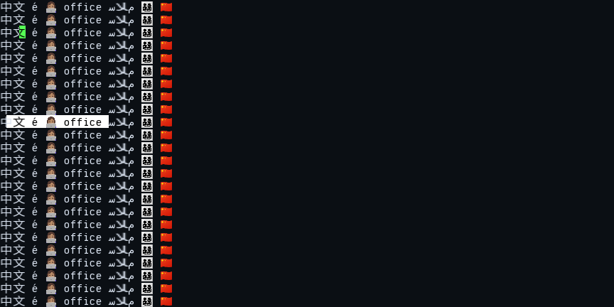
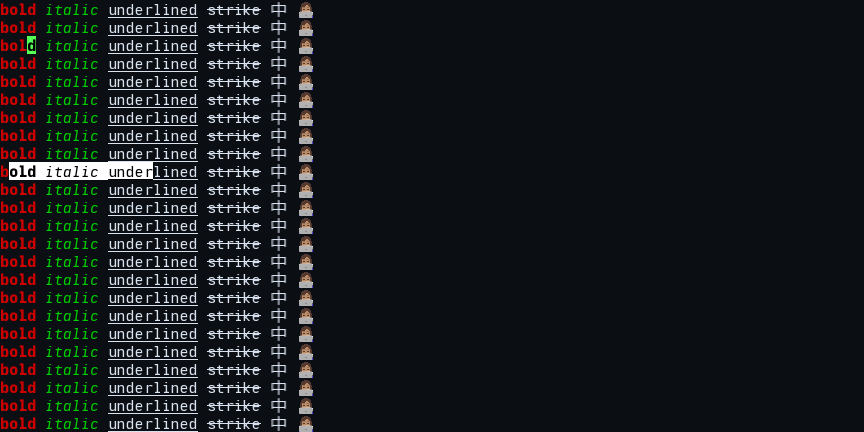

# ztty GPU 文字段缓冲复用

日期：2026-11-20（Asia/Taipei）

## 结果

本轮复用 GPU 文字分段过程中的临时数组。在 96×24 网格、预热五帧后的三类固定画面中，Rust `alloc + realloc` 从每帧 **27、76、227 次降到 0 次**。每类画面完成三组成对测试，每次统计 100 帧；三次分配结果完全一致。**9/9 组 RGBA 输出逐字节相同**，Unicode 和样式画面已进行视觉检查。

基线为 `22f337dac4c1c65287dae9cf32018e55a301f2f9`，运行时代码为 `9c0d8c3a4418dc684428daefd78ec77ae3de121e`。本轮为源码迭代，版本仍为 0.5.2。分配结果覆盖本次预热后的固定画面；新字形、排版缓存未命中、其他 UI 路径和原生字体/GL 库仍可申请内存。整进程 RSS、物理 GPU 帧率和实际按键到屏幕的延迟没有在本轮测量。

## 实现与内存边界

绘制之前，渲染器需要按字体和文字系统把文本分成若干段。旧实现每次创建 `Vec<TextRun>`，使用后立即释放。现在 `Renderer` 持有一个缓冲，`measure_text`、`draw_text` 和 `draw_cells` 共用同一套取出、使用和归还逻辑。使用结束后清空长度，下一次调用复用已分配空间。字体选择、脚本合并、HarfBuzz 排版顺序和单元格定位沿用原实现。

成功和错误路径均执行容量限制：最多保留 256 个 `TextRun`，64 位平台的数据容量上限为 **6 KiB/渲染器**，另有容器头与分配器开销。超过上限的碎片化文本仍可在原有 16 KiB 文本预算内处理，结束后释放较大的缓冲。字体重载后，新的文字段会重新选择字体；保留的缓冲不缓存字体 ID 或上次的分段内容。

代码：[GPU 渲染器](https://github.com/LIghtJUNction/ztty/blob/9c0d8c3a4418dc684428daefd78ec77ae3de121e/src/gpu/mod.rs)、[原生回归](https://github.com/LIghtJUNction/ztty/blob/9c0d8c3a4418dc684428daefd78ec77ae3de121e/src/gpu/tests.rs)。

## 分配和像素对照

下表是每帧平均值。三组成对采样顺序为旧/新、新/旧、旧/新；使用相同源码锁文件、子模块提交、编译参数和测试程序。申请字节为分配请求量的累计，未测量存活堆内存或 RSS。

| 场景 | alloc 次/帧 | realloc 次/帧 | 累计申请 B/帧 |
| --- | ---: | ---: | ---: |
| ASCII | 27 → 0 | 0 → 0 | 2,592 → 0 |
| Unicode、组合字符与 emoji | 27 → 0 | 49 → 0 | 16,608 → 0 |
| 混合样式 | 202 → 0 | 25 → 0 | 24,192 → 0 |

环境：`rustc 1.100.0 (0ef1bc386 2026-11-09)`，release fat LTO、codegen-units=1；`LIBGL_ALWAYS_SOFTWARE=1`、`LP_NUM_THREADS=2`，实际 EGL 驱动为 llvmpipe（LLVM 23.1.5）。本轮为软件 OpenGL 离屏测量。Rust 全局分配器计数不包含原生字体库、GL 驱动或显存。

每组画面直接比较 1,492,992 字节的 RGBA 内容。原始样本、环境、子模块版本和逐组比较结果见 [results.json](results.json)。





## 提交耗时复测

另用相同的两个已构建程序做了五组成对复测，固定 CPU 2、一个 llvmpipe 工作线程，每场景每次计时 200 帧，交替运行顺序。此处记录每次的 p50；百分比先计算每组 `100 × (新/旧 − 1)`，再取中位数。p95、最大值和全部初始样本均保存在 JSON 中。

| 场景 | 基线 p50 / ms，五次 | 候选 p50 / ms，五次 | 成对变化中位数 |
| --- | --- | --- | ---: |
| ASCII | 0.372 / 0.368 / 0.564 / 0.384 / 0.385 | 0.496 / 0.417 / 0.402 / 0.384 / 0.373 | -0.21% |
| Unicode、组合字符与 emoji | 0.413 / 0.410 / 0.399 / 0.387 / 0.568 | 0.388 / 0.445 / 0.388 / 0.391 / 0.393 | -2.54% |
| 混合样式 | 0.305 / 0.352 / 0.360 / 0.326 / 0.341 | 0.361 / 0.349 / 0.333 / 0.343 / 0.327 | -0.92% |

提交时间包含 CPU/EGL 调用和软件渲染线程调度。机器仍有其他工作负载，单核约束也会改变主线程与软件渲染线程的竞争方式。本轮以稳定减少 Rust 分配为结论；提交时间的全部观测保留在 [timing-control.json](timing-control.json)，不据此推广为硬件 GPU、桌面帧率或输入延迟的改善。

## 正确性与构建验证

新增 EGL 回归覆盖混合脚本输出、测量宽度与绘制宽度一致、重复调用时的缓冲复用、三个入口拒绝超长输入、真实字形预算错误后的恢复，以及超过 256 段时成功和失败两种路径的容量回收。

| 验证 | 结果与记录 |
| --- | --- |
| 工作区测试 | 193 项通过；[日志](workspace-tests.log) |
| 原生 EGL | 8 项通过，含本轮新增回归；[日志](native-gpu-tests.log) |
| SessionCore | 10 项检查通过，子进程全部回收；包含于工作区日志 |
| Clippy | 所有目标、wayland feature、`-D warnings` 通过；[日志](clippy.log) |
| release 构建 | 通过；[日志](candidate-build.log) |
| no_std 边界 | 生产依赖与 release 可执行文件检查通过；[日志](no-std.log) |
| 格式与补丁 | `cargo fmt --check`、`git diff --check` 通过 |
| 依赖一致性 | 基线与候选 Cargo.lock 逐字节相同，子模块提交固定 |

日志中的本机绝对目录已替换为 `<worktree>` 或 `<home>`，命令结果和测试输出保持原样。

## 复现

分别在上面的基线和候选提交、相同子模块版本及 Cargo.lock 下构建现有 [gpu_row_scratch_benchmark.rs](../../../examples/gpu_row_scratch_benchmark.rs)：

```sh
CARGO_BUILD_JOBS=2 cargo build --locked --offline --release \
  --features wayland --example gpu_row_scratch_benchmark
LIBGL_ALWAYS_SOFTWARE=1 LP_NUM_THREADS=2 \
  target/release/examples/gpu_row_scratch_benchmark 100 artifacts/gpu-pixels
```

保留两个可执行文件，按旧/新、新/旧、旧/新的顺序运行，并直接比较每个场景输出的 `.rgba` 文件。计时复测将帧数改为 200，设置 `LP_NUM_THREADS=1`，通过 `taskset -c 2` 固定到当前机器允许使用的同一 CPU，交替运行五组。离线构建需要本机已缓存依赖和子模块；本轮使用开发机现有副本完成构建。

## 依赖更新前的对照

开发期间上游合入 Project Z 依赖更新，包括 zgpui 0.1.5。本报告顶部的数据来自整合后的源码，基线与候选均使用更新后的相同依赖。旧依赖下的首轮结果、每场景 1,000 帧的五组成对计时和截图保存在 [prior-dependencies](prior-dependencies/README.md)，作为独立历史记录，不混入上面的采样。

## 结论与证据检查

| 检查维度 | 依据与边界 |
| --- | --- |
| 改动贡献 | 三个文字入口共用一个有界缓冲；没有新增依赖或改变公开接口。 |
| 表达清晰度 | 分配次数、申请字节、保留容量与提交耗时分别报告。 |
| 实验强度 | 三场景、三组分配与像素对照；五组固定 CPU 计时复测，保留全部样本。 |
| 覆盖完整性 | 成功、超长文本、真实排版错误、大缓冲回收和字体重载均有原生测试；实际硬件延迟另行测量。 |
| 方法边界 | 容量按实际 capacity 限制到 256 段；较大的临时缓冲及时释放，冷缓存路径继续按需分配。 |
