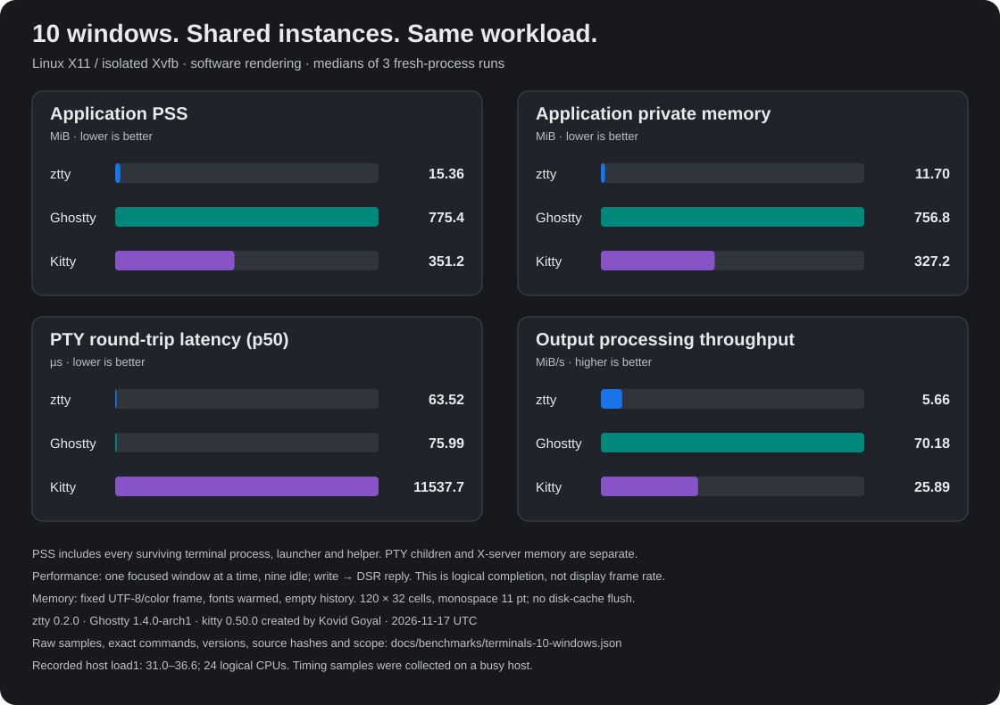

# ztty 0.2.1：输出吞吐优化与验证

日期：2026-11-18（UTC+8）。原始 JSON 的采集时间使用 UTC。

本轮在同一台机器上重新运行旧版和新版：十窗口场景的输出吞吐中位数从 **19.48 MiB/s 提高到 200.52 MiB/s，约 10.29 倍**。随后单独运行的三终端对比中，ztty 为 **227.58 MiB/s**，高于本次测得的 Ghostty 和 Kitty。结论适用于下文的 ASCII／颜色原地更新负载和 Xvfb 软件渲染环境；它不表示所有终端工作负载或真实显示器上的表现都最快。[前后对照原始数据](throughput-ab-2026-11-18.json) · [三终端原始数据](terminals-10-windows.json)

本文依次说明实测结果、实现改动、测量协议、正确性验证、复现步骤，以及尚未得到证据支持的范围。

## 1. 实测结果

### 旧版与新版：同一负载、当场重跑

每个窗口数量执行三组旧／新配对，顺序为 AB／BA／AB；每次启动全新的终端进程。十窗口测试逐个测量一个活动窗口，其他九个保持空闲。表中的范围是三次运行统计量的最小值与最大值，不是置信区间。吞吐单位为 MiB/s，越大越好。

| 实际窗口数 | 0.2.0 中位数 [运行范围] | 0.2.1 中位数 [运行范围] | 中位数之比 |
| ---: | ---: | ---: | ---: |
| 1 | 17.52 [11.71–19.17] | 194.18 [108.24–371.83] | **11.08×** |
| 10 | 19.48 [19.35–21.18] | 200.52 [117.69–271.51] | **10.29×** |

三组一窗口配对倍率为 9.24、11.08、19.39；三组十窗口配对倍率为 6.08、10.29、12.82。每一组都观察到提高，但新版的运行间波动明显，10.29 倍应理解为本轮中位数之比，不能当成所有机器、时刻或命令的固定收益。[完整配对与全部窗口样本](throughput-ab-2026-11-18.json)

提速没有伴随本轮驻留内存的大幅增加。下面的 PSS 包含共享宿主和所有等待启动器；PSS 会按比例分摊共享页。它是固定静态页之后、性能测试之前的驻留内存，不能代表输出过程的峰值内存。

| 实际窗口数 | 0.2.0 应用 PSS，MiB ↓ | 0.2.1 应用 PSS，MiB ↓ | 中位数差值 |
| ---: | ---: | ---: | ---: |
| 1 | 8.796 | 8.823 | +28 KiB |
| 10 | 14.268 | 14.232 | −36 KiB |

PTY 小请求延迟也保留在原始数据里。一窗口 p50 为 27.775 → 23.080 μs，十窗口 p50 为 20.571 → 21.872 μs；十窗口 p95 为 61.209 → 42.386 μs。因此本报告只把吞吐改善作为主要性能结论，并未把所有延迟指标概括为改善。[前后对照汇总](throughput-ab-2026-11-18.json)

历史 README 的 **5.66 MiB/s** 来自更高负载的另一批运行。本轮优化倍率使用当场重跑旧版所得的 19.48 MiB/s 作分母；历史结果仍可通过 Git 历史复查。前后对照的 200.52 MiB/s 与随后三终端运行的 227.58 MiB/s 属于不同批次，也不混合计算优化倍率。

### 三终端：同一批次的十窗口对比

三款终端各执行三轮，共九次独立运行；应用顺序轮换，避免总是让同一款先跑。下面各值是三轮中位数。吞吐列同时保留三轮运行范围。

| 终端版本 | 输出吞吐 MiB/s ↑ [范围] | 应用 PSS MiB ↓ | 应用＋完整 Xvfb PSS MiB ↓ | PTY p50 μs ↓ |
| --- | ---: | ---: | ---: | ---: |
| **ztty 0.2.1** | **227.58 [196.88–242.20]** | **14.91** | **137.36** | **17.24** |
| Ghostty 1.4.0-arch1 | 116.37 [80.83–126.32] | 795.20 | 905.38 | 56.58 |
| Kitty 0.50.0 | 43.49 [41.26–43.75] | 353.39 | 453.01 | 6,782.81 |

这组数据中 ztty 的吞吐约为 Ghostty 的 1.96 倍、Kitty 的 5.23 倍。比较保留了各终端的配置、版本、二进制哈希、窗口几何、进程身份、原始采样和清理结果。完整 Xvfb 一列包含独立显示服务本身的基线内存，不能当作在已有桌面上多开终端的边际成本。[方法与内存口径](README.md) · [原始 JSON](terminals-10-windows.json)

## 2. 改了什么，以及为什么有用

### 输出处理与绘制分别调度

旧路径在读取、解析输出后频繁进入绘制，短小的 PTY 分块也可能反复触发绘制工作。现在所有字节仍按顺序进入终端状态机，而已有屏幕改动可以在一个有限的时间窗口内合并绘制。这样，大量连续输出不会要求每个读取批次都立即绘制一遍屏幕。[共享会话循环](../../src/session.rs) · [重绘调度器](../../src/repaint.rs)

重绘调度使用 **8 ms 的输出合并预算**，从上一次绘制完成时开始计算。只有存在待绘制内容时才安排相应的唤醒；无改动的空闲窗口没有固定的 8 ms 轮询。即使输出结束后再无任何输入，待绘制的最终内容也有自己的截止时间，不依赖下一次键盘或窗口事件才出现。8 ms 是调度预算，操作系统调度和绘制本身仍可能花更久，不能据此声称有严格的输入到显示延迟上界。[调度实现](../../src/repaint.rs) · [调度测试](../../tests/repaint_schedule.rs)

交互输入的实际响应可以提前绘制。键盘或 MCP 写入先标记待响应，收到后续 PTY 输出后才消费这份优先级；一次旧画面的 Expose 重绘不会提前消耗它。每个会话每轮最多读取四个 16 KiB 块，事件循环仍会处理其他会话与管理请求，避免一个持续输出的窗口独占整个循环。[输入与读取路径](../../src/session.rs)

同步输出仍然保留完整帧的边界。应用结束同步模式后，提交状态会保留到前端清除已绘制改动，覆盖同一个输入块内 begin／end、超时与重置等情况；未显式结束的同步帧有 150 ms 的回退截止时间。频繁重复 begin 不会无限延长这个截止时间。[终端同步状态](../../crates/zterm/src/terminal.rs) · [实际像素验证](throughput-evidence-2026-11-18/repaint-gui.json)

### 合并连续行的像素复制

X11 绘制完成后，把连续需要更新的行合并成一个区域，每个区域只发送一次 XCopyArea，将后台图像中的对应像素复制到窗口；遇到未变化的行才结束这个区域。强制刷新整个窗口时，跳过逐行复制，最后只执行一次覆盖完整窗口宽高的复制，连同文字区之外的留白边缘一起刷新。这样减少了重复的 X11 复制请求，同时保留完整的显示内容；本轮没有单独开关这项改动测量，因此不为它分配独立的提速倍率。[X11 绘制与 publish_rows 实现](../../src/x11.rs)

### 减少状态机的重复工作

终端核心针对三个热路径减少工作量：环形屏幕索引和全屏滚动用一次条件减法处理已知的环回范围；SGR 颜色／样式参数直接遍历解析结果，避免提前初始化一张 32 项参数切片表；ASCII 快速路径只检查当前生效的 G0／G1 字符集。字符集切换、局部滚动区域、反向索引和宽字符等语义仍由回归测试验证。[屏幕实现](../../crates/zterm/src/screen.rs) · [解析与状态实现](../../crates/zterm/src/terminal.rs) · [核心回归](../../crates/zterm/src/tests.rs)

独立核心微基准只测解析器和屏幕模型，不包含 PTY、窗口或绘制。它使用原有 benchmark 程序，旧／新各三次独立进程运行，按 ABBAAB 交替；每次进程内部每个负载保留七个样本。

| 核心负载 | 旧版 MiB/s ↑ | 新版 MiB/s ↑ | 中位数变化 |
| --- | ---: | ---: | ---: |
| ASCII | 227.198 | 261.575 | +15.1% |
| ASCII，历史已满 | 147.492 | 173.506 | +17.6% |
| SGR | 175.323 | 208.134 | +18.7% |
| Unicode | 103.221 | 95.612 | **−7.4%** |

Unicode 没有得到提速证据。新版三次运行统计量为 71.710–118.196 MiB/s，旧版为 101.694–108.867 MiB/s；本轮观察到中位数下降并存在较大波动，不能仅凭三轮区分稳定回退与环境影响。所有样本保留。该微基准中的初始核心堆内存均为 107,676 bytes，稳态分配次数均为零。[核心微基准原始数据](throughput-evidence-2026-11-18/core-throughput-comparison.json)

端到端倍率衡量整组改动的效果。本轮没有完成每项优化单独开关的全套消融实验，因此不把 10.29 倍收益拆成“调度贡献多少、解析贡献多少”；核心微基准也不能直接换算成完整终端的吞吐。

## 3. 测量怎样保持可比、怎样防止只跑快而显示错误

计时工作负载没有变：每轮写入 **1,050,937 bytes** 的确定性 ASCII／SGR 序列，直接更新 120×32 屏幕，每行写 119 个字符，避免换行和历史滚动。负载 SHA-256 为：

~~~text
76376cc29e434d25d2fd58b984b231d6ad3efae2c7a9b0d8c87e762d12427f29
~~~

计时从第一次 PTY 写入之前开始，到整批输出后的 HOME／DSR 光标回复收到时结束。每窗口先预热一次，再测三次，取窗口中位数；每次运行取各窗口中位数；最终再取三次独立运行的中位数。原始字节数、时间和速率均保存，A/B 汇总会重新计算并核对派生统计量。[三终端收集器](../../tools/benchmark_terminals.py) · [A/B 收集器](../../tools/benchmark_throughput.py)

计时以外增加了独立的终态验证。每个窗口重新播放同一负载，直接请求光标位置，必须得到第 32 行、第 120 列，避免先重置光标而掩盖丢字；ztty 还通过本轮私有 broker 核对全部 32 行的最终文本。随后恢复相同静态页。吞吐计时里的负载和 HOME／DSR 尾部保持原样，验证自身的耗时没有混入吞吐分母。[完整性与发布门槛测试](../../tests/test_throughput_benchmark.py)

像素呈现由另外的真实 X11 测试验证。最终二进制通过七项检查，包括输出后静默时最终像素仍出现、洪水输出期间另一个窗口的 XTEST 和 broker 输入可见、旧画面 Expose 不吞掉输入优先级、同步帧在释放前保持已提交画面，以及同步超时和同块 begin／end。一次验收中，静默最终标记约 2.74 ms 后被观察到，洪水输出期间 XTEST 回显约 1.18 ms、broker 回显约 1.26 ms；这些是隔离 Xvfb 内的观测，不是真实显示器上的硬件输入延迟。[验收 JSON](throughput-evidence-2026-11-18/repaint-gui.json) · [最终帧截图](throughput-evidence-2026-11-18/screenshots/quiet-final-frame.png) · [并发交互截图](throughput-evidence-2026-11-18/screenshots/fairness-interaction.png)

## 4. 环境、验证与制品身份

### 环境中仍然存在负载与换页

本次机器是 Intel Core i9-12900HX、24 个逻辑 CPU、Linux x86_64，CPU governor 为 powersave。没有修改 CPU 亲和性或 governor，没有清空操作系统页缓存，也没有停止无关开发任务。每轮使用私有 Xvfb 和私有 D-Bus，所有窗口以 120×32 单元格映射到同一个 7680×2160 软件渲染显示服务。[环境原始记录](throughput-ab-2026-11-18.json)

A/B 采集发生于 2026-11-18 05:01:03–05:01:43 UTC（13:01:03–13:01:43 UTC+8）。采样的 load1 为 5.58–7.26，可用内存约 2.40–2.90 GiB，系统 Swap 已用约 18.95–19.78 GiB；换入与换出计数器均增加。这些是整台开发机的状态，不能归因于本次终端程序自身。

三终端采集发生于 05:03:56–05:06:12 UTC（13:03:56–13:06:12 UTC+8），load1 为 6.20–9.10。这套三终端收集器没有记录逐轮的整机 MemAvailable／SwapFree，因此上段 A/B 的整机可用内存和 Swap 范围只描述 A/B 采集时段，不套用到这批三终端运行。应用与同轮 Xvfb 成对采样的最大 Swap 为 ztty 0、Ghostty 3.57 MiB、Kitty 2.00 MiB。PSS 不包含已经换出的页；Swap 单列，不与 PSS 拼成所谓去重后的物理内存总量。全部九次三终端运行和十二次 A/B 运行均记录了空的遗留自有进程列表。[三终端内存与清理记录](terminals-10-windows.json) · [A/B 主机状态与清理记录](throughput-ab-2026-11-18.json)

### 验证记录

最终构建通过 **87 项 Rust 单元／集成测试和 4 项文档测试**，严格 Clippy、release 构建以及 zterm 的 x86_64-unknown-none 检查也通过。新增核心测试覆盖 SGR 缺失／无效／混合参数、活跃字符集切换、环形滚动和局部滚动区域、整块与逐字节流差分，以及同步帧的分块、超时和重置。[Rust 测试日志](throughput-evidence-2026-11-18/rust-tests.log) · [构建身份与命令](throughput-evidence-2026-11-18/build.json) · [Clippy](throughput-evidence-2026-11-18/clippy.log) · [no_std 检查](throughput-evidence-2026-11-18/no-std.log)

最终 0.2.1 二进制还通过七项图形检查、九项共享窗口检查、MCP 会话检查，以及十三项 Python 基准完整性／发布检查。它们分别覆盖图像传输／裁剪／层级／滚动／非法输入、窗口附着与重连生命周期、独立 PTY 输入、会话命名空间和传输断开后的持久性，以及原始测量与汇总的一致性。运行记录绑定最终二进制 SHA，保留命令、源文件哈希和退出状态。[运行验收记录](throughput-evidence-2026-11-18/runtime-checks.json) · [图形结果](throughput-evidence-2026-11-18/graphics-gui.json) · [共享窗口结果](throughput-evidence-2026-11-18/shared-gui.json) · [MCP 会话结果](throughput-evidence-2026-11-18/mcp-sessions.log)

### 可定位的源码与二进制

| 对象 | 身份 |
| --- | --- |
| A/B 旧版 | ztty 0.2.0；源码 f9de339a48f999817fd7492191c9676eabcbf109 |
| A/B 与三终端新版 | ztty 0.2.1；构建源码 dfe949c7ea58a372f69f0de9b4baa0cb2ab93379 |
| 三终端收集时的 Git revision | 59d9bda625176ec467965e900dc2c54566a651ef；相对构建源码仅增加 A/B 结果数据 |
| 新版二进制大小 | 443,456 bytes |

旧版二进制 SHA-256：

~~~text
32e2bba63d939e419cb51b81b6b0ac54fcea8062fbc521cdbf443808321de3c9
~~~

最终 0.2.1 二进制 SHA-256：

~~~text
5e1f6d111b7840ccbb2526bc253d7b75ab0a3f1d68f20685a8e74988f384607b
~~~

收集器记录二进制与辅助脚本哈希，并在 A/B 运行前后验证身份不变；原始 JSON 保留全部样本、运行顺序、源文件哈希和 raw-runs 哈希。一次失败不会被包装成成功结果，缺失样本、重复窗口、非有限数值或清理失败也不能通过 A/B 汇总检查。另一次独立数据复核覆盖全部 468 个计时 burst、156 次直接 CPR 检查记录，以及 96 个 ztty 全屏文本检查记录；逐项重算速率和汇总，并核对运行身份与清理结果。[汇总复核记录](throughput-evidence-2026-11-18/verification.json)

## 5. 复现

在仓库根目录执行下面一条命令，会先构建当前 release 源码，再测量三终端各十窗口、三轮，并更新 Git 跟踪的 JSON、SVG 和 README 图引用：

~~~sh
make benchmark-terminals
~~~

依赖、字体和终端参数见[基准说明](README.md)。如果只想依据已经保存的原始数据重新计算汇总和绘图：

~~~sh
python3 tools/benchmark_terminals.py --render-only
~~~

在本次开发机的隔离工作区，可以直接对保留的旧／新二进制复查 A/B。输出路径必须尚不存在，避免覆盖历史结果：

~~~sh
cd /home/lightjunction/Documents/GITHUB/ztty/artifacts/throughput-worktree

python3 tools/benchmark_throughput.py \
  --before artifacts/ztty-baseline-f9de339 \
  --after target-render/release/ztty \
  --before-source f9de339a48f999817fd7492191c9676eabcbf109 \
  --after-source dfe949c7ea58a372f69f0de9b4baa0cb2ab93379 \
  --counts 1,10 --rounds 3 \
  --json artifacts/throughput-ab-recheck-20261118.json
~~~

其他机器应在独立 checkout 中构建这两个源码 revision，并将 --before 和 --after 改为对应的二进制路径。不同工具链或平台编出的文件不一定具有相同 SHA；新一轮收集器会记录实际哈希。--rounds 1 可用于低成本探索，但输出会明确标记为 exploration，不能替代正式三轮结果。

## 6. 结论范围与自审

本轮证据支持的是：保持低驻留内存的同时，提高这项端到端输出处理负载的吞吐，并验证相关逻辑状态、实际 X11 像素与共享会话交互仍然正确。以下范围尚未由本轮基准覆盖：真实 GPU／Wayland 桌面呈现、多窗口同时作为输出生产者、长时间持续输出的峰值内存、各类 Unicode 工作负载，以及跨机器稳定排名。

### 主要结论与证据对应

| 结论 | 对应证据 | 状态 |
| --- | --- | --- |
| 十窗口旧／新吞吐中位数之比为 10.29× | 同机十二次 A/B 运行，完整样本与三组配对 | 支持；只限这批次与这项负载 |
| 新版是本次三终端测试中吞吐最高的一款 | 九次新采集，三终端各三轮，同负载与计时 | 支持；不推广为所有场景最快 |
| 本轮驻留内存基本持平 | A/B PSS 一窗口 +28 KiB、十窗口 −36 KiB | 支持；不是峰值内存结论 |
| 吞吐结果包含终态检查 | 计时外直接 CPR＋ztty 完整屏幕文字校验，全部运行通过 | 支持；实际像素另有 GUI 验收 |
| 连续输出仍允许另一个窗口交互，静默末帧可见 | 七项真实 X11 GUI 检查及截图 | 支持；没有物理显示延迟上界 |
| Unicode 已普遍变快 | 核心微基准中位数下降 7.4%，运行范围较宽 | 不支持；不作该结论 |
| 每个优化模块分别贡献确定的提速比例 | 尚无完整模块消融实验 | 证据不足；不作比例归因 |

### 五个维度的自审

1. **贡献是否有用？** 已从“输出过慢”这一实际问题出发给出同机旧／新实测；本文不把常见的批处理与热路径优化包装成新的研究算法。
2. **说明能否复查？** 字节负载、计时边界、聚合公式、二进制身份、源码 revision、命令和原始数据都有明确位置，历史 5.66 MiB/s 与当场旧版基线已区分。
3. **实测是否足够强？** 每组旧／新配对都观察到吞吐提高，同时公开运行范围、延迟未全部改善及 Unicode 的负向结果；三轮仍不足以给出跨机器置信结论。
4. **评估是否完整？** 已覆盖一／十窗口、三终端、核心微基准、逻辑终态和实际 X11 像素；GPU 桌面、并发生产者、峰值内存和完整消融仍需要新实验，因此相关承诺已从结论中移除。
5. **设计是否有隐藏代价？** 输出绘制会合并，预算为 8 ms；交互优先级、静默末帧、同步输出边界和空闲唤醒分别有验证。操作系统调度、绘制耗时和其他工作负载的结果继续构成实际边界。
