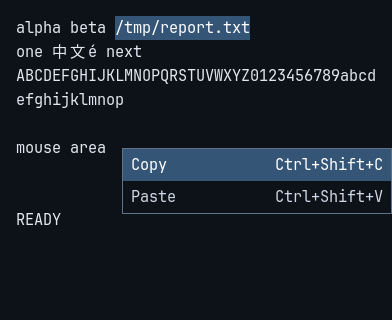

# ztty 复制粘贴改进与验收（2026-11-19）

本轮补齐了双击选词、三击选行、右键复制粘贴菜单和短暂反馈，并修复了大段粘贴丢失、旧式文本编码乱码、异常分块粘贴半截内容的问题。最终候选在隔离 X11 窗口中通过 13 项交互检查、25 项剪贴板传输检查和 19 项相关日常流程检查；安装回读尚待补齐。[验收记录](measurements/copy-paste-2026-11-19/validation.json)

本报告对应的代码提交是 [`db4253054dfad84fb1d5af64efd3d9efc4e048d1`](https://github.com/LIghtJUNction/ztty/commit/db4253054dfad84fb1d5af64efd3d9efc4e048d1)。三组最终 GUI 检查使用同一份 release ELF，其 SHA-256 为 `2eda135a24ae4507f6e9ba751fd7b2ddf042e38d1e60cca759a6fdf558d0a7d7`。后续文档提交不改变这份已测代码。[证据索引](measurements/copy-paste-2026-11-19/index.json)

## 现在怎样复制粘贴

下表列出默认操作。右键菜单同时显示当前配置的复制、粘贴快捷键；已有的自定义按键和鼠标绑定继续生效。[交互实现](../src/session.rs) · [快捷键实现](../src/actions.rs)

| 目的 | 操作 |
| --- | --- |
| 精确选择一段文字 | 按住左键拖动，可以反向拖选 |
| 选择词、文件路径或 URL | 双击；继续按住拖动时按整词扩展 |
| 选择一行 | 三击；继续按住拖动时按整行扩展 |
| 复制到系统剪贴板 | 选择后按 `Ctrl+Shift+C`，或右键选择 **Copy** |
| 从系统剪贴板粘贴 | 按 `Ctrl+Shift+V`，或右键选择 **Paste** |
| 使用 X11 的选区粘贴 | 左键选中后，在目标位置按鼠标中键 |
| 在 Vim、tmux 等接管鼠标的应用中操作终端选区 | 按住 `Shift` 再拖选、双击、三击或右键 |
| 用键盘操作已打开的菜单 | 上下方向键选择，`Enter` 执行，`Esc` 关闭 |

右键只打开临时菜单，选择 **Paste** 后才发送文本。没有可复制的选择时，**Copy** 显示为不可用；只读观察窗口仍可复制，**Paste** 则不可用。点击菜单外部会关闭菜单，菜单里的方向键和点击不会进入终端程序。原有 `Ctrl+C` 仍交给终端程序处理。[13 项交互结果](measurements/copy-paste-2026-11-19/copy-paste-gui.json)



图中内容全部由测试夹具生成。菜单沿用配置中的选择前景色、背景色，最终检查同时验证了实际窗口像素与复制结果。

## 选择边界与反馈

选词以终端字符为单位，保留宽字符和附加在字符上的组合音标。空白、括号、尖括号、逗号、分号及引号分隔词；路径中的斜杠、URL 中的冒号和常见标识符标点保持连贯。这里没有自然语言分词，例如相邻的中文会作为连续文本选择。[选区实现](../src/selection.rs) · [选择单元测试](../tests/selection.rs)

三击选择当前视口内的一条逻辑行：终端宽度造成的自动折行会重新连起来，程序明确输出的换行仍然保留。词和行的扩展都以当前可见网格为边界，不会自动纳入屏幕上方或下方不可见的部分；本轮也没有新增拖到窗口外自动滚动。文字提取继续沿用原有 4 MiB 上限。[选区实现](../src/selection.rs) · [软折行与 Unicode 实测](measurements/copy-paste-2026-11-19/copy-paste-gui.json)

选中内容首先更新 X11 的 `PRIMARY` 选区；显式复制才更新 `CLIPBOARD`，也就是通常所说的系统剪贴板。这使中键粘贴和 `Ctrl+Shift+V` 保持各自含义，不会因为一次拖选就覆盖用户先前复制的内容。选中和复制后会出现短暂提示，空剪贴板、传输格式错误、超限或输入队列满也会给出可见反馈。[交互实测](measurements/copy-paste-2026-11-19/copy-paste-gui.json)

“Pasted” 表示有效正文已经完整进入终端的输入队列，不表示 shell 已执行成功。只有实际入队的非空文本才返回实时输出位置并记录输入活动；空文本和失败不会发送空的粘贴标记，也不会把正在查看的历史内容拉回底部。提示沿用现有到期机制，到期时清除一次，不依靠连续重绘保持显示。[输入处理](../src/main.rs) · [窗口状态处理](../src/session.rs)

## 大段与多行粘贴修复

X11 剪贴板既可以一次传输文本，也可以用 `INCR` 分块传输。分块接收需要分别确认“收到有效数据”“传输正常结束”和“读取失败”。旧路径把部分错误与正常结束混在一起，还在分块 `STRING` 文本上丢失了 Latin-1 编码信息，结果可能是乱码或把已收到的半段内容当成成功粘贴。[传输实现](../src/x11.rs) · [旧版复现](measurements/copy-paste-2026-11-19/clipboard-baseline.json)

新版在接收期间保留文本类型，检查头部、每个分块的类型和格式，并在完整结束后统一解码。发生错误或超过上限时，会丢弃这次传输的全部内容并提示失败。这样，UTF-8 字符被分在两个块中也不会被提前解码，Latin-1 回退文本会正确转换为 UTF-8，异常分块之后的下一次正常粘贴也能恢复。[25 项传输实测](measurements/copy-paste-2026-11-19/clipboard-transfer.json)

Linux 输入队列同时从 1 MiB 调整为 8 MiB，解决了剪贴板已成功接收、正文却无法进入较小输入队列的问题。剪贴板仍最多接收 4 MiB 原始数据；编码转换、粘贴标记和已排队的输入都会占用队列空间。如果整段不能入队，会整体拒绝并显示错误，不截断后发送。[输入队列构造](../src/session.rs) · [原子入队](../src/main.rs)

下表是同一传输夹具对旧安装 ELF 和最终候选的真实 PTY 字节检查。“期望”为终端程序应收到的字节数，包含适用的括号粘贴标记；失败案例要求收到零字节。

| 案例 | 期望字节 | 旧版实际字节 | 最终候选实际字节 |
| --- | ---: | ---: | ---: |
| Latin-1 分块回退文本 | 24 | 27，内容不符 | 24，散列一致 |
| 大段多行 UTF-8 | 1,360,012 | 0 | 1,360,012，散列一致 |
| 空剪贴板 | 0 | 12 | 0 |
| 分块类型中途变化 | 0 | 30 | 0 |
| 分块格式错误 | 0 | 20 | 0 |

旧安装 ELF 的 SHA-256 为 `9cfa87530c3bbbf21950e0828ff9ecf9973a699551fabc034a6a3a01d264b468`，通过 15/25 项；最终候选通过 25/25 项。两次记录的传输测试脚本散列相同。大段案例包含 1,360,000 字节正文和 12 字节粘贴标记，最终收到的完整字节流 SHA-256 为 `67652b8c2f033e81be4d531417608afe8c6bb4d028c81fa5cf8be3d9cf5673fe`。[基线](measurements/copy-paste-2026-11-19/clipboard-baseline.json) · [最终候选](measurements/copy-paste-2026-11-19/clipboard-transfer.json)

## 验证范围与证据

最终验收使用私有 Xvfb、真实 XTEST 鼠标键盘事件、X11 剪贴板请求以及测试自有的原始 PTY。字节检查通过实际键盘事件形成输入屏障，避免把迟到的上一条回复计入下一案例；测试进程根据实际归属清理，不向用户窗口注入输入。[交互夹具](../tests/copy_paste_gui.py) · [传输夹具](../tests/clipboard_transfer_gui.py)

| 最终同一 ELF 上的检查 | 结果 | 主要覆盖 |
| --- | --- | --- |
| 复制粘贴交互 | 13/13 | 双击、三击、宽字与组合字符、软折行、双向扩展、右键菜单、快捷键、中键、反馈、只读窗口、Shift 绕过及按键释放归属 |
| 剪贴板传输 | 25/25 | UTF-8、Latin-1、分块边界、大段完整字节、空文本、异常类型和格式、超限、失败后恢复 |
| 日常流程 | 19/19 | 历史搜索复制、命令输出复制、自定义绑定、配置热更新、历史返回控件、观察窗口与输入所有权 |

[交互 JSON](measurements/copy-paste-2026-11-19/copy-paste-gui.json) · [传输 JSON](measurements/copy-paste-2026-11-19/clipboard-transfer.json) · [日常流程 JSON](measurements/copy-paste-2026-11-19/daily-workflow.json)

选择模块的 10 项单元检查在 `5155ef8` 阶段通过，之后该模块和对应测试未再改动。整合期的 `cargo check` 与 `clippy -D warnings` 通过；最后一次仅修正菜单选择配色后，重新完成 release 构建及上表三组 GUI 验收。代码格式检查也通过。传输报告保留了退出阶段的 broker 断开提示，`cleanup_errors` 为空；交互报告的自有剩余进程列表为空。[构建及阶段记录](measurements/copy-paste-2026-11-19/validation.json) · [选择测试日志](measurements/copy-paste-2026-11-19/selection-tests.log)

这轮结果适用于 Linux X11 路径。Windows、macOS 的原生菜单交互以及原生 Wayland 路径不在本轮实测范围内；本轮没有新增吞吐量或延迟基准，因此不据此声称性能百分比提升。

公开证据去除了机器绝对路径、临时 socket、显示编号和进程号，保留检查项、字节数、散列及错误输出；所有公开截图均来自合成测试场景。[文件散列索引](measurements/copy-paste-2026-11-19/index.json) 可对应到原始报告。原始日志、JSON、截图和夹具另存于开发机 `/home/lightjunction/Documents/GITHUB/ztty/artifacts/copy-paste-20261119-evidence`，其中 `manifest.json` 和 `SHA256SUMS` 记录文件散列；`pre-barrier` 目录只保留被后续检查取代的早期记录，不用于上表结论。

具备 Rust 工具链、Xvfb、python-xlib 和 Pillow 的 Linux 开发环境，可以从仓库根目录执行以下命令复现最终三组检查：

```sh
python3 docs/measurements/copy-paste-2026-11-19/run_validation.py
```

脚本先执行 `cargo build --locked --release`，然后依次运行三个 GUI 夹具；输出写入 `artifacts/copy-usability/final`。此命令只运行本地检查，不触发 CI。

## 安装状态

本节等待本机安装步骤补齐包版本、实际入口二进制散列和现有会话保留结果。当前报告记录的是已提交、已验证的候选代码，不把候选验收等同于系统包已更新；正式 tag 或 Release 不在本轮操作范围内。
