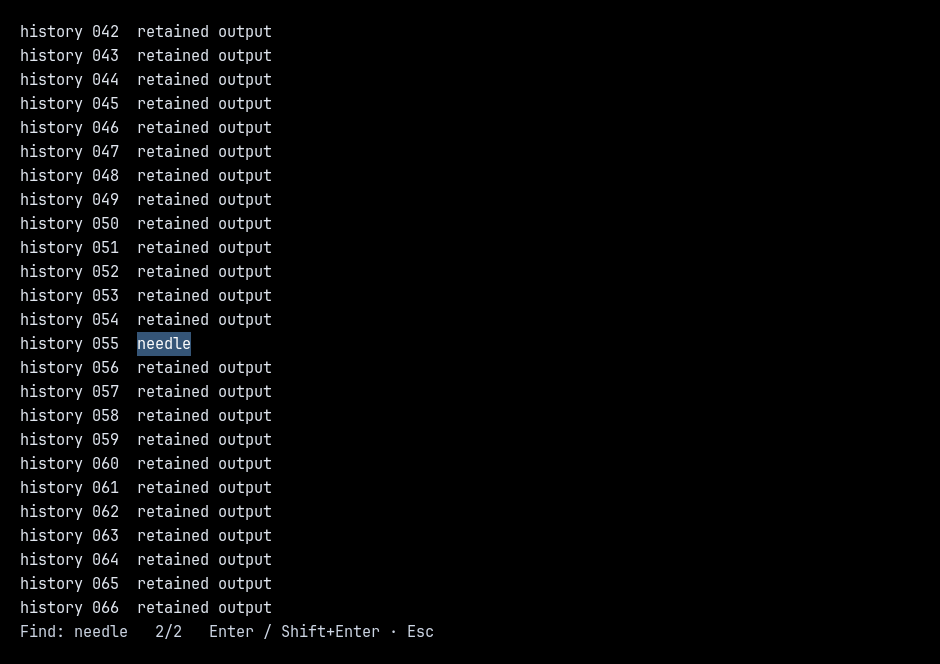
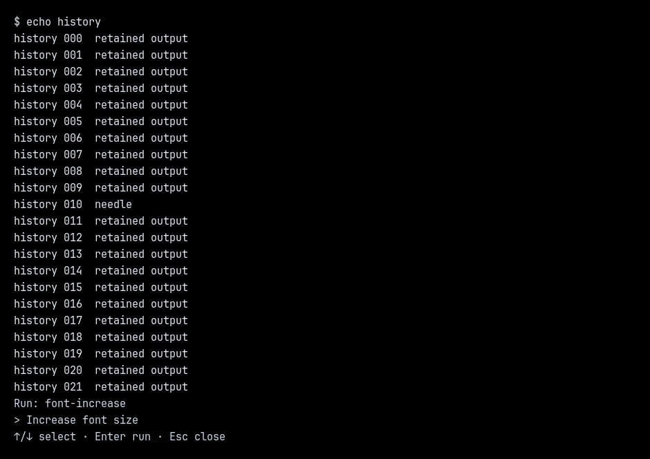

# Daily workflow on Linux

The Linux shared runtime keeps the PTY and terminal model independent of its
window. Search, command actions and configuration changes operate on that live
session; they do not restart its child. The native macOS and Windows frontends
do not yet implement these view actions or the shared runtime.

## Keyboard and command palette

| Shortcut | Action |
| --- | --- |
| Ctrl+Shift+F | Open history search; seed it with a single-line selection |
| Enter / Shift+Enter in search | Next / previous match, wrapping at the ends |
| F3 / Shift+F3 in search | Next / previous match |
| Ctrl+U or Ctrl+A in search/palette | Clear the query |
| Esc | Close the temporary search/palette |
| Ctrl+Shift+P | Open the command palette; type to filter, arrows to select, Enter to run |
| Ctrl+Shift+K / J | Previous / next retained shell command |
| Ctrl+Shift+Y | Copy the selected command's output; otherwise copy the latest output |
| Ctrl+Equal / Ctrl+Minus / Ctrl+0 | Increase, decrease or reset font size |
| Ctrl+Shift+R | Reload the session's configuration file |
| Ctrl+Shift+C / V | Copy selection / paste clipboard |
| Shift+PageUp / PageDown | Scroll history |

The palette appears only when requested. It uses the existing window and does
not send its query or action keystrokes to the child. It exposes the same named
actions as custom bindings and `ztty action NAME ACTION`. Workspace shortcuts
are listed in [workspaces](workspaces.md).

Search is case-sensitive, literal UTF-8 matching within each retained physical
line. It highlights complete wide/combining cells and all visible matches, and
selects the current match for copying. Queries are limited to 1,024 bytes; one
row is scanned at a time rather than copying the complete history. The highlight
map uses one bit per visible cell, at most 16 KiB for a 512×256 grid.

Search does not yet join soft-wrapped lines or provide regular expressions.
Current column width bounds the searchable part of older rows. Match counts
refresh when editing/navigating the query; ongoing output can shift retained
positions between navigations. Full history reflow remains separate work.

## Shell command regions

Enable the appropriate script using [shell/README.md](../shell/README.md).
`ztty shell-integration bash|zsh|fish|nu` prints the packaged script, so it can be
loaded explicitly without changing unrelated shell configuration. The scripts
send OSC 133 prompt/input/output/end marks and OSC 7 working-directory metadata.

```sh
ztty commands work
ztty command-output work 1
```

The CLI returns JSON. Command-output responses contain `text`, `complete`,
`truncated` and `command_id`. MCP additionally accepts `part: "input"` and a
`max_bytes` bound through `session_command_read`. At most 128 metadata records
are retained; extracted text is limited to 65,536 UTF-8 bytes. Copying through
the GUI refuses truncated output, so an incomplete region is not silently
presented as a complete command result.

Command regions point into the existing terminal history. They are rendered
text, not immutable stdout, and physical lines become newline separators.
Overwriting/erasing text, changing the width of a live region or exhausting
history can invalidate a region. Navigation skips unavailable records. Already
retained, intact historical commands remain usable after a font change.

## Custom keys and mouse buttons

Bindings are lines in the same configuration file as fonts and colors:

```ini
keybind = ctrl+shift+x = search
keybind = ctrl+shift+p = palette
keybind = ctrl+shift+t = none
mousebind = ctrl+button3 = palette
```

Modifiers are `ctrl`, `shift`, `alt`, `super`. Keys include ASCII characters,
`f1`–`f35`, `enter`, `escape`, `tab`, `backspace`, `space`, arrows, `home`, `end`,
`pageup`, `pagedown`, `equal`/`plus`, and `minus`. Mouse buttons are `button1`–
`button7`. Caps Lock and Num Lock do not change binding matching. Custom bindings
replace defaults for the exact chord. `none` consumes a chord without running an
action. Each matched press and its release are withheld from application input,
including buttons while an application has enabled mouse reports. There are at
most 128 custom chords; unknown actions and malformed chords reject the config.

The palette lists action descriptions; exact binding names are in
[src/actions.rs](../src/actions.rs). Selection, copy and navigation remain
available while observing; paste requires local input ownership.

## Live configuration

The session remembers its explicit `--config` path, otherwise the default config
path. Linux inotify watches the containing directory, including atomic saves.
It follows replacement/recreation of that directory through the nearest
existing ancestor and releases watches after their last session closes.
There is no periodic idle polling. Manual reload is Ctrl+Shift+R.

Valid changes update fonts, padding, theme, cursor and selection colors, custom
bindings and supported opacity/blur settings in the existing window. Invalid
configuration retains the last valid state and shows a temporary error line.
Font validation and PTY resizing precede the live appearance commit. A window
created with an opaque visual needs detach/attach before enabling a supported
transparent visual; an X server without an alpha visual retains its opaque
fallback. Theme changes preserve explicit RGB colors and update default/ANSI
colors using compact source flags in the existing 28-byte cell.

Font reset returns to the latest successfully loaded config font. A font change
preserves the PTY PID and window. Observing views cannot resize the child; their
window appearance can still change independently.

## Reproducible checks

```sh
cargo test --locked --workspace
cargo clippy --locked --workspace --all-targets -- -D warnings
cargo build --release --locked
python3 tests/daily_workflow.py --binary ./target/release/ztty
python3 tests/mcp_transport.py --binary ./target/release/ztty
python3 tests/mcp_sessions.py --binary ./target/release/ztty
python3 tests/mcp_security.py --binary ./target/release/ztty
cargo build --locked -p zterm --example shell_probe
python3 tests/shell_integration.py
```

The daily workflow test uses private Xvfb, XTEST key/button events, a real raw
PTY, actual clipboard transfers and pixel captures. It records binary/source
hashes and cleans only its own processes. Its coverage is Linux X11; hardware
GPU, native Wayland, macOS/Windows feature parity and IME accessibility are
independent acceptance gates.

The 2026-11-18 run passed all 12 daily GUI scenarios and the existing workspace
GUI regression. [GUI evidence](measurements/daily-workflow-x11-2026-11-18.json),
[final build/Clippy/no_std log](measurements/daily-workflow-gates-2026-11-18.txt)
and [stdio/HTTP ownership/security evidence](measurements/mcp-roadmap-2026-11-18.json)
record the exact binary and source hashes. Earlier failed checks led to the
invalid-region navigation fix and the visible config-error diagnostic; the
linked final records are the passing reruns.




