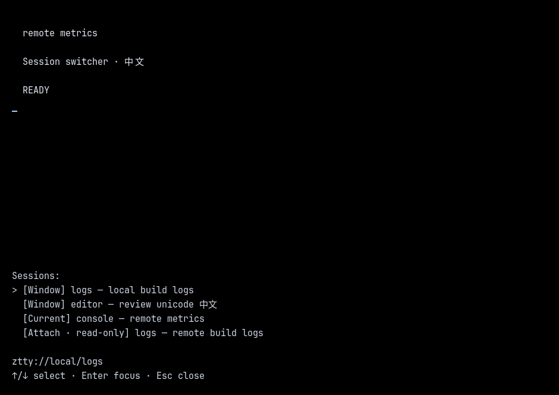
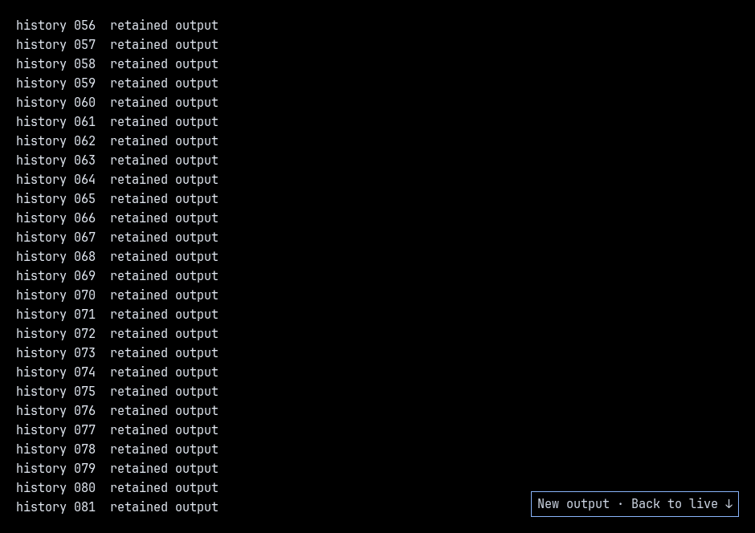
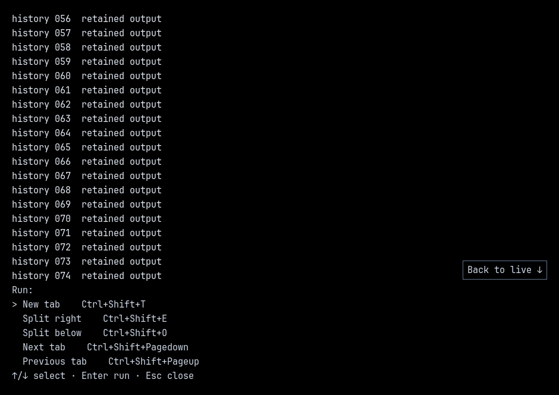

# ztty 体验迭代与发布验收记录

日期：2026-11-18。初始主体验收检查点：[`0563554b95dc6321f6e45bdd53659b6c85f90850`](https://github.com/LIghtJUNction/ztty/commit/0563554b95dc6321f6e45bdd53659b6c85f90850)；返回底部的追加验收绑定运行时 `3730b28` 和脚本 `aef55d9`。本记录覆盖逻辑行搜索与复制、会话切换、历史滚动、锁定键输入和安装升级，并按源码独立记录原生平台候选。

**当前发布状态：正式 `v0.3.0` 门禁失败，未发布、未安装。** tag 已固定在 `9b5497dac5402603ba0f633152fa4b07e6c11c9e`。同源运行的 Verify、Linux 两种架构、macOS 两种架构和 Windows x64 通过；Windows ARM 在原快速缩放恢复检查失败，Publish 被跳过，Release-by-tag API 返回 404。失败后的两个带 trace 诊断进程通过，不改变正式失败结论；修复后使用新 tag，旧 tag 保持不动。[正式运行与状态索引](measurements/experience-release-2026-11-18/formal-v0.3.0/index.json)

后续固定八次冷启动实验已在 Windows x64 第八次取得同进程失败现场：内部画布正确，窗口右侧仍为黑色，刷新 GDI 队列无效，正常补画后恢复。ARM 第四次完成全部像素检查后因临时目录仍被占用而失败。两项失败分别保留，尚未据此宣称发布修复已通过。[冷启动实验与原始快照](measurements/experience-release-2026-11-18/cold-44315250297/index.json)

本轮让终端里已经存在的内容和会话更容易继续使用。搜索可以跨屏幕自动折行，复制保留真正的文本边界；会话切换能找到其他窗口和隐藏标签里的既有 PTY，并保留输入所有权。Linux 本地工作区测试通过，开发机上的五套既有 GUI 检查通过，新增会话切换脚本修正后通过六组检查。新增行元数据曾导致核心微基准回退，定位并修正热路径后保留了全部对照样本；这些结果只用于评价该核心负载。[验收索引](measurements/experience-release-2026-11-18/summary.json) · [文件校验清单](measurements/experience-release-2026-11-18/manifest.json)

追加的 Linux 返回底部入口通过全部 18 组日常 GUI 检查，包含新输出到达、搜索／命令面板并存和只读观察视图。后续 `2ac46e2` 的 macOS 两种架构通过原生候选；Windows 的 `dc43870` 缩放恢复失败与 `8a2f4be` 子进程启动失败分别保留，均未记作通过。[追加源码与文件身份](measurements/experience-release-2026-11-18/scroll-prompt/source-binding.json) · [18 组原始记录](measurements/experience-release-2026-11-18/scroll-prompt/daily-workflow.json)

发布前复验进一步通过 Linux 六套 GUI 的 67 组检查，以及 Windows `3418b82` 双架构各 31 项基础、19 项工作区检查。Linux wrapper 的 `source_sha` 是测试检出的 `8a2f4be`，运行文件仍为 `3730b28` 构建、哈希为 `2a50377…` 的二进制；Windows 结果来自独立的原生候选。这些发布前记录与后续正式 tag 运行分别保留，不能用候选通过替换正式失败。[发布前证据索引](measurements/experience-release-2026-11-18/pre-release/index.json)

## 1. 固定源码与验收对象

表 1 将实现、测试脚本和运行二进制分别绑定到固定提交。不同来源的证据不能合并成对同一最终发行文件的通过结论。

| 对象 | 固定提交或文件身份 | 本记录中的用途 |
| --- | --- | --- |
| 迭代起点 | [`072111be0fb13062d2d5369ac4a5d58b64cfaa35`](https://github.com/LIghtJUNction/ztty/commit/072111be0fb13062d2d5369ac4a5d58b64cfaa35) | 已包含 POST SSE；核心性能对照起点 |
| 锁定键修复 | [`c76ca3cd47f50b1bb0ac96d9b11d4735bc141107`](https://github.com/LIghtJUNction/ztty/commit/c76ca3cd47f50b1bb0ac96d9b11d4735bc141107) | 传统模式静默，增强模式保留事件 |
| 搜索、复制、会话切换 | [`114ca5bb9fdcc2378eab6cdbbd2a995ddd8e1847`](https://github.com/LIghtJUNction/ztty/commit/114ca5bb9fdcc2378eab6cdbbd2a995ddd8e1847) | 主要体验改动；初次性能测量对象 |
| 安装升级 | [`a045871a76ff51c1acd29881ff280869e093efbb`](https://github.com/LIghtJUNction/ztty/commit/a045871a76ff51c1acd29881ff280869e093efbb) | 暂存校验、原子替换、回滚副本 |
| 核心热路径修复 | [`cfc7ae80e785e4d3de11ffa5e1fba3f63d158222`](https://github.com/LIghtJUNction/ztty/commit/cfc7ae80e785e4d3de11ffa5e1fba3f63d158222) | 开发机 Linux 候选的生产源码 |
| 初始 Linux 测试脚本 | `0563554b95dc6321f6e45bdd53659b6c85f90850` | 只修正会话切换的观测方式；工作区测试与 GUI 复验检查点 |
| Linux GUI／协议候选 | 728,232 字节；SHA-256 `c6e6a8105c30e9b16be7def46a558eb3aee6154c9539c0f74b3a6501698e3ae6` | 在云工作区构建，在 Linux x86_64 开发机运行 |
| 返回底部运行时 | [`3730b28a16f48b15809581213bccab284f6f4f22`](https://github.com/LIghtJUNction/ztty/commit/3730b28a16f48b15809581213bccab284f6f4f22) | 临时入口、到达标记和鼠标事件隔离；开发机构建并运行 |
| 返回底部验收脚本 | [`aef55d95747c38aad34d161043ad1b9c72127b44`](https://github.com/LIghtJUNction/ztty/commit/aef55d95747c38aad34d161043ad1b9c72127b44) | 18 组日常 GUI 检查；新剪贴板断言拒绝沿用旧值 |
| 返回底部测试二进制 | SHA-256 `2a50377a0aea0e53498f0e76c71d969f8dbe7f2585e15b24bc2530063ad4fada` | 本报告追加 GUI 结果所使用的文件，独立于前述 `cfc7ae8` 候选 |
| 完整 Linux GUI 测试检出 | `8a2f4bee22324685f2193e91a16744dda21d0df9` | 六套 wrapper 的源码身份；运行文件继续使用上一行的 `3730b28` 二进制 |
| Windows 完整原生候选 | [`3418b82dcfa1b9323379e36aec0f3926371b0eb6`](https://github.com/LIghtJUNction/ztty/commit/3418b82dcfa1b9323379e36aec0f3926371b0eb6) | 两个原生架构分别构建、运行和验收；各自二进制哈希保存在发布前索引与原始 JSON |
| 正式 `v0.3.0` tag | [`9b5497dac5402603ba0f633152fa4b07e6c11c9e`](https://github.com/LIghtJUNction/ztty/commit/9b5497dac5402603ba0f633152fa4b07e6c11c9e) | 运行 44309412482，`build_only=false`、`candidate_platform=all`；Windows ARM 失败导致整轮正式发布被阻止 |

Linux 候选的构建与运行环境记录在[二进制身份](measurements/experience-release-2026-11-18/linux/candidate-builder.json)和[原始 GUI 汇总](measurements/experience-release-2026-11-18/linux/linux-native.json)中。后者保留了首次执行的失败状态；会话切换的通过结论来自另存的[复验记录](measurements/experience-release-2026-11-18/linux/session-switcher-recheck.json)。

## 2. 用户可见变化与实现边界

### 2.1 搜索和复制按逻辑行工作

一段文字显示到窗口右边时，终端会自动换到下一屏幕行；程序主动输出换行符则表示真正的新行。本轮为这两种情况保存不同的行边界，使搜索和复制能还原前一种连续文本，同时保留后一种换行。例如，在四列窗口中输出 `abcdefgh`，搜索 `cdef` 可以跨两行命中；输出 `abcd\r\nefgh` 时，同一查询不会跨行拼接。[搜索用例](https://github.com/LIghtJUNction/ztty/blob/0563554b95dc6321f6e45bdd53659b6c85f90850/tests/search.rs) · [行边界实现](https://github.com/LIghtJUNction/ztty/blob/0563554b95dc6321f6e45bdd53659b6c85f90850/crates/zterm/src/terminal.rs)

搜索沿已有历史逐段扫描，额外匹配状态受 1,024 字节查询上限约束，不把全部历史复制成字符串。命中保存起止行和完整字符单元的位置，因此中文宽字、组合字符、上下文中的真实空格以及跨视口边界的高亮可以使用同一定位结果。宽字提前折行留下的填充空白不会进入搜索文本。下一项、上一项和循环导航继续按非重叠匹配的顺序工作。[搜索实现](https://github.com/LIghtJUNction/ztty/blob/0563554b95dc6321f6e45bdd53659b6c85f90850/src/search.rs)

复制搜索结果时会核对终端文本版本。新的 PTY 输出或实际尺寸变化会使旧命中失效；界面重新搜索当前查询后再复制，避免历史移动或屏幕被覆盖后复制到另一个位置。普通选区也使用共享的文本提取函数，跨自动折行时拼接，跨明确换行时保留换行，输出最多 4 MiB，并在完整字符单元边界停止。[界面接线](https://github.com/LIghtJUNction/ztty/blob/0563554b95dc6321f6e45bdd53659b6c85f90850/src/session.rs) · [共享选区](https://github.com/LIghtJUNction/ztty/blob/0563554b95dc6321f6e45bdd53659b6c85f90850/src/selection.rs)

行边界元数据随滚动、擦除、插删行、主备屏切换、尺寸变化及历史淘汰更新。历史的 8 MiB 预算计入行缓冲区容量和历史容器容量，其中包括新增元数据；单个 `Cell` 仍为 28 字节。实现沿用 `no_std` 与 `alloc`，没有为搜索引入 Rust 标准库依赖。窄化后已经不可见或被裁掉的列不会被当作完整连续文本拼接。相关约束由核心行边界、预算、搜索和选区测试覆盖。[核心测试](https://github.com/LIghtJUNction/ztty/blob/0563554b95dc6321f6e45bdd53659b6c85f90850/crates/zterm/src/wrap_tests.rs) · [预算测试](https://github.com/LIghtJUNction/ztty/blob/0563554b95dc6321f6e45bdd53659b6c85f90850/crates/zterm/src/terminal.rs) · [选区测试](https://github.com/LIghtJUNction/ztty/blob/0563554b95dc6321f6e45bdd53659b6c85f90850/tests/selection.rs)

图 1 是实际 X11 窗口截图。查询文本跨右边界显示为两段，高亮覆盖两段；完整复制与覆盖旧文本后的重新定位由同一 GUI 用例另行核对。

### 2.2 会话切换保留既有工作和输入所有权

会话列表支持按名称、标题和 URI 的多个词筛选，用方向键选择、Enter 执行、Esc 关闭。已有视图显示为切换或聚焦目标；未挂接的会话明确显示 Attach 及只读状态。聚焦隐藏标签或其他窗口时复用其原有工作区、视图和 PTY。输入过滤词和移动选择不会把按键发送给终端子进程。[界面与动作实现](https://github.com/LIghtJUNction/ztty/blob/0563554b95dc6321f6e45bdd53659b6c85f90850/src/session.rs) · [GUI 用例](https://github.com/LIghtJUNction/ztty/blob/0563554b95dc6321f6e45bdd53659b6c85f90850/tests/session_switcher.py)

列表中的操作按打开列表时显示的意图执行。如果原本可聚焦的目标后来已经脱离窗口，Enter 会提示重新打开列表，不会自动把 Focus 改成 Attach。代理拥有的后台 PTY 可以显式挂接为只读视图；从观察者视图执行挂接也保留只读约束，不夺取输入控制权、不偷偷改变 PTY 尺寸。复验逐项检查 PTY、视图、工作区、所有者和尺寸，并确认关闭新增只读视图后原进程仍在运行。[六组实际检查](measurements/experience-release-2026-11-18/linux/session-switcher-recheck.json)

图 2 是实际会话列表，底部显示当前选中 URI 和操作提示。

### 2.3 锁定键和安装升级

Caps Lock、Num Lock、Scroll Lock 在传统键盘模式下不再向子进程写入功能键序列。程序显式启用相应增强键盘事件后仍能收到锁定键事件，小键盘数字、Insert 语义和常用控制键映射继续保留。核心单元测试覆盖编码规则，真实 XTEST 输入检查覆盖 Num Lock、小键盘及增强报告路径。[输入修复](https://github.com/LIghtJUNction/ztty/commit/c76ca3cd47f50b1bb0ac96d9b11d4735bc141107) · [33 个输入向量／9 组检查](measurements/experience-release-2026-11-18/linux/keypad-input.json) · [当前候选输入复验](measurements/experience-release-2026-11-18/linux/input_gui.json)

安装器支持已构建本机可执行文件的 `--from-binary` 路径，也支持校验下载的 Linux Release。它先把文件写入目标目录内的临时文件，核对 SHA-256 并运行 `--version`，再通过同一文件系统内的重命名替换二进制。升级保留一个经过校验的 `ztty.previous`；相同文件重复安装不会覆盖更有用的旧回滚副本。桌面启动器使用安装后的绝对路径，避免 PATH 中的旧版本抢先运行。[安装实现](https://github.com/LIghtJUNction/ztty/blob/a045871a76ff51c1acd29881ff280869e093efbb/install.sh)

安装回归覆盖正在运行的 ELF 替换、重复安装、回滚、校验失败、错误版本、符号链接及含特殊字符的安装路径，开发机脚本退出码为 0。这里的原子性指单个文件的替换；二进制、桌面文件和回滚文件依次更新。本记录的测试结果不等同于用户设备已经安装，也没有把整个多文件升级描述为断电事务。[测试源码](https://github.com/LIghtJUNction/ztty/blob/a045871a76ff51c1acd29881ff280869e093efbb/tests/install_test.py) · [开发机回归退出状态](measurements/experience-release-2026-11-18/linux/regressions.json)

### 2.4 历史视图可以直接返回最新输出

用滚轮或 Shift+PageUp/PageDown 向上浏览后，右下角出现 **Back to live ↓**。点击入口即返回最新输出并隐藏入口，终端继续使用完整行数。浏览期间收到新的 PTY 输出时，当前阅读位置保持锚定，入口变为蓝边的 **New output · Back to live ↓**；返回底部会清除这次到达标记，再次上翻时使用普通提示。[视图实现](https://github.com/LIghtJUNction/ztty/blob/3730b28a16f48b15809581213bccab284f6f4f22/src/session.rs) · [入口绘制](https://github.com/LIghtJUNction/ztty/blob/3730b28a16f48b15809581213bccab284f6f4f22/src/x11.rs)

入口避让搜索行和完整命令面板，点击后保留它们的输入模式。只读观察视图可以执行同一操作，同时保留输入所有者、PTY 和尺寸。入口的按下、移动和松开由视图处理；真实 GUI 用例在应用开启鼠标报告时确认 PTY 输入字节没有增加。窄窗口逐级使用较短标签，空间不足时隐藏完整目标。[交互范围](daily-workflow.md#returning-to-live-output) · [原始检查和入口矩形](measurements/experience-release-2026-11-18/scroll-prompt/daily-workflow.json)

图 3 是新输出到达后的实际历史视图。图 4 保留打开的命令面板，入口位于面板上方。六张新截图全部保持原始像素，另有[普通入口](measurements/experience-release-2026-11-18/scroll-prompt/scrollback-return.png)、[返回后实时视图](measurements/experience-release-2026-11-18/scroll-prompt/scrollback-live.png)、[搜索并存](measurements/experience-release-2026-11-18/scroll-prompt/scrollback-search.png)和[只读观察视图](measurements/experience-release-2026-11-18/scroll-prompt/scrollback-observer.png)。

## 3. Linux 验收与测试脚本修正

表 2 的工作区结果来自 `0563554`，开发机 GUI 与协议结果来自表 1 中的 `cfc7ae8` 二进制。Linux 上的 Darwin spawn 用例明确跳过，未算入通过数量。

| 检查 | 实际结果 | 证据 |
| --- | --- | --- |
| Rust 工作区 | 264 项常规测试、6 项文档测试通过；自定义 SessionCore 程序另有 8 项检查通过，全部测试子进程已回收 | [摘要](measurements/experience-release-2026-11-18/linux/local-workspace-tests.json) · [完整日志](measurements/experience-release-2026-11-18/linux/local-workspace-tests.log) |
| 与本轮直接相关的 Rust 测试 | zterm 88、搜索 13、选区 5、输入 18，均包含在上述工作区数量中，不能重复相加 | 同一日志 |
| 既有五套 GUI | 工作区 17、日常流程 15、Sixel 10、输入 9 组、重绘 7 组通过；各套 wrapper 记录无遗留自有进程 | [首次 wrapper](measurements/experience-release-2026-11-18/linux/linux-native.json)及各套 JSON |
| 新会话切换复验 | 6 组通过，包含跨窗口聚焦、只读挂接、过期 Focus 拒绝、跨折行搜索复制和旧命中刷新 | [复验 JSON](measurements/experience-release-2026-11-18/linux/session-switcher-recheck.json) |
| 安装与 Bash 集成 | 两套脚本退出码为 0；Bash 的 11 项检查通过 | [退出状态](measurements/experience-release-2026-11-18/linux/regressions.json) · [Bash JSON](measurements/experience-release-2026-11-18/linux/bash-integration.json) |
| MCP 回归 | transport、sessions、security 三套退出码为 0；等待 13 组、POST SSE 7 组通过，均记录清理通过 | [退出状态](measurements/experience-release-2026-11-18/linux/regressions.json) · [等待 JSON](measurements/experience-release-2026-11-18/linux/mcp-wait.json) · [SSE JSON](measurements/experience-release-2026-11-18/linux/mcp-sse.json) |

首次 Linux wrapper 总体状态是失败，原因在新增测试脚本的观测方式。脚本完成前四组后，等待启动器日志出现过期 Focus 的错误信息；实际守护 broker 已将 stderr 重定向到 `/dev/null`，这个断言无法观察它要检查的事件。原始失败、错误字段和[失败截图](measurements/experience-release-2026-11-18/linux/screenshots/session-switcher-first-failure.png)均保留。[原始 wrapper](measurements/experience-release-2026-11-18/linux/linux-native.json) · [脚本修正提交](https://github.com/LIghtJUNction/ztty/commit/0563554b95dc6321f6e45bdd53659b6c85f90850)

修正后的脚本使用后续普通按键到达源 PTY 作为处理屏障，随即捕获实际错误提示，并逐项核对源会话和脱离目标的身份、进程、所有权、窗口、工作区及尺寸。它同时确认提示区域出现文字、列表区域恢复、目标未被隐式挂接。复验使用相同二进制哈希并通过六组检查；这次修正只改变测试脚本，没有对应的产品运行时代码修复。[复验状态及 143 个提示前景像素](measurements/experience-release-2026-11-18/linux/session-switcher-recheck.json) · [实际拒绝提示截图](measurements/experience-release-2026-11-18/linux/screenshots/stale-focus-rejected.png)

这些 GUI 检查运行在开发机的专属 Xvfb 中，使用真实 PTY、实际 X11 窗口像素回读和合成 XTEST 输入。它们覆盖指定软件路径，没有测量真实显示器扫描输出、物理键盘或 IME，也没有给出端到端输入呈现延迟。[环境与限制](measurements/experience-release-2026-11-18/linux/linux-native.json)

### 3.1 追加：返回底部的 18 组设备 GUI 复验

开发机使用表 1 的新二进制运行修订后的 `daily_workflow.py`，退出码为 0，18 组全部通过。原有 15 组继续执行，新增三组分别检查历史锚定与到达标记、搜索／面板并存、实际 `--observe` 重附后的只读行为。点击前后逐项比较输入所有者、只读状态、PTY PID 和行列数，并核对应用收到的完整输入字节。脚本通过自有 PTY 内的线程发出新输出，不向应用注入测试按键；沿用自有 Xvfb、进程与临时目录的清理路径。[原始 JSON](measurements/experience-release-2026-11-18/scroll-prompt/daily-workflow.json) · [完整日志](measurements/experience-release-2026-11-18/scroll-prompt/daily-workflow.log) · [设备运行摘要](measurements/experience-release-2026-11-18/scroll-prompt/summary.json)

原始报告中的 13 个源码哈希全部与固定脚本检查点 `aef55d9` 相符；其中运行时文件也与 `3730b28` 相符。六张新 PNG 的 SHA-256 与原始报告逐项一致。原始运行还生成四张既有流程截图，本次追加目录只复制六张新图，原始 JSON 的路径保留原样。[来源与校验方法](measurements/experience-release-2026-11-18/scroll-prompt/source-binding.json) · [总清单](measurements/experience-release-2026-11-18/manifest.json)

对保存 PNG 的独立解码显示，普通入口与新输出入口两张图的 26 行正文均含前景像素，正文区域逐像素相同；全图差异只位于入口矩形 `(661,612)–(920,644)`。面板图左侧正文的前 19 行也与普通历史图一致，底部七行由面板使用。该分析覆盖保存图像，不构成连续帧或物理显示器验收。[逐行像素与差异记录](measurements/experience-release-2026-11-18/scroll-prompt/pixel-review.json)

### 3.2 完整 Linux 本地门禁

开发机在固定源码 `8a2f4bee22324685f2193e91a16744dda21d0df9` 运行 `ZTTY_BARE_METAL=1 make check`，70.01 秒后退出 0，检查前后的 Git 提交一致。通过范围为 271 项普通 Rust 测试、6 项文档测试、独立 SessionCore runner 的 8 项实际 PTY 检查，以及严格工作区 Clippy、发行构建、生产依赖与符号审计、17 项安装回归、11 项 Bash 集成检查、MCP transport／sessions／security／wait／SSE 检查和 `x86_64-unknown-none` 可移植性编译。Darwin 原生用例明确跳过，未计入 Linux 通过数量；依赖 `zune-png` 的未来 Rust 兼容性提示保留在日志中。[固定源码与退出状态](measurements/experience-release-2026-11-18/scroll-prompt/full-check-8a.json) · [完整门禁日志](measurements/experience-release-2026-11-18/scroll-prompt/full-check-8a.log)

此前在 `3730b28` 启动的一次检查因开发机连接重建而中断，没有完成状态，未记为通过。该次的日志与中断记录仍保留。上述完整本地门禁和返回底部 GUI 结果分别绑定各自的源码与可执行文件；正式发布仍要求最终 tag 的 Verify 和六个原生架构任务。[中断记录](measurements/experience-release-2026-11-18/scroll-prompt/full-check-interrupted-3730.json) · [中断时日志](measurements/experience-release-2026-11-18/scroll-prompt/full-check-interrupted-3730.log)

### 3.3 完整 Linux GUI：67 组通过，运行文件保持固定

开发机在测试检出 `8a2f4bee22324685f2193e91a16744dda21d0df9` 运行完整六套 Xvfb GUI wrapper，所有组均通过。检查前后记录同一源码且无受跟踪文件改动；实际 ELF 的 SHA-256 前后均为 `2a50377a0aea0e53498f0e76c71d969f8dbe7f2585e15b24bc2530063ad4fada`，即此前 `3730b28` 的运行文件。这里的测试源码身份与二进制构建身份分别保留。[原始 wrapper](measurements/experience-release-2026-11-18/pre-release/linux/native.json) · [完整日志](measurements/experience-release-2026-11-18/pre-release/linux/native.log) · [来源说明](measurements/experience-release-2026-11-18/pre-release/index.json)

| 套件 | 通过组数 | wrapper 记录的 PNG 数 |
| --- | ---: | ---: |
| 工作区 | 17 | 2 |
| 日常流程与返回底部 | 18 | 10 |
| 会话切换 | 6 | 7 |
| Sixel | 10 | 1 |
| 输入 | 9 | 1 |
| 重绘 | 7 | 6 |
| 合计 | 67 | 27 |

各套件退出码均为 0，清理记录中的遗留自有 PID 列表均为空。27 张 PNG 的文件身份保存在原始 wrapper 中；本次发布前子目录复制报告与日志，实际图片归档范围仍以总清单为准。该运行覆盖原生 Linux x86_64 ELF、真实 PTY、专属 Xvfb 的窗口像素和合成 XTEST 输入，未增加物理显示延迟、原生 Wayland 或硬件输入的结论。[运行范围与文件身份](measurements/experience-release-2026-11-18/pre-release/linux/native.json) · [总清单](measurements/experience-release-2026-11-18/manifest.json)

## 4. 行元数据的性能回退、定位和修复

### 4.1 对照方法与发现

性能检查使用未修改的 `crates/zterm/examples/benchmark.rs`，比较 `072111be` 与 `114ca5bb`，再比较加入热路径修复的版本。每个版本使用隔离检出和构建目录，同一 Rust 1.100.0、Cargo 配置、依赖锁文件和负载；执行固定在同一共享 Linux 主机的 CPU 8。四个负载均为 120×32 单元，其中历史负载保留 2,048 行。[构建输入](measurements/experience-release-2026-11-18/performance/core-throughput-build-inputs.json) · [基准源码](https://github.com/LIghtJUNction/ztty/blob/072111be0fb13062d2d5369ac4a5d58b64cfaa35/crates/zterm/examples/benchmark.rs)

每个负载预热 4,096 次 feed，再运行七个各含 4,096 次 feed 的内部样本，由原 runner 输出中位数。每个版本再启动三个独立进程，最终顺序为 ABBAAB；所有进程结果保留，没有剔除慢样本。没有独占 CPU、锁定频率或清空缓存；runner 只输出内部七次的中位数，记录中保留的是外层进程输出，不是全部内部原始计时。[最终原始样本](measurements/experience-release-2026-11-18/performance/core-throughput-optimized-final.json)

初次 UX 版本相对于起点的吞吐中位数比为 ASCII 0.867、满历史 ASCII 0.898、SGR 0.939、Unicode 0.895。进一步检查发现，行元数据访问从单元索引反推物理行时引入动态整数除法，同时新增边界判断使 `overwrite_span` 不再被编译器内联。仅去除除法的中间版本改善了一部分负载，随后恢复该热函数内联，形成最终的小范围修复。元数据语义、字段、历史预算和单元布局没有改变。[首次样本](measurements/experience-release-2026-11-18/performance/core-throughput-072111be-114ca5bb.json) · [中间版本对照](measurements/experience-release-2026-11-18/performance/core-throughput-rowindex-diagnosis.json) · [汇编与修复记录](measurements/experience-release-2026-11-18/performance/core-throughput-summary.json)

### 4.2 最终配对结果

表 3 使用三个外层进程中位数的中位数，单位为 MiB/s，数值越大表示该核心负载处理越快。A 是 `072111be`，B 是 `114ca5bb` 加[完整修复补丁](measurements/experience-release-2026-11-18/performance/core-inline-optimization.patch)。该补丁的 `screen.rs` 与生产提交 `cfc7ae8` 及主体检查点逐字节一致，SHA-256 为 `b275499b99ebebffcf4d35dcae718179bad4b9992b9f1ae6f35e5344ad4c9d64`。测量对象是开发用核心基准程序，不能把它的文件哈希或吞吐当成已发布终端文件的测量值。

| 核心负载 | A：MiB/s | B：MiB/s | B/A 中位数比 | 三组配对比范围 | A/B 样本变异系数 |
| --- | ---: | ---: | ---: | ---: | ---: |
| ASCII | 239.454 | 250.514 | 1.046 | 0.947–1.148 | 11.47% / 2.18% |
| 满历史 ASCII | 175.331 | 188.319 | 1.074 | 0.951–1.550 | 22.41% / 1.68% |
| SGR | 183.975 | 180.544 | 0.981 | 0.981–1.034 | 3.91% / 2.21% |
| Unicode | 136.208 | 129.972 | 0.954 | 0.943–1.059 | 7.13% / 4.37% |

最终样本中，各负载的配对比都没有低于 0.90，中位数比为 0.954–1.074。这说明此前发现的明显热路径回退在这组复验中得到缓解；共享环境的波动仍然很大，尤其是满历史起点的 22.41% 变异系数。三个外层样本不足以建立普遍加速、性能等价或统计置信区间，表中大于 1 的比值也不应当用于宣传速度提升。[全部结果与限制](measurements/experience-release-2026-11-18/performance/core-throughput-summary.json)

基准记录的初始活动堆字节数从 107,676 变为 107,932，增加 256 字节，与该几何下 32 行的行元数据相符；各变体记录的稳态吞吐阶段堆分配次数均为 0。它没有测量完整进程 RSS/PSS、渲染资源或 GPU 显存。搜索、高亮、PTY、GUI、其他操作系统和其他终端软件均不在这次性能对照范围内。最终热路径修复另通过全部 88 项 zterm 测试。[内存及验证记录](measurements/experience-release-2026-11-18/performance/core-throughput-summary.json)

## 5. 原生候选：按源码和架构保留结果

### 5.1 macOS 后续双架构通过

前两次 macOS 运行使用 `build_only=true`、`candidate_platform=macos`；后续 `2ac46e2` 使用 `candidate_platform=all`。表中各项均为候选结果，不能替代正式 tag 的全平台发布门禁，也不能把一个架构或旧源码的成功推广到另一个架构或新源码。

| 运行与固定源码 | Apple Silicon | Intel | 证据 |
| --- | --- | --- | --- |
| [44293476047](https://github.com/LIghtJUNction/ztty/actions/runs/44293476047)，`a045871a76ff51c1acd29881ff280869e093efbb` | 8 项 spawn、24 项原生检查、13 个阶段通过；清单记录 10 张实际 PNG，应用退出 0、无遗留自有进程；候选接受 | spawn 阶段失败，后续原生窗口与打包跳过 | [运行索引](measurements/experience-release-2026-11-18/macos/run-44293476047/index.json) · [ARM 原生记录](measurements/experience-release-2026-11-18/macos/run-44293476047/ztty-macos-aarch64.native.json) · [Intel 失败摘要](measurements/experience-release-2026-11-18/macos/run-44293476047/macos-x86_64-summary.json) |
| [44295578969](https://github.com/LIghtJUNction/ztty/actions/runs/44295578969)，`bfd2732e238b3864e95e721e873f6c9498507bec` | spawn 的子进程清理断言失败：`waitpid(..., WNOHANG)` 返回 0；后续原生窗口与打包跳过 | 8 项 spawn 通过；实际像素的红色向量得到 `[255,0,3]`，预期 `[255,0,0]`，原生门禁失败，打包跳过 | [ARM 构建](measurements/experience-release-2026-11-18/macos/run-44295578969/ztty-macos-aarch64.build.json) · [清理断言日志](measurements/experience-release-2026-11-18/macos/run-44295578969/ztty-macos-aarch64.spawn.stderr.log) · [Intel 构建](measurements/experience-release-2026-11-18/macos/run-44295578969/ztty-macos-x86_64.build.json) · [像素向量](measurements/experience-release-2026-11-18/macos/run-44295578969/ztty-macos-x86_64.native.sixel_rgb_native_pixels.json) |
| [44298970562](https://github.com/LIghtJUNction/ztty/actions/runs/44298970562)，`2ac46e2fd6e6c373752221d5f1bed9923c67fc1a` | 8/8 spawn、24/24 原生检查、13 个阶段和 10 张 PNG；退出 0、无遗留自有进程；候选接受 | 同样通过 8/8、24/24、13 个阶段和 10 张 PNG；退出 0、无遗留自有进程；候选接受 | [ARM 审计摘要](measurements/experience-release-2026-11-18/scroll-prompt/native/run-44298970562/macos-aarch64-summary.json) · [Intel 审计摘要](measurements/experience-release-2026-11-18/scroll-prompt/native/run-44298970562/macos-x86_64-summary.json) |

第一次 ARM 记录实际使用 AppKit、Darwin PTY 和 ScreenCaptureKit 的 WindowServer 窗口回读，覆盖图像、窗口缩放／最小化恢复及 PTY 恢复等指定路径；其 IME／键盘字段仍为 `not_performed`。前两次的失败记录全部保留。后续修正包含 sRGB 窗口 backing，以及在创建 PTY／子进程前按有效用户身份检查 helper 的执行权限；后者保留检查与执行之间发生路径变化的边界。[ARM 原始范围](measurements/experience-release-2026-11-18/macos/run-44293476047/ztty-macos-aarch64.native.json) · [实现与原生复验边界](darwin-threaded-pty.md)

`2ac46e2` 的两个架构各自完成实际窗口缩放、最小化恢复和后续 PTY 恢复。保存 PNG 中的 20 个采样点分别重新读取后，与报告值的最大通道差均为 0。该结果建立此源码下的候选通过状态，IME／键盘输入与物理显示延迟仍在窗口门禁范围之外。[ARM 像素复核](measurements/experience-release-2026-11-18/scroll-prompt/native/run-44298970562/macos-aarch64-summary.json) · [Intel 像素复核](measurements/experience-release-2026-11-18/scroll-prompt/native/run-44298970562/macos-x86_64-summary.json)

### 5.2 Windows 历史失败分别保留

Windows 的以下三轮均为 `build_only=true`、`candidate_platform=windows`，运行于各自原生架构。它们在不同阶段失败，各轮没有到达的路径均不计为该轮通过。

| 固定源码与运行 | 两种架构的实际结果 | 未到达范围与清理 |
| --- | --- | --- |
| `dc43870ef2c8e3c54894d0124e47a23445a3c624`，[44300272576](https://github.com/LIghtJUNction/ztty/actions/runs/44300272576) | 各完成 22/30 基础检查、12 项可见像素检查后，快速缩小／恢复的 `resize_restores_visible_image` 失败；预期红色 `[255,0,0]`，x64 为 `[0,0,0]`，ARM64 为 `[20,20,20]` | 19 组工作区检查未开始；应用退出 0，自有 Job 为空，输入桌面／线程桌面恢复，句柄关闭 |
| `8a2f4bee22324685f2193e91a16744dda21d0df9`，[44303751871](https://github.com/LIghtJUNction/ztty/actions/runs/44303751871) | 各完成前 7 项检查后，重定向宿主路径中的 ConPTY 测试子进程在 `SetConsoleMode(stdin, 0x200)` 返回 `WinError 6`，没有到达 ready 标记 | 未到缩放、rapid/staged 诊断或工作区检查；无 PNG；应用退出 1，所有自有进程、Job、临时目录及桌面资源清理完成 |
| `e334cf7ed6bb757f092ebabdcae5291c0d54b03a`，[44305368950](https://github.com/LIghtJUNction/ztty/actions/runs/44305368950) | 重定向标准流回归及原 rapid 基础门禁各 31/31 通过；工作区通过前 5 项后，在 pane A 历史视图检查失败 | 完整工作区和候选总体仍为失败；该轮的基础通过保留为独立结果 |

第一轮的像素失败保留原样；第二轮是更早发生的启动问题，不能用来判定该版本的缩放恢复已通过，也不能把缺少截图写成视觉检查通过。第三轮进一步暴露历史视图问题，完整修正和后续通过记录见 5.3。启动失败的 stderr 保留原始字节。[缩放 x64](measurements/experience-release-2026-11-18/scroll-prompt/native/run-44300272576/windows-x86_64-summary.json) · [缩放 ARM64](measurements/experience-release-2026-11-18/scroll-prompt/native/run-44300272576/windows-aarch64-summary.json) · [启动 x64](measurements/experience-release-2026-11-18/scroll-prompt/native/run-44303751871/windows-x86_64-summary.json) · [启动 ARM64](measurements/experience-release-2026-11-18/scroll-prompt/native/run-44303751871/windows-aarch64-summary.json) · [x64 子进程 stderr](measurements/experience-release-2026-11-18/scroll-prompt/native/run-44303751871/windows-x86_64.runtime.log) · [ARM64 子进程 stderr](measurements/experience-release-2026-11-18/scroll-prompt/native/run-44303751871/windows-aarch64.runtime.log) · [e334 x64](measurements/experience-release-2026-11-18/pre-release/windows-e334/x86_64-summary.json) · [e334 ARM64](measurements/experience-release-2026-11-18/pre-release/windows-e334/aarch64-summary.json)

### 5.3 Windows 双架构完整候选通过

固定源码 `3418b82dcfa1b9323379e36aec0f3926371b0eb6` 的 [Windows 原生运行 44306719420](https://github.com/LIghtJUNction/ztty/actions/runs/44306719420)在 x64 和 ARM64 均被接受。运行使用 `build_only=true`、`candidate_platform=windows`。两种架构各通过 31 项基础检查、19 项工作区检查，基础可见像素检查 19 项，工作区像素组 12 组；各自记录 12 张 PNG。应用、工作区探针、Job 和桌面资源均完成清理。[x64 审计摘要](measurements/experience-release-2026-11-18/pre-release/windows-3418/x86_64-summary.json) · [ARM64 审计摘要](measurements/experience-release-2026-11-18/pre-release/windows-3418/aarch64-summary.json)

这次验收包含两项具体运行时修复。ConPTY 创建子进程时显式使用空的标准句柄槽，让伪控制台提供实际控制台句柄；重定向宿主的标准流不会被误用为子进程控制台。新增原生回归确认子进程的 stdin、stdout、stderr 都是有效控制台句柄，并以 0 退出。Windows 输入处理则只在编码结果非空时入队、返回底部并清除选区，因此静默的 Shift／Control 按下或松开不会撤销刚完成的历史滚动；真正的 Enter 输入仍会返回实时视图。两种架构的历史用例都记录静默修饰键保持历史、实际输入为 `0d` 后恢复实时像素。[ConPTY 实现](https://github.com/LIghtJUNction/ztty/blob/3418b82dcfa1b9323379e36aec0f3926371b0eb6/crates/zpty/src/windows.rs) · [Windows 输入实现](https://github.com/LIghtJUNction/ztty/blob/3418b82dcfa1b9323379e36aec0f3926371b0eb6/src/platform/windows.rs) · [x64 原始原生记录](measurements/experience-release-2026-11-18/pre-release/windows-3418/x86_64.native.json) · [ARM64 原始原生记录](measurements/experience-release-2026-11-18/pre-release/windows-3418/aarch64.native.json)

工作区检查还覆盖独立 ConPTY、真实键盘焦点、非活动 pane 鼠标处理、选区隔离、第三个 pane、最大化恢复、尺寸同步、交换、隐藏标签输出、标签切回以及关闭时兄弟会话的生存。两种架构均完成全部 19 项，原始检查与像素向量单独保留。[x64 工作区记录](measurements/experience-release-2026-11-18/pre-release/windows-3418/x86_64.native.workspace.json) · [ARM64 工作区记录](measurements/experience-release-2026-11-18/pre-release/windows-3418/aarch64.native.workspace.json)

基础门禁使用原来的快速缩小／恢复路径，没有启用运行时 trace，也没有增加逐阶段 ACK。`e334` 和 `3418` 在两种架构上各连续通过该路径，保存的恢复前后图像相同，红色采样为 `[255,0,0]`。这些是候选的实际通过结果；`dc43870` 历史黑带的最初机制尚未经过独立复现并确定，因此不把本轮通过写成该历史问题的因果闭环或所有调度时序的保证。正式发布仍需最终 tag 自身的六个原生架构门禁。[原 rapid 结果和边界](measurements/experience-release-2026-11-18/pre-release/index.json)

### 5.4 正式 v0.3.0 门禁失败

正式 tag `v0.3.0` 指向 `9b5497dac5402603ba0f633152fa4b07e6c11c9e`，annotated tag 对象为 `9317806ac9b098c772f1a05514d222942268d2d5`。[运行 44309412482](https://github.com/LIghtJUNction/ztty/actions/runs/44309412482)由 tag push 触发，使用 `build_only=false`、`candidate_platform=all`，这是 attempt 1。GitHub 最终记录整轮 `failure`、Publish `skipped`；这些状态与各平台子任务的通过结果同时保留。[API 读回记录](measurements/experience-release-2026-11-18/formal-v0.3.0/github-status.json)

| 正式门禁 | 固定 tag 的实际结果 | 直接证据 |
| --- | --- | --- |
| Verify | 通过：271 项普通 Rust、6 个独立 doctest、8 项独立 SessionCore、17 项安装器、11 项 Bash、MCP 各套及 12 组 GUI smoke；格式、严格 Clippy、release build 和 no_std 检查通过 | [审计摘要](measurements/experience-release-2026-11-18/formal-v0.3.0/verify-summary.json) |
| Linux x86_64、ARM64 | 各通过六套 GUI、67 组检查、27 张 PNG；前后检出干净，运行文件与打包文件身份相符，清理完成 | [x86_64](measurements/experience-release-2026-11-18/formal-v0.3.0/linux-x86_64-summary.json) · [ARM64](measurements/experience-release-2026-11-18/formal-v0.3.0/linux-aarch64-summary.json) |
| macOS Intel、Apple Silicon | 各通过 8 项 spawn、24 项 native、13 阶段，记录 10 张 PNG；无残留自有进程，ad-hoc 签名通过，未 notarize | [Intel](measurements/experience-release-2026-11-18/formal-v0.3.0/macos-x86_64-summary.json) · [Apple Silicon](measurements/experience-release-2026-11-18/formal-v0.3.0/macos-aarch64-summary.json) |
| Windows x64 | 原 rapid 路径关闭 trace，31 项基础及 19 项工作区全部通过；进程、Job 和桌面清理通过 | [x64 摘要](measurements/experience-release-2026-11-18/formal-v0.3.0/windows-x86_64-summary.json) |
| Windows ARM64 | 原 rapid 路径关闭 trace，23 项基础通过后在缩放恢复检查失败；工作区未进入；清理通过 | [ARM64 摘要](measurements/experience-release-2026-11-18/formal-v0.3.0/windows-aarch64-summary.json) |

Verify 中同一组六个 doctest 执行了两遍，按六个独立用例计数；Darwin 的 Linux 本地跳过项不算通过。Verify 没有上传独立 artifact，其摘要来自任务日志，不能声称 GUI smoke 另有独立的二进制哈希记录。正式 Linux 的六套检查分别为 17、18、6、10、9、7 组，各架构 47 个原始证据文件及 27 张 PNG 已核对大小与哈希。正式 x86_64 可执行文件 SHA-256 为 `4b9e2f354dc09cc32641b75bcd0238f14a2886074bfa66e091b992103ea38586`，ARM64 为 `700b154987505b2a44b8e98805f5debb212f64e5d890e149a0ab6b54074097e5`，均由当前 tag 构建；第 3.3 节使用的 `3730b28` 开发机文件保持独立身份。[Verify 范围](measurements/experience-release-2026-11-18/formal-v0.3.0/verify-summary.json) · [正式平台索引](measurements/experience-release-2026-11-18/formal-v0.3.0/index.json)

Windows ARM 的失败检查为 `resize_restores_visible_image`。窗口已恢复到 180×190 client 像素，但 `(175, 28)` 的实际采样在 10 秒等待结束时仍为 `[20,20,20]`，期望值为红色 `[255,0,0]`。原始记录的 `runtime_trace_enabled=false`、`resize_path=rapid`，23 项基础检查已经通过，后续基础检查与全部工作区检查未完成。应用退出、临时目录删除、Job 清空和桌面恢复均成功。保留的 621 字节 PNG 是该原始失败的恢复帧，未修改图像内容。[原始 native JSON](measurements/experience-release-2026-11-18/formal-v0.3.0/windows-aarch64/ztty-windows-aarch64.native.json)

原进程 PID 为 8344。失败后分别新建 PID 5644 和 7884，启用运行时 trace，运行 rapid 与 staged 诊断；两者各通过 31 项基础检查并清理自身资源。诊断 JSON 自身未重复写入 source SHA 或二进制哈希，其来源由正式原始报告的 `diagnostic_retries`、同一个已校验 artifact 和相同可执行路径绑定。这两个进程不是对原失败进程的恢复，也没有使正式门禁转为通过；启用 trace 后的成功不足以确定未启用 trace 时的失败原因。原 rapid 历史问题的因果边界继续保留，不在本报告推断根因。[rapid 原始诊断](measurements/experience-release-2026-11-18/formal-v0.3.0/windows-aarch64/ztty-windows-aarch64.native.resize-rapid-diagnostic.json) · [rapid trace](measurements/experience-release-2026-11-18/formal-v0.3.0/windows-aarch64/ztty-windows-aarch64.native.resize-rapid-diagnostic.runtime.log) · [staged 原始诊断](measurements/experience-release-2026-11-18/formal-v0.3.0/windows-aarch64/ztty-windows-aarch64.native.resize-staged-diagnostic.json) · [staged trace](measurements/experience-release-2026-11-18/formal-v0.3.0/windows-aarch64/ztty-windows-aarch64.native.resize-staged-diagnostic.runtime.log)

### 5.5 固定八次冷启动捕获同进程显示故障

候选源码 `504fa770a97069e32bed4d8f45616066d5c4dbc5` 在 [44315250297](https://github.com/LIghtJUNction/ztty/actions/runs/44315250297) 要求每个 Windows 架构顺序完成八次独立冷启动。每次完整运行原 31 项检查和额外 10 轮快速缩放；前一进程及其目录清理完成后才启动下一次。任何失败立即停止剩余冷启动和工作区检查。原始报告按字节保留，最终检查重新读取报告并核对源码、二进制、所属桌面和 SHA-256；原采样、窗口参数、像素阈值和 180 秒总时限保持不变。[实验索引与文件身份](measurements/experience-release-2026-11-18/cold-44315250297/index.json)

| 架构 | 实际结果 | 原始证据 |
| --- | --- | --- |
| Windows x64 | 前七次各通过 31 项和 10 轮缩放；第八次在原缩放恢复检查失败，此前通过 23 项，未进入额外缩放或工作区检查；所有进程与目录清理通过 | [独立审计](measurements/experience-release-2026-11-18/cold-44315250297/windows-x86_64-summary.json) · [第八次原始报告](measurements/experience-release-2026-11-18/cold-44315250297/windows-x86_64/ztty-windows-x86_64.native.cold-08.json) |
| Windows ARM64 | 前三次完整通过；第四次完成 31 项和 10 轮缩放，主进程退出码为 0，但删除临时目录遇到文件占用，整体保持失败；第五至八次及工作区未启动 | [独立审计](measurements/experience-release-2026-11-18/cold-44315250297/windows-aarch64-summary.json) · [第四次原始报告](measurements/experience-release-2026-11-18/cold-44315250297/windows-aarch64/ztty-windows-aarch64.native.cold-04.json) |

x64 第八次的原失败进程为 PID `8576`、HWND `2294132`。超时后的快照显示，client、surface、selected bitmap 均为 `180×190`，终端与 PTY 均为 `20×10`，CPU 像素及 source DIB 在 `(175,28)` 为红色；窗口 ClientDC 与 ScreenDC 却同时为黑色。待处理尺寸、dirty 和 full redraw 标记均已清除，最后一次 paint 记录全幅区域且 BitBlt 返回成功。显式 GdiFlush 前后窗口没有变化；随后单独请求正常失效化并经消息泵补画，同一点才恢复为红色。这将本次问题缩小到窗口画面提交与补画的边界，尚不能确认自然重入或某一种窗口管理事件就是根因。[同进程原始快照](measurements/experience-release-2026-11-18/cold-44315250297/windows-x86_64/ztty-windows-x86_64.native.cold-08.post-failure.json)

原失败 PNG 与 flush 后 PNG 完全相同；补画后的 PNG 与缩放前正确画面完全相同。x64 的 251 张 PNG、390 个缩放采样点，以及 ARM 的 140 张 PNG、220 个缩放采样点均已独立核对。原失败画面的右侧分界为 `144+8=152` 像素，作为窗口尺寸与边框相关的线索保留。诊断补画的恢复不改变原失败结论，也没有使这轮候选获得发布或安装资格。[缩放前](measurements/experience-release-2026-11-18/cold-44315250297/windows-x86_64/ztty-windows-x86_64.native.cold-08.resize-before.png) · [原始失败](measurements/experience-release-2026-11-18/cold-44315250297/windows-x86_64/ztty-windows-x86_64.native.cold-08.resize-restored.png) · [诊断补画后](measurements/experience-release-2026-11-18/cold-44315250297/windows-x86_64/ztty-windows-x86_64.native.cold-08.post-repaint.png)

### 5.6 补画契约候选仍失败，排除本次重入并验证清理恢复

源码 `04cfd7bb9a516fe7914dc34daff380fa4c232cf2` 补齐了被可变借用保护拒绝的补画请求，并在绘制前处理已排队的尺寸变化。它同时对 Windows 临时目录的共享冲突增加 2 秒有界等待。新候选 [44317542062](https://github.com/LIghtJUNction/ztty/actions/runs/44317542062) 中，x64 前两次冷启动完整通过，第三次在原快速缩放恢复处失败；ARM 前六次完整通过，第七次在同一检查失败。两侧均在失败前通过 23 项，未进入该次额外缩放和后续工作区检查。[两架构证据索引](measurements/experience-release-2026-11-18/presentation-44317542062/index.json)

两个原失败进程的 `deferred_paints` 都为 0，待处理补画标记也为 false，说明本次失败没有经历 guard 拒绝的绘制。内部画布、终端尺寸和图像像素仍正确，显式 flush 仍不能恢复窗口，正常补画后恢复。此前补齐的重入契约因此不能被写成本次实际故障的直接原因。下一项生产候选调整 Windows 在真实尺寸变化时保存、回贴旧客户端像素的策略，仍需独立原生验收。[x64 原始快照](measurements/experience-release-2026-11-18/presentation-44317542062/windows-x86_64/ztty-windows-x86_64.native.cold-03.post-failure.json) · [ARM 原始快照](measurements/experience-release-2026-11-18/presentation-44317542062/windows-aarch64/ztty-windows-aarch64.native.cold-07.post-failure.json)

ARM 第七次在主进程退出码为 0 后真实遇到 `winerror=32` 的临时文件占用，第二次删除在 0.055527 秒后成功，首次异常仍保存在报告中。所有已启动进程、临时目录、Job 和桌面均完成清理；像素失败保持 `passed=false`。这验证了测试脚本能等待本次短暂锁释放，不构成对生产子进程生命周期的额外修复声明。[ARM 清理与原失败报告](measurements/experience-release-2026-11-18/presentation-44317542062/windows-aarch64/ztty-windows-aarch64.native.cold-07.json) · [x64 审计](measurements/experience-release-2026-11-18/presentation-44317542062/windows-x86_64/summary.json) · [ARM 审计](measurements/experience-release-2026-11-18/presentation-44317542062/windows-aarch64/summary.json)

### 5.7 NOCOPYBITS 与背靠背缩放候选仍在原检查失败

源码 `65dcd2ce3e69a4cbadcb98c7d9e08f431962270f` 的 [Windows 候选运行 44320248994](https://github.com/LIghtJUNction/ztty/actions/runs/44320248994)在 x64 和 ARM64 都失败。该候选包含生产策略 `7098ee9`：仅在真实外框尺寸变化、且请求未指定 `NOSIZE` 或 `NOREDRAW` 时设置 `SWP_NOCOPYBITS`，请求 Windows 不保留旧客户端像素。两侧首先失败的仍是原来的 `resize_restores_visible_image` 像素断言，因此本次结果不是新增验证字段导致的契约拒绝。[生产策略源码](https://github.com/LIghtJUNction/ztty/blob/7098ee9bf53e44b7d4d8af7e9e5c9786a5967df7/src/platform/windows.rs) · [本轮证据索引](measurements/experience-release-2026-11-18/burst-44320248994/index.json)

新增背靠背检查用于覆盖缩小后尚未采样就立即恢复的请求顺序。原 31 项和额外 10 轮快速缩放保持不变；每次冷启动随后再要求 10 轮连续的缩小／恢复调用。测试发出的两次 `SetWindowPos` 都使用 `0x16`，中间不查询窗口、不截图、不做 PTY 往返或等待，恢复后仍按原来的红色像素、每通道误差不超过 1 和 10 秒时限判断。八次冷启动中的每份报告都必须同时满足 `31+10+10`，任何失败停止剩余冷启动和工作区检查，180 秒总期限不变。[固定源码中的验收路径](https://github.com/LIghtJUNction/ztty/blob/65dcd2ce3e69a4cbadcb98c7d9e08f431962270f/tests/windows_native.py) · [逐份报告约束](https://github.com/LIghtJUNction/ztty/blob/65dcd2ce3e69a4cbadcb98c7d9e08f431962270f/tests/windows_desktop.py)

| 架构 | 已完成的完整冷启动 | 首个失败及停止范围 | 直接证据 |
| --- | --- | --- | --- |
| Windows x64 | 第一次通过原 31 项、warm 10 轮和背靠背 10 轮 | 第二次在原缩放恢复处失败，此前通过 23 项；实际 `[0,0,0]`，期望 `[255,0,0]`；该次 warm／背靠背均未开始，第三至八次及工作区未执行 | [审计摘要](measurements/experience-release-2026-11-18/burst-44320248994/windows-x86_64/summary.json) · [第二次原始报告](measurements/experience-release-2026-11-18/burst-44320248994/windows-x86_64/ztty-windows-x86_64.native.cold-02.json) |
| Windows ARM64 | 前四次各通过原 31 项、warm 10 轮和背靠背 10 轮 | 第五次在同一原检查失败，此前通过 23 项；实际 `[20,20,20]`，期望 `[255,0,0]`；该次 warm／背靠背均未开始，第六至八次及工作区未执行 | [审计摘要](measurements/experience-release-2026-11-18/burst-44320248994/windows-aarch64/summary.json) · [第五次原始报告](measurements/experience-release-2026-11-18/burst-44320248994/windows-aarch64/ztty-windows-aarch64.native.cold-05.json) |

两个失败进程的内部画布仍正确，窗口采样却没有显示对应像素。x64 的 PID 为 `8384`，ARM64 为 `7744`；快照中的 client、surface 和 selected bitmap 都是 `180×190`，终端与 PTY 都是 `20×10`，CPU 与 source DIB 在 `(175,28)` 都为红色。两侧 `deferred_paints=0`，补画和尺寸 pending 标记均为 false；显式 GdiFlush 后 target DC 与 ScreenDC 仍分别为黑色或灰色，经正常消息泵补画后才恢复红色。原失败帧与 flush 后帧字节相同，补画后的帧与缩放前正确帧字节相同，诊断恢复没有改变原失败结论。[x64 同进程快照](measurements/experience-release-2026-11-18/burst-44320248994/windows-x86_64/ztty-windows-x86_64.native.cold-02.post-failure.json) · [ARM64 同进程快照](measurements/experience-release-2026-11-18/burst-44320248994/windows-aarch64/ztty-windows-aarch64.native.cold-05.post-failure.json)

本轮证据只能说明当前 NOCOPYBITS 策略候选没有消除该故障。快照没有记录该策略分支的命中次数、最终 `WINDOWPOS` flags 或 Windows 内部的像素保存／回贴顺序，因此不能据此认定 Windows 忽略了标志，也不能把旧像素回贴写成已经证实的根因。x64 的 51 张 PNG、80 个缩放采样点和 ARM64 的 186 张 PNG、305 个缩放采样点均已独立校验；每侧唯一不符预期的采样点都是该次原检查的恢复红色点。精简归档保留了两架构的构建记录、原始失败报告、快照和三个阶段的 PNG，其余原始文件仍由已核验的 artifact 与逐份哈希索引绑定。[x64 文件身份](measurements/experience-release-2026-11-18/burst-44320248994/windows-x86_64/evidence-index.json) · [ARM64 文件身份](measurements/experience-release-2026-11-18/burst-44320248994/windows-aarch64/evidence-index.json)

本轮七个已启动应用进程及其临时目录都完成清理，目录均在第一次尝试中实际删除，外层 Job 清空且桌面恢复；两个 worker 分别在 12.749 秒和 17.944 秒以退出码 1 结束。本轮使用 `build_only=true`、`candidate_platform=windows`，没有取得发布或设备安装资格；正式 `v0.3.0` tag 和此前失败记录保持不变。[本轮范围与清理结果](measurements/experience-release-2026-11-18/burst-44320248994/index.json)

### 5.8 绘制诊断补齐了标志与裁剪证据，候选仍失败

源码 `03053f794e3d765f24d8fbd29292f91517ab2574` 的 [Windows 诊断运行 44323138525](https://github.com/LIghtJUNction/ztty/actions/runs/44323138525)在双架构再次失败。本轮显式设置 `windows_paint_diagnostics=true`，构建、每份原始报告和同进程快照均记录 `paint_diagnostics_enabled=true`；它在 `BitBlt` 后、`EndPaint` 前增加 `GetClipBox` 和 `GetDCOrgEx` 两次查询，用于记录目标绘制区域及原点。`runtime_trace_enabled=false` 只表示另一路逐帧 trace 关闭，不表示本轮没有额外查询。查询可能改变 GDI 时序，因此本轮所有成功冷启动和诊断恢复都不计入普通发布验收。[固定诊断源码](https://github.com/LIghtJUNction/ztty/blob/03053f794e3d765f24d8fbd29292f91517ab2574/src/platform/windows.rs) · [诊断范围与结果](measurements/experience-release-2026-11-18/paint-diagnostics-44323138525/index.json)

本轮保持原 31 项、warm 10 轮、背靠背 10 轮和八次冷启动要求，两侧最先失败的仍是原 `resize_restores_visible_image` 像素断言。此前完整通过的冷启动仅说明对应进程执行了所有检查；任一失败仍停止后续冷启动和工作区验收，不能以较早成功覆盖失败。[x64 原始失败报告](measurements/experience-release-2026-11-18/paint-diagnostics-44323138525/windows-x86_64/ztty-windows-x86_64.native.cold-03.json) · [ARM64 原始失败报告](measurements/experience-release-2026-11-18/paint-diagnostics-44323138525/windows-aarch64/ztty-windows-aarch64.native.cold-06.json)

| 架构 | 完整执行的冷启动 | 原检查失败与停止范围 | 图像校验 |
| --- | --- | --- | --- |
| Windows x64 | 前两次各通过 `31+10+10` | 第三次通过 23 项后失败，恢复点实际 `[0,0,0]`；该次 warm／背靠背为 0，第四至八次及工作区未执行 | 96 张 PNG、155 个缩放采样点；154 点精确符合预期，唯一失败为原恢复红色点。[摘要](measurements/experience-release-2026-11-18/paint-diagnostics-44323138525/windows-x86_64/summary.json) |
| Windows ARM64 | 前五次各通过 `31+10+10` | 第六次通过 23 项后失败，恢复点实际 `[20,20,20]`；该次 warm／背靠背为 0，第七至八次及工作区未执行 | 231 张 PNG、380 个缩放采样点；379 点精确符合预期，唯一失败为原恢复红色点。[摘要](measurements/experience-release-2026-11-18/paint-diagnostics-44323138525/windows-aarch64/summary.json) |

新增记录证明，这两个失败现场的恢复请求确实携带了 `SWP_NOCOPYBITS`。`WM_WINDOWPOSCHANGING` 收到的 flags 为 `0x16`，提交值为 `0x116`，随后 `WM_WINDOWPOSCHANGED` 报告 `0x1116`，其中 `0x100` 仍然存在。两侧最后一次 paint 均记录 `BitBlt` 返回 1，紧随其后的目标 clip type 为 2、范围为 `[0,0,180,190]`，DC 原点为 `[40,63]`，与恢复后的客户端区域及屏幕位置一致。这些记录排除了该次恢复请求未携带标志、或最后一次查询仍得到缩小后的目标裁剪区域这两种解释；它们没有观察系统内部如何处理旧像素。[x64 快照](measurements/experience-release-2026-11-18/paint-diagnostics-44323138525/windows-x86_64/ztty-windows-x86_64.native.cold-03.post-failure.json) · [ARM64 快照](measurements/experience-release-2026-11-18/paint-diagnostics-44323138525/windows-aarch64/ztty-windows-aarch64.native.cold-06.post-failure.json)

消息记录进一步缩小了可见时序范围。两侧最近一次已记录的默认过程退出序号均为 205，最后一次 paint 的开始／结束序号为 210／211，快照序号为 212；该次 paint 的 `default_message=0`、`default_depth=0`。失败进程的 `deferred_paints=0`，没有记录到因 App 可变借用守卫而拒绝的 `WM_PAINT`。这些数据支持“最后一次 paint 位于已记录的默认过程嵌套范围之外”，但记录只保留六类消息的最近阶段，不是完整事件轨迹，也不能证明另一线程的 `SetWindowPos` 已经返回，或系统 backing surface、合成和内部复制已经结束。[两侧时序及结论边界](measurements/experience-release-2026-11-18/paint-diagnostics-44323138525/index.json)

失败后的快照仍显示应用画布正确、窗口画面错误。x64 PID 为 `6564`，ARM64 PID 为 `2724`；两侧 client、surface 和 selected bitmap 均为 `180×190`，终端与 PTY 均为 `20×10`，尺寸、补画及脏标记均为 false。CPU／source DIB 在 `(175,28)` 的红色是在原检查已经失败后采得，不能倒推最后一次 `BitBlt` 当时的源或目标像素。此后显式 GdiFlush 仍未恢复窗口；经正常消息泵补画后才显示红色。每侧原失败帧与 flush 后帧字节相同，补画帧与缩放前正确帧字节相同，原失败结论始终保留。[x64 三阶段文件身份](measurements/experience-release-2026-11-18/paint-diagnostics-44323138525/windows-x86_64/evidence-index.json) · [ARM64 三阶段文件身份](measurements/experience-release-2026-11-18/paint-diagnostics-44323138525/windows-aarch64/evidence-index.json)

本轮九个已启动应用进程均退出，九个临时目录均在首试中实际删除，外层 Job 清空且桌面恢复；x64 和 ARM64 worker 分别在 14.208 秒、20.105 秒以退出码 1 结束。归档绑定了源码、原始 artifact 和二进制哈希，并逐字保留两架构的构建记录、原始失败报告、快照和三个阶段的 PNG。本轮仍是 `build_only=true` 的诊断候选，没有取得发布或设备安装资格，也没有证明内部呈现故障的最终根因。[本轮清理、身份与交付范围](measurements/experience-release-2026-11-18/paint-diagnostics-44323138525/index.json)

### 5.9 移除主动同步绘制后，原首进程仍失败

源码 `f10e0daaae4ad611d79f21ca1d3788725b1043f5` 的 [Windows 候选运行 44324788860](https://github.com/LIghtJUNction/ztty/actions/runs/44324788860)仍在双架构失败。该候选仅移除主循环中无条件执行的 `UpdateWindow` 调用及其未使用的 FFI 声明，保留 `InvalidateRect`、正常消息派发和原有等待／唤醒路径。本轮额外绘制查询关闭，全部原始及诊断进程均记录 `paint_diagnostics_enabled=false`；两个原验收进程也均为 `runtime_trace_enabled=false`。因此这次失败直接说明，单独移除该同步绘制调用没有消除原故障。[固定生产修改](https://github.com/LIghtJUNction/ztty/commit/f10e0daaae4ad611d79f21ca1d3788725b1043f5) · [本轮范围与结果](measurements/experience-release-2026-11-18/queued-paint-44324788860/index.json)

两侧第一个原验收进程都在通过 23 项后，于 `resize_restores_visible_image` 失败。原 `31+10+10` 和八次冷启动要求保持不变，但本轮每侧完整冷启动完成数均为 `0/8`，原进程的 warm／背靠背检查未开始，后续冷启动和工作区也未进入。原进程清理后各执行了两个既有的独立 trace 诊断；这些进程的结果不能替代已经固定的原失败。[x64 原始报告](measurements/experience-release-2026-11-18/queued-paint-44324788860/windows-x86_64/ztty-windows-x86_64.native.json) · [ARM64 原始报告](measurements/experience-release-2026-11-18/queued-paint-44324788860/windows-aarch64/ztty-windows-aarch64.native.json)

| 架构 | 原首进程，trace 关闭 | 独立 rapid + trace | 独立 staged + trace |
| --- | --- | --- | --- |
| Windows x64 | 23 项后恢复点失败，实际 `[0,0,0]`，期望 `[255,0,0]` | `31+10+10` 通过，仅供诊断 | `31+10+10` 通过，仅供诊断。[摘要](measurements/experience-release-2026-11-18/queued-paint-44324788860/windows-x86_64/summary.json) |
| Windows ARM64 | 23 项后同点失败，实际 `[20,20,20]`，期望 `[255,0,0]` | `31+10+10` 通过，仅供诊断 | 基础 31 项通过；随后第 1 轮 warm 恢复点失败，warm 完成 0、背靠背未开始。[摘要](measurements/experience-release-2026-11-18/queued-paint-44324788860/windows-aarch64/summary.json) |

ARM64 的 staged 诊断必须按阶段解释。它的基础缩放确实取得缩小后 16 列、恢复后 20 列的子进程尺寸记录和前端 query ACK，基础 31 项随后全部通过。失败发生在接下来的第 1 轮快速 warm，而这一轮的三个阶段没有尺寸／query ACK 字段；不能把这个失败改写成带 ACK 的基础 staged 检查失败。原始 staged 诊断报告的哈希由本轮 `build.files` 绑定，精简索引保留其失败阶段和独立进程身份。[ARM64 诊断报告索引](measurements/experience-release-2026-11-18/queued-paint-44324788860/windows-aarch64/evidence-index.json)

两个原失败快照仍显示最终尺寸已经进入应用模型。x64 PID 为 `8220`，ARM64 PID 为 `9320`；两侧 client、surface 和 selected bitmap 均为 `180×190`，终端与 PTY 均为 `20×10`，尺寸、补画和脏标记为 false，`deferred_paints=0`。内存记录中的 flags 仍为 `0x16 → 0x116 → 0x1116`，最近默认过程退出序号为 205，最后 paint 为 210／211，快照为 212。不过本轮 `last_paint.target_after_blit=null`，没有取得最后一次 `BitBlt` 紧随其后的目标 clip、原点或像素；上一源码的额外查询结果不能代替本轮观测。[x64 同进程快照](measurements/experience-release-2026-11-18/queued-paint-44324788860/windows-x86_64/ztty-windows-x86_64.native.post-failure.json) · [ARM64 同进程快照](measurements/experience-release-2026-11-18/queued-paint-44324788860/windows-aarch64/ztty-windows-aarch64.native.post-failure.json)

失败后的 CPU／source DIB 红色仍不能证明最后一次复制当时的像素状态。两侧显式 GdiFlush 后窗口保持黑色或灰色，经正常消息泵补画后才恢复红色；原失败 PNG 与 flush 后 PNG 字节一致，补画 PNG 与缩放前正确 PNG 字节一致。本轮据此保留“移除 UpdateWindow 未消除故障”的结论，继续不推断另一线程 `SetWindowPos` 的返回时刻、系统 backing surface／内部复制顺序或最终呈现根因。[x64 原始帧身份](measurements/experience-release-2026-11-18/queued-paint-44324788860/windows-x86_64/evidence-index.json) · [ARM64 原始帧身份](measurements/experience-release-2026-11-18/queued-paint-44324788860/windows-aarch64/evidence-index.json)

本轮已核对 x64 的 96 张 PNG、157 个窗口采样，以及 ARM64 的 61 张 PNG、94 个窗口采样；采样计数包含独立诊断和失败后观察，不等于通过的检查数。两个原验收进程及四个独立诊断进程均退出，六个临时目录均首试实际删除，外层 Job 清空且桌面恢复；worker 分别在 19.127 秒和 26.636 秒以退出码 1 结束。精简归档的原始字节、artifact、源码和二进制哈希已绑定。本轮依然没有取得发布或设备安装资格，正式 `v0.3.0` 失败记录保持不变。[本轮身份、清理与交付边界](measurements/experience-release-2026-11-18/queued-paint-44324788860/index.json)

## 6. 发布与设备安装状态

本节按正式失败后的实际状态更新。`v0.3.0` tag 保持固定，源码和历史失败证据继续可追溯；修复后的发布使用新 tag，并重新通过该 tag 的完整门禁。下列未执行动作不能用已有候选或单个平台通过替代。[正式状态索引](measurements/experience-release-2026-11-18/formal-v0.3.0/index.json)

| 交付项 | 当前状态 | 后续完成所需记录 |
| --- | --- | --- |
| `v0.3.0` tag | 已创建，固定到 `9b5497d`，保持不动 | 新修复另建版本 tag；不重指旧 tag |
| 正式平台验收 | Verify、Linux 双架构、macOS 双架构和 Windows x64 通过；Windows ARM 失败 | 修复后新 tag 的全套同源门禁及原始证据 |
| 正式 Release | 未创建；Publish 被跳过；2026-11-18 21:11:00 Asia/Taipei (13:11:00 UTC) 的 by-tag API 返回 404 | 新 tag 的 Release URL、正式资产和校验记录 |
| 用户设备安装 | 未执行本次正式版本安装 | 安装绝对路径、实际 `--version`、二进制 SHA-256、启动器目标 |
| 回滚与既有会话 | 未执行本次正式版本的设备验收 | `ztty.previous` 身份与校验、既有进程／会话的保留情况 |

## 7. 仍然存在的范围限制

Linux 会话切换、返回底部和多工作区体验的实测结论限于本报告列出的 X11 路径。Windows Tabs／Splits 的指定路径已在 `3418b82` 通过双架构 19 项原生工作区检查；macOS 工作区界面及 macOS／Windows 的共享会话、搜索和命令面板仍有缺口。共享文本提取函数在源码上接入三个前端，并不自动证明三个平台的真实剪贴板与输入路径都已经验收。原生 Wayland、硬件 GPU／VRAM、物理输入矩阵、IME 和端到端延迟继续需要独立证据。Apple Developer ID／notarization 与 Windows 签名也不由本次候选记录提供。[架构范围](architecture.md) · [原生候选与剩余门禁](native-candidates-2026-11-18.md) · [已有性能口径](performance.md)

搜索目前是有长度上限的字面查询，命中计数仍需扫描保留的历史；可见高亮有时需要回溯到一条很长的逻辑行开头，才能保持非重叠匹配顺序。没有整份历史字符串副本有助于控制临时内存，但不构成搜索耗时的常数上界。本轮没有给这部分新增交互延迟承诺。[搜索算法及边界](https://github.com/LIghtJUNction/ztty/blob/0563554b95dc6321f6e45bdd53659b6c85f90850/src/search.rs)

## 8. 结论与证据核对

表 4 对主要结论逐项标明依据；原始 JSON 中的时间用于记录具体执行，不自动作为性能结论。所有复制的文件和派生索引均在[manifest](measurements/experience-release-2026-11-18/manifest.json)中列出来源、字节数与 SHA-256。JSON 内保留的原机器路径可能指向未复制的日志或图片，实际归档范围以该清单为准。

| 结论 | 直接证据 | 状态 |
| --- | --- | --- |
| 自动折行可搜索、完整复制，并拒绝过期命中 | 13 项搜索测试、5 项选区测试、六组 GUI 的最后一组 | 在所列 Linux／核心范围内支持 |
| 会话切换保留所有权，过期 Focus 不隐式挂接 | GUI 的身份、输入、尺寸和实际提示断言 | 复验支持；首轮脚本失败已保留 |
| 上翻后可点击返回，新输出有提示，观察者不夺权 | 18 组日常 GUI 原始记录、源码绑定和六张新 PNG | 在所列 Linux 候选范围内支持 |
| Linux 六套 GUI 全部执行，Windows 两项具体修复完成原生回归 | Linux 67 组 wrapper；Windows 双架构 31 项基础、19 项工作区记录 | 分别支持所列测试检出／运行文件及 Windows 固定候选 |
| 新元数据的明显热路径回退得到缓解 | 原始对照、中间版本、最终配对、汇编与源码身份 | 仅支持所测核心负载，不支持普遍加速 |
| 安装路径先校验再替换并保留回滚 | 安装回归源码和开发机退出状态 | 支持脚本验收；设备实际安装待记录 |
| 原生候选和正式交付已分开 | 历史候选、正式 tag 全平台摘要、ARM 原始失败与两个独立诊断、API 状态 | `v0.3.0` 正式门禁失败，Publish 跳过，Release 404，未安装；旧 tag 保持不动 |

### 五项自审

| 维度 | 核对问题与处理 |
| --- | --- |
| 改进价值 | 是否对应用户可见的问题？已用跨折行文本、既有会话聚焦、返回最新输出、锁定键和运行中升级说明具体行为。 |
| 表达清晰 | 是否混淆物理行与逻辑行、候选与发布、脚本与运行时修复？各自定义并固定源码，首轮失败单独说明。 |
| 实验证据 | 是否把波动当作加速？保留全部外层样本、比值范围、变异系数和最初回退，限制结论到同一核心负载。 |
| 验收完整性 | 是否遗漏失败或平台缺口？保留早期 macOS 的架构差异、Windows 历史失败及原 rapid 根因边界、首次 Linux 脚本失败、Darwin 本地跳过；追加正式 ARM 失败，不用后续 trace 成功替换。 |
| 设计边界 | 是否把有界内存理解为无成本，或把单文件原子替换理解为多文件事务？明确历史预算、查询上限、扫描代价和安装原子性的范围。 |
