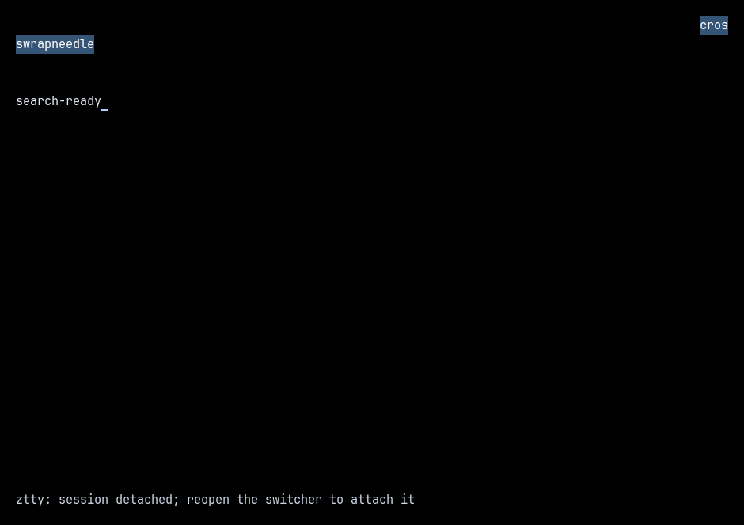

# ztty 体验迭代与发布验收记录

日期：2026-11-18。主体验收检查点：[`0563554b95dc6321f6e45bdd53659b6c85f90850`](https://github.com/LIghtJUNction/ztty/commit/0563554b95dc6321f6e45bdd53659b6c85f90850)。本记录覆盖逻辑行搜索与复制、会话切换、锁定键输入和安装升级，并独立记录 macOS 候选门禁。正式 Release 与用户设备安装尚待完成，见文末状态表。

本轮让终端里已经存在的内容和会话更容易继续使用。搜索可以跨屏幕自动折行，复制保留真正的文本边界；会话切换能找到其他窗口和隐藏标签里的既有 PTY，并保留输入所有权。Linux 本地工作区测试通过，开发机上的五套既有 GUI 检查通过，新增会话切换脚本修正后通过六组检查。新增行元数据曾导致核心微基准回退，定位并修正热路径后保留了全部对照样本；这些结果只用于评价该核心负载。[验收索引](measurements/experience-release-2026-11-18/summary.json) · [文件校验清单](measurements/experience-release-2026-11-18/manifest.json)

## 1. 固定源码与验收对象

表 1 将实现、测试脚本和运行二进制分别绑定到固定提交。不同来源的证据不能合并成对同一最终发行文件的通过结论。

| 对象 | 固定提交或文件身份 | 本记录中的用途 |
| --- | --- | --- |
| 迭代起点 | [`072111be0fb13062d2d5369ac4a5d58b64cfaa35`](https://github.com/LIghtJUNction/ztty/commit/072111be0fb13062d2d5369ac4a5d58b64cfaa35) | 已包含 POST SSE；核心性能对照起点 |
| 锁定键修复 | [`c76ca3cd47f50b1bb0ac96d9b11d4735bc141107`](https://github.com/LIghtJUNction/ztty/commit/c76ca3cd47f50b1bb0ac96d9b11d4735bc141107) | 传统模式静默，增强模式保留事件 |
| 搜索、复制、会话切换 | [`114ca5bb9fdcc2378eab6cdbbd2a995ddd8e1847`](https://github.com/LIghtJUNction/ztty/commit/114ca5bb9fdcc2378eab6cdbbd2a995ddd8e1847) | 主要体验改动；初次性能测量对象 |
| 安装升级 | [`a045871a76ff51c1acd29881ff280869e093efbb`](https://github.com/LIghtJUNction/ztty/commit/a045871a76ff51c1acd29881ff280869e093efbb) | 暂存校验、原子替换、回滚副本 |
| 核心热路径修复 | [`cfc7ae80e785e4d3de11ffa5e1fba3f63d158222`](https://github.com/LIghtJUNction/ztty/commit/cfc7ae80e785e4d3de11ffa5e1fba3f63d158222) | 开发机 Linux 候选的生产源码 |
| 最终 Linux 测试脚本 | `0563554b95dc6321f6e45bdd53659b6c85f90850` | 只修正会话切换的观测方式；工作区测试与 GUI 复验检查点 |
| Linux GUI／协议候选 | 728,232 字节；SHA-256 `c6e6a8105c30e9b16be7def46a558eb3aee6154c9539c0f74b3a6501698e3ae6` | 在云工作区构建，在 Linux x86_64 开发机运行 |

Linux 候选的构建与运行环境记录在[二进制身份](measurements/experience-release-2026-11-18/linux/candidate-builder.json)和[原始 GUI 汇总](measurements/experience-release-2026-11-18/linux/linux-native.json)中。后者保留了首次执行的失败状态；会话切换的通过结论来自另存的[复验记录](measurements/experience-release-2026-11-18/linux/session-switcher-recheck.json)。

## 2. 用户可见变化与实现边界

### 2.1 搜索和复制按逻辑行工作

一段文字显示到窗口右边时，终端会自动换到下一屏幕行；程序主动输出换行符则表示真正的新行。本轮为这两种情况保存不同的行边界，使搜索和复制能还原前一种连续文本，同时保留后一种换行。例如，在四列窗口中输出 `abcdefgh`，搜索 `cdef` 可以跨两行命中；输出 `abcd\r\nefgh` 时，同一查询不会跨行拼接。[搜索用例](https://github.com/LIghtJUNction/ztty/blob/0563554b95dc6321f6e45bdd53659b6c85f90850/tests/search.rs) · [行边界实现](https://github.com/LIghtJUNction/ztty/blob/0563554b95dc6321f6e45bdd53659b6c85f90850/crates/zterm/src/terminal.rs)

搜索沿已有历史逐段扫描，额外匹配状态受 1,024 字节查询上限约束，不把全部历史复制成字符串。命中保存起止行和完整字符单元的位置，因此中文宽字、组合字符、上下文中的真实空格以及跨视口边界的高亮可以使用同一定位结果。宽字提前折行留下的填充空白不会进入搜索文本。下一项、上一项和循环导航继续按非重叠匹配的顺序工作。[搜索实现](https://github.com/LIghtJUNction/ztty/blob/0563554b95dc6321f6e45bdd53659b6c85f90850/src/search.rs)

复制搜索结果时会核对终端文本版本。新的 PTY 输出或实际尺寸变化会使旧命中失效；界面重新搜索当前查询后再复制，避免历史移动或屏幕被覆盖后复制到另一个位置。普通选区也使用共享的文本提取函数，跨自动折行时拼接，跨明确换行时保留换行，输出最多 4 MiB，并在完整字符单元边界停止。[界面接线](https://github.com/LIghtJUNction/ztty/blob/0563554b95dc6321f6e45bdd53659b6c85f90850/src/session.rs) · [共享选区](https://github.com/LIghtJUNction/ztty/blob/0563554b95dc6321f6e45bdd53659b6c85f90850/src/selection.rs)

行边界元数据随滚动、擦除、插删行、主备屏切换、尺寸变化及历史淘汰更新。历史的 8 MiB 预算计入行缓冲区容量和历史容器容量，其中包括新增元数据；单个 `Cell` 仍为 28 字节。实现沿用 `no_std` 与 `alloc`，没有为搜索引入 Rust 标准库依赖。窄化后已经不可见或被裁掉的列不会被当作完整连续文本拼接。相关约束由核心行边界、预算、搜索和选区测试覆盖。[核心测试](https://github.com/LIghtJUNction/ztty/blob/0563554b95dc6321f6e45bdd53659b6c85f90850/crates/zterm/src/wrap_tests.rs) · [预算测试](https://github.com/LIghtJUNction/ztty/blob/0563554b95dc6321f6e45bdd53659b6c85f90850/crates/zterm/src/terminal.rs) · [选区测试](https://github.com/LIghtJUNction/ztty/blob/0563554b95dc6321f6e45bdd53659b6c85f90850/tests/selection.rs)

图 1 是实际 X11 窗口截图。查询文本跨右边界显示为两段，高亮覆盖两段；完整复制与覆盖旧文本后的重新定位由同一 GUI 用例另行核对。

### 2.2 会话切换保留既有工作和输入所有权

会话列表支持按名称、标题和 URI 的多个词筛选，用方向键选择、Enter 执行、Esc 关闭。已有视图显示为切换或聚焦目标；未挂接的会话明确显示 Attach 及只读状态。聚焦隐藏标签或其他窗口时复用其原有工作区、视图和 PTY。输入过滤词和移动选择不会把按键发送给终端子进程。[界面与动作实现](https://github.com/LIghtJUNction/ztty/blob/0563554b95dc6321f6e45bdd53659b6c85f90850/src/session.rs) · [GUI 用例](https://github.com/LIghtJUNction/ztty/blob/0563554b95dc6321f6e45bdd53659b6c85f90850/tests/session_switcher.py)

列表中的操作按打开列表时显示的意图执行。如果原本可聚焦的目标后来已经脱离窗口，Enter 会提示重新打开列表，不会自动把 Focus 改成 Attach。代理拥有的后台 PTY 可以显式挂接为只读视图；从观察者视图执行挂接也保留只读约束，不夺取输入控制权、不偷偷改变 PTY 尺寸。复验逐项检查 PTY、视图、工作区、所有者和尺寸，并确认关闭新增只读视图后原进程仍在运行。[六组实际检查](measurements/experience-release-2026-11-18/linux/session-switcher-recheck.json)

图 2 是实际会话列表，底部显示当前选中 URI 和操作提示。

### 2.3 锁定键和安装升级

Caps Lock、Num Lock、Scroll Lock 在传统键盘模式下不再向子进程写入功能键序列。程序显式启用相应增强键盘事件后仍能收到锁定键事件，小键盘数字、Insert 语义和常用控制键映射继续保留。核心单元测试覆盖编码规则，真实 XTEST 输入检查覆盖 Num Lock、小键盘及增强报告路径。[输入修复](https://github.com/LIghtJUNction/ztty/commit/c76ca3cd47f50b1bb0ac96d9b11d4735bc141107) · [33 个输入向量／9 组检查](measurements/experience-release-2026-11-18/linux/keypad-input.json) · [当前候选输入复验](measurements/experience-release-2026-11-18/linux/input_gui.json)

安装器支持已构建本机可执行文件的 `--from-binary` 路径，也支持校验下载的 Linux Release。它先把文件写入目标目录内的临时文件，核对 SHA-256 并运行 `--version`，再通过同一文件系统内的重命名替换二进制。升级保留一个经过校验的 `ztty.previous`；相同文件重复安装不会覆盖更有用的旧回滚副本。桌面启动器使用安装后的绝对路径，避免 PATH 中的旧版本抢先运行。[安装实现](https://github.com/LIghtJUNction/ztty/blob/a045871a76ff51c1acd29881ff280869e093efbb/install.sh)

安装回归覆盖正在运行的 ELF 替换、重复安装、回滚、校验失败、错误版本、符号链接及含特殊字符的安装路径，开发机脚本退出码为 0。这里的原子性指单个文件的替换；二进制、桌面文件和回滚文件依次更新。本记录的测试结果不等同于用户设备已经安装，也没有把整个多文件升级描述为断电事务。[测试源码](https://github.com/LIghtJUNction/ztty/blob/a045871a76ff51c1acd29881ff280869e093efbb/tests/install_test.py) · [开发机回归退出状态](measurements/experience-release-2026-11-18/linux/regressions.json)

## 3. Linux 验收与测试脚本修正

表 2 的工作区结果来自 `0563554`，开发机 GUI 与协议结果来自表 1 中的 `cfc7ae8` 二进制。Linux 上的 Darwin spawn 用例明确跳过，未算入通过数量。

| 检查 | 实际结果 | 证据 |
| --- | --- | --- |
| Rust 工作区 | 264 项常规测试、6 项文档测试通过；自定义 SessionCore 程序另有 8 项检查通过，全部测试子进程已回收 | [摘要](measurements/experience-release-2026-11-18/linux/local-workspace-tests.json) · [完整日志](measurements/experience-release-2026-11-18/linux/local-workspace-tests.log) |
| 与本轮直接相关的 Rust 测试 | zterm 88、搜索 13、选区 5、输入 18，均包含在上述工作区数量中，不能重复相加 | 同一日志 |
| 既有五套 GUI | 工作区 17、日常流程 15、Sixel 10、输入 9 组、重绘 7 组通过；各套 wrapper 记录无遗留自有进程 | [首次 wrapper](measurements/experience-release-2026-11-18/linux/linux-native.json)及各套 JSON |
| 新会话切换复验 | 6 组通过，包含跨窗口聚焦、只读挂接、过期 Focus 拒绝、跨折行搜索复制和旧命中刷新 | [复验 JSON](measurements/experience-release-2026-11-18/linux/session-switcher-recheck.json) |
| 安装与 Bash 集成 | 两套脚本退出码为 0；Bash 的 11 项检查通过 | [退出状态](measurements/experience-release-2026-11-18/linux/regressions.json) · [Bash JSON](measurements/experience-release-2026-11-18/linux/bash-integration.json) |
| MCP 回归 | transport、sessions、security 三套退出码为 0；等待 13 组、POST SSE 7 组通过，均记录清理通过 | [退出状态](measurements/experience-release-2026-11-18/linux/regressions.json) · [等待 JSON](measurements/experience-release-2026-11-18/linux/mcp-wait.json) · [SSE JSON](measurements/experience-release-2026-11-18/linux/mcp-sse.json) |

首次 Linux wrapper 总体状态是失败，原因在新增测试脚本的观测方式。脚本完成前四组后，等待启动器日志出现过期 Focus 的错误信息；实际守护 broker 已将 stderr 重定向到 `/dev/null`，这个断言无法观察它要检查的事件。原始失败、错误字段和[失败截图](measurements/experience-release-2026-11-18/linux/screenshots/session-switcher-first-failure.png)均保留。[原始 wrapper](measurements/experience-release-2026-11-18/linux/linux-native.json) · [脚本修正提交](https://github.com/LIghtJUNction/ztty/commit/0563554b95dc6321f6e45bdd53659b6c85f90850)

修正后的脚本使用后续普通按键到达源 PTY 作为处理屏障，随即捕获实际错误提示，并逐项核对源会话和脱离目标的身份、进程、所有权、窗口、工作区及尺寸。它同时确认提示区域出现文字、列表区域恢复、目标未被隐式挂接。复验使用相同二进制哈希并通过六组检查；这次修正只改变测试脚本，没有对应的产品运行时代码修复。[复验状态及 143 个提示前景像素](measurements/experience-release-2026-11-18/linux/session-switcher-recheck.json) · [实际拒绝提示截图](measurements/experience-release-2026-11-18/linux/screenshots/stale-focus-rejected.png)

这些 GUI 检查运行在开发机的专属 Xvfb 中，使用真实 PTY、实际 X11 窗口像素回读和合成 XTEST 输入。它们覆盖指定软件路径，没有测量真实显示器扫描输出、物理键盘或 IME，也没有给出端到端输入呈现延迟。[环境与限制](measurements/experience-release-2026-11-18/linux/linux-native.json)

## 4. 行元数据的性能回退、定位和修复

### 4.1 对照方法与发现

性能检查使用未修改的 `crates/zterm/examples/benchmark.rs`，比较 `072111be` 与 `114ca5bb`，再比较加入热路径修复的版本。每个版本使用隔离检出和构建目录，同一 Rust 1.100.0、Cargo 配置、依赖锁文件和负载；执行固定在同一共享 Linux 主机的 CPU 8。四个负载均为 120×32 单元，其中历史负载保留 2,048 行。[构建输入](measurements/experience-release-2026-11-18/performance/core-throughput-build-inputs.json) · [基准源码](https://github.com/LIghtJUNction/ztty/blob/072111be0fb13062d2d5369ac4a5d58b64cfaa35/crates/zterm/examples/benchmark.rs)

每个负载预热 4,096 次 feed，再运行七个各含 4,096 次 feed 的内部样本，由原 runner 输出中位数。每个版本再启动三个独立进程，最终顺序为 ABBAAB；所有进程结果保留，没有剔除慢样本。没有独占 CPU、锁定频率或清空缓存；runner 只输出内部七次的中位数，记录中保留的是外层进程输出，不是全部内部原始计时。[最终原始样本](measurements/experience-release-2026-11-18/performance/core-throughput-optimized-final.json)

初次 UX 版本相对于起点的吞吐中位数比为 ASCII 0.867、满历史 ASCII 0.898、SGR 0.939、Unicode 0.895。进一步检查发现，行元数据访问从单元索引反推物理行时引入动态整数除法，同时新增边界判断使 `overwrite_span` 不再被编译器内联。仅去除除法的中间版本改善了一部分负载，随后恢复该热函数内联，形成最终的小范围修复。元数据语义、字段、历史预算和单元布局没有改变。[首次样本](measurements/experience-release-2026-11-18/performance/core-throughput-072111be-114ca5bb.json) · [中间版本对照](measurements/experience-release-2026-11-18/performance/core-throughput-rowindex-diagnosis.json) · [汇编与修复记录](measurements/experience-release-2026-11-18/performance/core-throughput-summary.json)

### 4.2 最终配对结果

表 3 使用三个外层进程中位数的中位数，单位为 MiB/s，数值越大表示该核心负载处理越快。A 是 `072111be`，B 是 `114ca5bb` 加[完整修复补丁](measurements/experience-release-2026-11-18/performance/core-inline-optimization.patch)。该补丁的 `screen.rs` 与生产提交 `cfc7ae8` 及主体检查点逐字节一致，SHA-256 为 `b275499b99ebebffcf4d35dcae718179bad4b9992b9f1ae6f35e5344ad4c9d64`。测量对象是开发用核心基准程序，不能把它的文件哈希或吞吐当成已发布终端文件的测量值。

| 核心负载 | A：MiB/s | B：MiB/s | B/A 中位数比 | 三组配对比范围 | A/B 样本变异系数 |
| --- | ---: | ---: | ---: | ---: | ---: |
| ASCII | 239.454 | 250.514 | 1.046 | 0.947–1.148 | 11.47% / 2.18% |
| 满历史 ASCII | 175.331 | 188.319 | 1.074 | 0.951–1.550 | 22.41% / 1.68% |
| SGR | 183.975 | 180.544 | 0.981 | 0.981–1.034 | 3.91% / 2.21% |
| Unicode | 136.208 | 129.972 | 0.954 | 0.943–1.059 | 7.13% / 4.37% |

最终样本中，各负载的配对比都没有低于 0.90，中位数比为 0.954–1.074。这说明此前发现的明显热路径回退在这组复验中得到缓解；共享环境的波动仍然很大，尤其是满历史起点的 22.41% 变异系数。三个外层样本不足以建立普遍加速、性能等价或统计置信区间，表中大于 1 的比值也不应当用于宣传速度提升。[全部结果与限制](measurements/experience-release-2026-11-18/performance/core-throughput-summary.json)

基准记录的初始活动堆字节数从 107,676 变为 107,932，增加 256 字节，与该几何下 32 行的行元数据相符；各变体记录的稳态吞吐阶段堆分配次数均为 0。它没有测量完整进程 RSS/PSS、渲染资源或 GPU 显存。搜索、高亮、PTY、GUI、其他操作系统和其他终端软件均不在这次性能对照范围内。最终热路径修复另通过全部 88 项 zterm 测试。[内存及验证记录](measurements/experience-release-2026-11-18/performance/core-throughput-summary.json)

## 5. macOS 候选：按源码和架构保留结果

两次 macOS 运行均为 `build_only=true`、`candidate_platform=macos`。它们不能替代正式 tag 的全平台发布门禁，也不能把一个架构或旧源码的成功推广到另一个架构或新源码。

| 运行与固定源码 | Apple Silicon | Intel | 证据 |
| --- | --- | --- | --- |
| [44293476047](https://github.com/LIghtJUNction/ztty/actions/runs/44293476047)，`a045871a76ff51c1acd29881ff280869e093efbb` | 8 项 spawn、24 项原生检查、13 个阶段通过；清单记录 10 张实际 PNG，应用退出 0、无遗留自有进程；候选接受 | spawn 阶段失败，后续原生窗口与打包跳过 | [运行索引](measurements/experience-release-2026-11-18/macos/run-44293476047/index.json) · [ARM 原生记录](measurements/experience-release-2026-11-18/macos/run-44293476047/ztty-macos-aarch64.native.json) · [Intel 失败摘要](measurements/experience-release-2026-11-18/macos/run-44293476047/macos-x86_64-summary.json) |
| [44295578969](https://github.com/LIghtJUNction/ztty/actions/runs/44295578969)，`bfd2732e238b3864e95e721e873f6c9498507bec` | spawn 的子进程清理断言失败：`waitpid(..., WNOHANG)` 返回 0；后续原生窗口与打包跳过 | 8 项 spawn 通过；实际像素的红色向量得到 `[255,0,3]`，预期 `[255,0,0]`，原生门禁失败，打包跳过 | [ARM 构建](measurements/experience-release-2026-11-18/macos/run-44295578969/ztty-macos-aarch64.build.json) · [清理断言日志](measurements/experience-release-2026-11-18/macos/run-44295578969/ztty-macos-aarch64.spawn.stderr.log) · [Intel 构建](measurements/experience-release-2026-11-18/macos/run-44295578969/ztty-macos-x86_64.build.json) · [像素向量](measurements/experience-release-2026-11-18/macos/run-44295578969/ztty-macos-x86_64.native.sixel_rgb_native_pixels.json) |

第一次 ARM 记录实际使用 AppKit、Darwin PTY 和 ScreenCaptureKit 的 WindowServer 窗口回读，覆盖图像、窗口缩放／最小化恢复及 PTY 恢复等指定路径；其 IME／键盘字段仍为 `not_performed`。第二次运行保留了新的失败，不能用第一次成功覆盖它。后续色彩格式与子进程问题的修正、复验以及最终发行源码的验收状态应追加到下面的状态区。[ARM 范围](measurements/experience-release-2026-11-18/macos/run-44293476047/ztty-macos-aarch64.native.json) · [历史原生候选记录](native-candidates-2026-11-18.md)

## 6. 发布与设备安装状态

本节为后续实际动作保留可更新位置。主体报告和原始失败证据按固定检查点保留；完成后应增加具体源码、tag、资产校验和安装记录，不把“候选测试通过”改写成“已发布／已安装”。

| 交付项 | 当前状态 | 完成时需要补入的记录 |
| --- | --- | --- |
| 后续 macOS 修正与复验 | 待完成 | 固定提交、运行 ID、两个架构分别的 spawn／native／package 结果 |
| 正式 Release | 待完成 | tag、发行源码、Release URL、最终平台门禁与资产校验记录 |
| 用户设备安装 | 待完成 | 安装绝对路径、实际 `--version`、二进制 SHA-256、启动器目标 |
| 回滚与既有会话 | 待完成设备实测记录 | `ztty.previous` 身份与校验、既有进程／会话的保留情况 |

## 7. 仍然存在的范围限制

Linux 会话切换和多工作区体验的实测结论限于本报告列出的 X11 路径。macOS／Windows 的原生共享会话、Tabs／Splits 与同等交互仍有缺口；共享文本提取函数在源码上接入三个前端，并不自动证明三个平台的真实剪贴板与输入路径都已经验收。原生 Wayland、硬件 GPU／VRAM、物理输入矩阵、IME 和端到端延迟继续需要独立证据。Apple Developer ID／notarization 与 Windows 签名也不由本次候选记录提供。[架构范围](architecture.md) · [原生候选与剩余门禁](native-candidates-2026-11-18.md) · [已有性能口径](performance.md)

搜索目前是有长度上限的字面查询，命中计数仍需扫描保留的历史；可见高亮有时需要回溯到一条很长的逻辑行开头，才能保持非重叠匹配顺序。没有整份历史字符串副本有助于控制临时内存，但不构成搜索耗时的常数上界。本轮没有给这部分新增交互延迟承诺。[搜索算法及边界](https://github.com/LIghtJUNction/ztty/blob/0563554b95dc6321f6e45bdd53659b6c85f90850/src/search.rs)

## 8. 结论与证据核对

表 4 对主要结论逐项标明依据；原始 JSON 中的时间用于记录具体执行，不自动作为性能结论。所有复制的文件和派生索引均在[manifest](measurements/experience-release-2026-11-18/manifest.json)中列出来源、字节数与 SHA-256。JSON 内保留的原机器路径可能指向未复制的日志或图片，实际归档范围以该清单为准。

| 结论 | 直接证据 | 状态 |
| --- | --- | --- |
| 自动折行可搜索、完整复制，并拒绝过期命中 | 13 项搜索测试、5 项选区测试、六组 GUI 的最后一组 | 在所列 Linux／核心范围内支持 |
| 会话切换保留所有权，过期 Focus 不隐式挂接 | GUI 的身份、输入、尺寸和实际提示断言 | 复验支持；首轮脚本失败已保留 |
| 新元数据的明显热路径回退得到缓解 | 原始对照、中间版本、最终配对、汇编与源码身份 | 仅支持所测核心负载，不支持普遍加速 |
| 安装路径先校验再替换并保留回滚 | 安装回归源码和开发机退出状态 | 支持脚本验收；设备实际安装待记录 |
| 原生候选和正式交付已分开 | 两轮 macOS 的分架构结果及交付状态表 | 正式 Release／设备安装待完成 |

### 五项自审

| 维度 | 核对问题与处理 |
| --- | --- |
| 改进价值 | 是否对应用户可见的问题？已用跨折行文本、既有会话聚焦、锁定键和运行中升级说明具体行为。 |
| 表达清晰 | 是否混淆物理行与逻辑行、候选与发布、脚本与运行时修复？各自定义并固定源码，首轮失败单独说明。 |
| 实验证据 | 是否把波动当作加速？保留全部外层样本、比值范围、变异系数和最初回退，限制结论到同一核心负载。 |
| 验收完整性 | 是否遗漏失败或平台缺口？保留两次 macOS 的架构差异、首次 Linux 脚本失败、Darwin 本地跳过和未完成门禁。 |
| 设计边界 | 是否把有界内存理解为无成本，或把单文件原子替换理解为多文件事务？明确历史预算、查询上限、扫描代价和安装原子性的范围。 |
