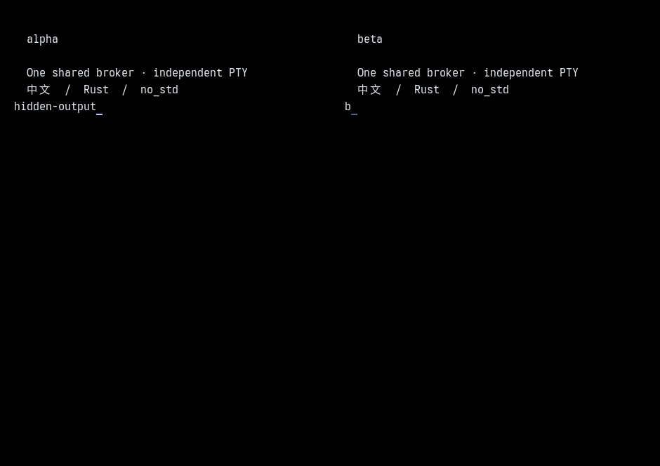

# ztty 开发分支整合与 Unicode 写入优化

日期：2026-11-18（UTC+8）。

本轮把主分支的吞吐优化合入完整功能开发分支，保留共享会话、标签页与分屏、观察者、主题热重载和 Shell 集成，并优化 Unicode 字符写入。最终源码通过 220 项 Rust 单元／集成测试、6 项文档测试、61 项实际 Linux GUI 检查及三套 MCP 测试。固定 CPU 的核心微基准中，Unicode 吞吐中位数由 87.760 提高到 112.083 MiB/s，观察到 27.7% 提升。[完整验收记录](measurements/integration-unicode-2026-11-18/summary.json)

交付入口是 [PR #2](https://github.com/LIghtJUNction/ztty/pull/2) 的持续开发分支。当前为候选版本；跨平台完整功能与原生验收继续按 [任务清单](https://chatgpt.com/space/page_33438d764dec8191882dcdae0f86b1ff) 推进。

## 1. 源码与提交

| 内容 | 提交 |
| --- | --- |
| 整合完整功能分支与主分支吞吐优化 | [b9771a3](https://github.com/LIghtJUNction/ztty/commit/b9771a39a5653c488719679d737844180ad45067) |
| Unicode 单元格覆盖优化及五项边界回归 | [3c5b8e2](https://github.com/LIghtJUNction/ztty/commit/3c5b8e28a0c9baccd0dca1f24e1d3c3d558c449d) |
| 整合前完整功能分支 | [7c552ac](https://github.com/LIghtJUNction/ztty/commit/7c552acd0765834a4f41b44b4e69b64b97b1f0ac) |
| 纳入的主分支版本 | [cd38909](https://github.com/LIghtJUNction/ztty/commit/cd389099e1f01fd355f542258854d1d446c1aa5d) |

开发分支原有的六个 Windows 窗格、布局与原生 resize 提交一并同步。整合保留了两条分支的提交历史，PR 的合并冲突已消除。当前源码版本为 ztty 0.2.1；此次交付没有创建新的正式 Release。

## 2. 实现改动

### 把性能优化接入完整功能

屏幕行索引用条件减法完成环回，减少动态取模；SGR 颜色和样式直接消费参数迭代器；ASCII 快速路径只检查当前激活的字符集。SGR 同时保留调色板来源信息，因此配置热重载仍能更新索引颜色，并保留显式 RGB。整合回归覆盖颜色参数缺失、无效值、混合形式、字符集切换、滚动和分块输入。[终端核心](../crates/zterm/src/terminal.rs) · [核心测试](../crates/zterm/src/tests.rs) · [主题测试](../crates/zterm/src/theme_tests.rs)

X11 将连续需要更新的行合并复制。每个分屏窗格继续使用自己的窗口和后台图像，完整刷新包含留白边缘；搜索和命令面板继续在终端内容之后绘制。共享会话的输入所有权、只读观察、隐藏标签页输出处理及同步帧截止时间保持完整。[绘制实现](../src/x11.rs) · [会话实现](../src/session.rs)

### Unicode 目标格只写入一次

原来的 Unicode 路径先把目标格填为空白，再写入新字符。现在复用 ASCII 路径已有的 `overwrite_span`：先清理覆盖区间外被切开的宽字符半边，再直接写入目标 1–2 个单元格。行末宽字符换行前的真正擦除仍保留。此改动没有增加依赖、常驻字段或分配。

新增五项回归验证宽字符前半格和后半格覆盖、跨两个宽字符覆盖、颜色／样式／链接／组合符元数据、插入模式、单列屏幕、自动换行，以及不同 PTY 分块下屏幕和历史的一致性。最终 zterm 库测试共 79 项通过。[优化提交与测试](https://github.com/LIghtJUNction/ztty/commit/3c5b8e28a0c9baccd0dca1f24e1d3c3d558c449d)

### 让整合后的基准测量保持正确

每个独立窗口的终态验证使用该窗口对应的 broker 地址；A/B 收集器动态指定的单窗口数量也按调用时的值生效。收集器保留独立显示服务归属核验、主机压力检查、矩阵和工作负载入口，以及计时外的光标回复和完整屏幕文本验证。含错误、清理错误或遗留进程的结果会被拒绝发布。[收集器](../tools/benchmark_terminals.py) · [25+13 项 Python 回归日志](measurements/integration-unicode-2026-11-18/benchmark-python.log)

两窗口共享／独立模式的实际收集器检查通过：分别使用一个、两个 GUI 进程，四个窗口均完成直接光标回复及全部 32 行文本核验，所属进程清理为空。该检查使用已有 production 二进制，定位为收集器验收。[原始记录及二进制身份](measurements/integration-unicode-2026-11-18/benchmark-collector-smoke.json)

## 3. 最终代码验收

| 检查 | 结果 |
| --- | --- |
| Rust 工作区单元／集成测试 | 220 通过 |
| Rust 文档测试 | 6 通过 |
| 格式与严格 Clippy | 通过 |
| Linux release 构建、生产 no_std 检查 | 通过 |
| zterm／zinput／zgraphics 裸机目标检查 | 通过 |
| Windows GNU、macOS Intel、macOS ARM 类型检查 | 通过 |
| 工作区、分屏、标签页、布局恢复 | 10 项实际 GUI 检查通过 |
| 搜索、命令面板、主题、配置、观察者 | 15 项实际 GUI 检查通过 |
| 静默末帧、持续输出公平性、同步重绘 | 7 项实际 GUI 检查通过 |
| Sixel 图像、尺寸变更、取消与恢复 | 10 项实际 GUI 检查通过 |
| 键盘、CJK 选择、剪贴板、粘贴与基础显示 | 12 项实际 GUI 检查通过 |
| Kitty 图片格式、透明度、裁剪、层级及 icat | 7 项实际 GUI 检查通过 |
| MCP stdio／HTTP、会话及权限 | 三套检查通过 |

[命令与退出状态](measurements/integration-unicode-2026-11-18/gates.json) · [Rust 日志](measurements/integration-unicode-2026-11-18/rust-tests.log) · [构建身份](measurements/integration-unicode-2026-11-18/binary.json)

实际 GUI 检查使用隔离的 Xvfb/X11、真实 PTY、键鼠事件及窗口像素。以下为本轮最终二进制的分屏截图。



其他截图：[命令面板](measurements/integration-unicode-2026-11-18/daily-workflow/command-palette.png) · [历史搜索](measurements/integration-unicode-2026-11-18/daily-workflow/history-search.png) · [同步帧释放](measurements/integration-unicode-2026-11-18/repaint/sync-release.png) · [Sixel](measurements/integration-unicode-2026-11-18/sixel.png)

## 4. Unicode 核心微基准

比较对象是整合提交 b9771a3 与仅增加 Unicode 覆盖优化的 3c5b8e2。使用已有 `zterm` benchmark 示例、相同构建配置和屏幕几何。每批按 ABBAAB 顺序启动六个独立进程，前／后各三次；每个进程内部保留原示例的预热与七次采样取中位数方法。所有进程返回值都保存在原始 JSON 中。

主要对照固定在同一逻辑 CPU 0，且在本轮自有构建、测试结束后执行。只限制基准子进程的 CPU 亲和性，宿主仍有其他任务。

| 负载 | 优化前 MiB/s，中位数 [范围] | 优化后 MiB/s，中位数 [范围] | 中位数变化 |
| --- | ---: | ---: | ---: |
| ASCII | 175.151 [141.978–227.035] | 195.128 [176.790–211.848] | +11.4% |
| 满历史 ASCII | 98.376 [89.958–127.377] | 137.036 [111.136–141.110] | +39.3% |
| SGR | 144.063 [104.511–149.641] | 139.914 [128.212–144.253] | −2.9% |
| **Unicode** | **87.760 [68.106–89.259]** | **112.083 [98.420–115.624]** | **+27.7%** |

[固定 CPU 全部样本](measurements/integration-unicode-2026-11-18/unicode-core-pinned.json)

另一批不固定 CPU 的三次前／后运行，Unicode 中位数为 82.717 → 125.943 MiB/s（+52.3%），ASCII 为 −6.6%，SGR 为 +8.3%。不同批次中 ASCII／SGR 的变化方向与范围存在波动，因此本轮性能结论限定在两批都观察到改善的 Unicode 核心负载；其他数值完整保留供复查。[不固定 CPU 全部样本](measurements/integration-unicode-2026-11-18/unicode-core-unpinned.json)

十二次进程运行的初始核心堆内存均为 **107,676 bytes**，稳态分配次数均为 **0**。这套基准测量解析器和屏幕模型，范围不含 PTY、窗口绘制或显示器延迟。README 中已有的十窗口终端比较仍保留其原始源码与测量批次，本轮没有将微基准结果替换进该图表。

## 5. 复现与继续开发

在对应源码 checkout 中分别构建核心 benchmark：

```sh
cargo build --locked --release -p zterm --example benchmark
taskset -c 0 target/release/examples/benchmark
```

前版本使用 b9771a3，后版本使用 3c5b8e2；按原始记录的 ABBAAB 顺序各运行三次。源码、命令、二进制 SHA 和每次返回值在两个 JSON 中明确记录。

本轮实际验证的 Linux 可执行文件位于开发机：

```text
/home/lightjunction/Documents/GITHUB/ztty/artifacts/integration-20261118/target/release/ztty
```

其大小为 677,768 bytes，身份见构建记录。发布前还需继续完成 macOS 原生像素／输入验收、Windows 新标签页与分屏的原生验收、原生共享会话覆盖，以及任务清单中的 Wayland、复杂文字布局等工作。Windows 与 macOS 本轮完成的是类型检查；已保存的较早原生候选结果仍绑定原来的源码版本。当前每格最多两个组合字符的范围保持不变。

## 6. 结论自审

| 维度 | 结论与证据 |
| --- | --- |
| 实际作用 | 完整功能分支纳入已验证的吞吐路径，Unicode 热路径减少重复写入。 |
| 说明与复现 | 两次源码提交、全部命令、原始结果和实际截图有明确位置。 |
| 测量强度 | 两批各三次前／后运行均观察到 Unicode 改善；保留范围与其他负载的负向数值。 |
| 验收完整性 | Linux 行为及像素检查通过；其余原生平台按实际检查范围记录。 |
| 设计代价 | 复用已有覆盖方法，无新增依赖、常驻字段或稳态分配；宽字符边界与元数据有回归。 |
