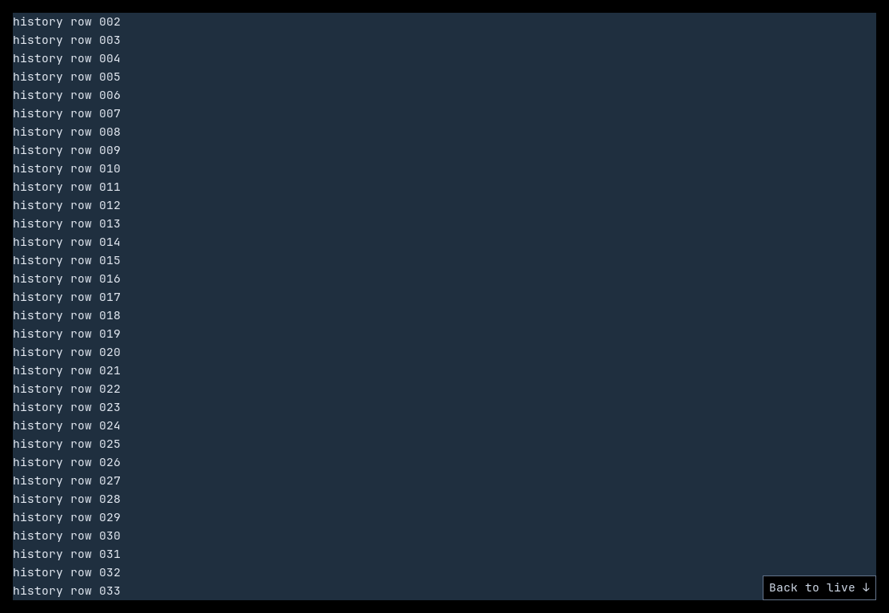

# Complete-frame X11 presentation

Date: 2026-11-19

## Result

The Linux renderer now publishes one complete frame after painting the terminal
and its view overlays. The real-window regression passes all 11 checks.
The same test reproduces three visible copies in the previous renderer for
one synchronized update to three nonadjacent rows.

Source change: `4c391f123227b63c68299311ec6d4cc5518237cb`. Baseline: `868e841fc81f747283de40eed4956e52ca063aba`.
The exact binary hashes, source hashes, copy rectangles and cleanup results are
recorded in [evidence.json](evidence.json).

## Cause and change

The previous renderer copied each completed span of dirty rows from its retained
pixmap to the visible window while later rows were still being painted. Delaying
the final `XFlush` did not make those copies a transaction: Xlib may send buffered
requests earlier. Search and scrollback overlays also issued their own copies.

Painting now records the vertical bounds of damage. After the terminal, search
or command overlay, notice and scrollback prompt are complete, `finish_frame`
copies their union once. Expose still restores the retained frame immediately.
The DEC 2026 hold and 150 ms stalled-frame timeout are unchanged.

| Scenario | Observed visible copies | Copied height |
| --- | ---: | ---: |
| Old renderer, three nonadjacent rows | 3 | 23 px each |
| Fixed renderer, the same update | 1 | 736 px |
| Fixed renderer, one changed row | 1 | 23 px |
| Fixed renderer, terminal plus search | 1 | 768 px |
| Fixed renderer, scrollback plus return prompt | 1 | 768 px |

The union can include unchanged rows between separate damaged regions. Those
cells are not redrawn. A single-row update still copies only that row.

## Verification

Both binaries were built with `cargo build --locked --offline --release`
in separate worktrees. The final test harness was run against both artifacts.
The baseline intentionally fails the new one-copy assertion; the candidate
passes it and the existing quiet-output, idle, concurrent-input, Expose and
synchronized-output checks. Formatting and `git diff --check` also pass.

The test-only preload tracer records real `XCopyArea` calls without changing
their order, geometry or flushing. Independent X11 pixel reads verify the
visible result. The tracer is never linked into the shipped executable.
All test-owned processes and private displays were cleaned up.

Run the regression from the candidate source tree:

```sh
python3 tests/repaint_gui.py --binary ./target/release/ztty
```



## Scope

This verifies software frame composition and X11 presentation on a private
display. It does not measure physical monitor scanout, compositor vblank timing
or a hardware-specific tearing guarantee. Applications that write a logical
frame in several PTY chunks should bracket it with synchronized output; the
ssmcp sender change is tracked separately. This report records a tested source
candidate, not an installation or a public release.
