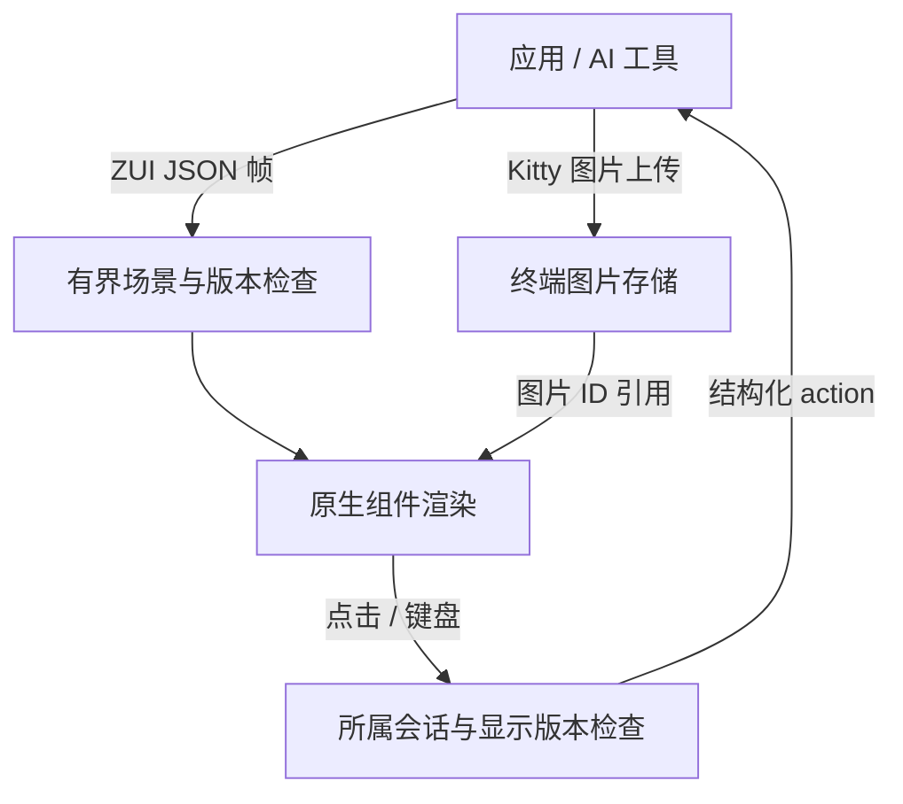
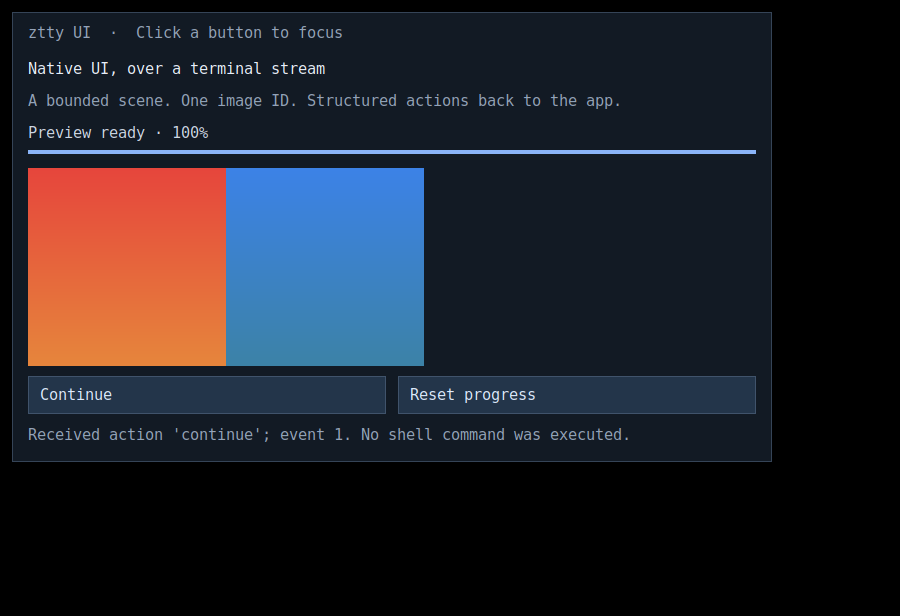

# ZUI/1：原生终端界面原型与验证记录

记录日期：2026-11-19（Asia/Taipei）。ZUI/1 的原生 UI、常用快捷键、进度数值更新优化与原子帧提交修复已经完成同一源码、同一二进制的 Linux 原生验收。实际测试提交为 [`242a10ee`](https://github.com/LIghtJUNction/ztty/commit/242a10eea3a602d5b9b239099ca007e62d36b37e)，[运行 44402521719](https://github.com/LIghtJUNction/ztty/actions/runs/44402521719) 的全部门禁通过。[实验 PR #11](https://github.com/LIghtJUNction/ztty/pull/11) 保留私有实验协议定位；正式 0.3.1 发布不包含 ZUI。

## 已经做成什么

| 部分 | 当前结果 |
| --- | --- |
| 协议核心 | 独立 `ztty-ui` crate，`no_std + alloc`，无外部 crate 依赖，生产代码禁止 unsafe |
| 组件 | Column、Row、Text、Progress、Button、ImageRef 六类 |
| Linux 原生显示 | 文字、进度条、按钮及真实图片在 X11 窗口中显示；随仓库提供的示例通过真实点击把进度更新到 100% |
| 图片 | 引用现有 Kitty 图片 ID；历史宿主测量中两个组件共用一份 2,048 字节的 XRender 服务端图像 pixmap |
| 交互 | 点击和键盘操作返回场景版本、节点及事件 ID；跨标签和窗口外释放边界通过原生检查 |
| 完整帧呈现 | 终端行与所有覆盖内容绘制完毕后统一提交，保留受损区域合并；11 项 repaint 检查通过 |
| 最终 Linux 整合验收 | 格式、严格 Clippy、10 项应用库测试、12 项 actions 测试及 release 构建通过；同一 ELF 通过 24 项原生 UI、59 个输入向量／14 个字号场景、11 项 repaint 检查 |
| 历史协议与状态测试 | 核心版本通过 104 项 zterm 测试及 3 项 doctest；优化后的协议库通过 18 项测试与严格 Clippy，保留各自源码边界 |
| 进度更新微基准 | 固定输入、CPU 和工具链的 5 组交替测量中，单值更新中位数从 7.8386 µs 降到 0.55184 µs，分配次数从 3 次降到 1 次；范围限于协议核心 |

本表的最终验收结果来自[完整摘要](measurements/native-ui-atomic-2026-11-19/summary.json)。历史宿主、核心与微基准的源码标识和数值保留在[机器可读记录](native-ui-progress-2026-11-19.json)及后文各节。

### 最终整合源码与实际运行

生产合并 [`b114d003`](https://github.com/LIghtJUNction/ztty/commit/b114d0033053cdda0107e07ee7fb461d8f689b70) 将实验分支 `d1ba712` 与主线 `cf7158b` 合并。它保留有界场景、图片引用缓存、字形裁剪和完整手势归属，并采用主线的帧提交顺序：终端行、原生面板、搜索、命令面板、消息和滚动提示先完成绘制，再调用一次 `finish_frame`。原生面板登记自己的受损范围；普通终端的单行更新仍可只提交该行，有覆盖内容时再合并对应范围。Expose 继续直接恢复已保留的画面。

开发机不可用后，验收在单独的 `validate/native-ui-atomic-20261119` 分支运行一个 Ubuntu 24.04 原生任务，使用私有 Xvfb 和真实 PTY/XTEST 输入。既有 CI 配置未修改，也未运行新的协议微基准。第一次工作流记录 [`44401948746`](https://github.com/LIghtJUNction/ztty/actions/runs/44401948746) 在配置校验阶段停止，未创建 job；随后仅调整工作流中临时 rustup 路径的初始化位置，运行时代码和门禁保持不变。

实际通过的 [Linux job](https://github.com/LIghtJUNction/ztty/actions/runs/44402521719/job/135149043694) 于 2026-11-18 21:32:30–21:33:38 UTC 执行，使用 Rust 1.100.0。所有结果绑定以下标识：

| 标识 | 值 |
| --- | --- |
| 实际测试提交 | `242a10eea3a602d5b9b239099ca007e62d36b37e` |
| 实际测试 tree | `cc3003c603d2d207ce13e92f44a868c8c8adcf70` |
| 同一 release ELF 的 SHA-256 | `17b6d40d62e8691148fb69899e259ad40d9378519c3d7b300b955f845e2f628a` |
| 前后源码清单 SHA-256 | `363c086e78c233595accd077d30a6e46936cde24556e8652e7add519569cf7b2` |
| 跟踪文件数 | 959；验收前后均无变化 |
| 完整结果 | [日志提取摘要](measurements/native-ui-atomic-2026-11-19/summary.json)，保留全部门禁、源码哈希、二进制哈希和清理结果 |

### 文档提交与验收提交的关系

本次报告和截图作为 `242a10ee` 的仅文档后续提交加入仓库。Git tree 比较确认 `docs/` 以外的顶层条目完全相同，因此运行时代码、Cargo 清单、测试和验收工作流均未变化。这里的通过结论始终指向实际运行的 `242a10ee`；后续文档 head 通过该树比较关联已有结果，不被记作一次新的验收运行。若继续修改运行时代码，这个等价关系就需要重新核对。

更早的本地候选 `888512b4b1ec1ad43e6da80615a07902c171c199`（运行时 tree `675d60314637f8dc3ce5ef9a1ded4757c7c7bb73`）通过格式检查、144 项 Rust 测试及 3 项 doctest，随后在严格 Clippy 阶段因连接中断停止。[`e8cd862`](https://github.com/LIghtJUNction/ztty/commit/e8cd86239f5f0ea6f9a54646248c66d474ce246c) 保留其等价运行时代码与报告资产。该历史部分通过记录不补记为完成；最终原子帧整合的完整结论来自上面的独立运行。

## ChatGPT 里的交互界面，对应哪个开放项目

OpenAI 文档将 ChatGPT 的工具交互界面建立在 **MCP Apps** 开放扩展上：工具可提供 UI 资源，宿主在受限 iframe 中运行界面，通过 JSON-RPC 消息桥通信。`apps-sdk-ui` 是可选的组件库，并非整个 ChatGPT 产品界面的源码。[OpenAI 文档](https://developers.openai.com/plugins/build/chatgpt-ui)；[MCP Apps 概览](https://apps.extensions.modelcontextprotocol.io/api/documents/overview.html)。

若目标是让模型生成结构化组件，再由宿主原生渲染，**A2UI** 的声明式组件与数据更新方式更接近本项目的方向。[A2UI v1 规范](https://github.com/a2ui-project/a2ui/blob/main/specification/v1_0/docs/a2ui_protocol.md)。

**json-render** 也提供多种渲染器，其中已经包含基于 Ink 的终端渲染器。因此，本工作没有“首次让 AI 生成终端 UI”的独创性结论。ZUI/1 的具体选择是：把有界场景放进终端字节流，复用 ztty 的原生渲染和现有图片存储。[json-render 渲染器文档](https://json-render.dev/docs/renderers)。

## 从字节流到界面

终端程序本来就向 PTY 输出字节。ZUI/1 为其中一种 APC 帧定义了结构化内容，终端验证完整场景后，把固定组件画出来。应用或模型负责描述内容；宿主负责字体、布局、裁剪和输入归属。



帧由前缀 `ESC _ ZUI;1;`、UTF-8 JSON 和 ST 终止符（`ESC` 后跟一个反斜杠）组成。Python 字节写法为 `b"\x1b_ZUI;1;"` 和 `b"\x1b\\"`。普通文字与 Kitty `_G` 图形继续使用原有解析路径。

应用先发送能力探测：

```json
{"v":1,"op":"capabilities"}
```

通用 zterm 消费者默认返回不支持，忽略场景修改。只有已连接的原生宿主显式启用能力后才返回支持；应用可在不支持或超时时继续输出文字。

取得 `last_rev` 后，使用更大的版本创建场景。以下示例假设首次返回的 `last_rev` 为 0：

```json
{"v":1,"op":"replace","surface":7,"rev":1,"events":true,"root":1,"nodes":[{"id":1,"type":"column","children":[2,3,4]},{"id":2,"type":"progress","value":2500,"label":"Building"},{"id":3,"type":"image","image_id":42,"alt":"Preview"},{"id":4,"type":"button","label":"Retry","action":"build.retry"}]}
```

图片 42 应先通过现有 Kitty 图形协议上传。ImageRef 保存图片 ID 和可选内容代次，不复制图片像素，不下载 URL，也不增加另一套图片解码器。

更新进度时可以只发送改变的字段：

```json
{"v":1,"op":"update","surface":7,"base_rev":1,"rev":2,"set":[{"id":2,"value":10000}]}
```

一次更新中的全部目标先通过检查，然后一起提交。错误字段、无效树、过期版本或不存在的节点不会留下半更新场景。按钮事件携带当时实际显示的场景版本；应用决定如何处理 `build.retry`，协议本身不会执行 shell 命令。

## 边界与当前范围

| 资源或状态 | v1 规则 |
| --- | --- |
| 单帧 JSON | 最大 65,536 字节 |
| 场景 | 一个 surface，最多 256 节点，深度最多 8 |
| 文字 | 场景累计最多 32,768 UTF-8 字节；单字符串最多 4,096 字节 |
| action | 最多 64 个 ASCII 字母、数字或 `._:-` |
| 进度值 | 0–10,000 的整数，10,000 表示 100% |
| 版本 | u64 单调递增；清除、RIS 和主/备用屏幕切换不重用旧版本 |
| 事件 | 场景显式开启 events；宿主还要检查会话输入权限、当前显示版本和完整手势 |
| 图片 | 当前终端内的 KGP 图片 ID；可选 generation 固定特定内容 |
| 不支持的宿主 | 能力探测返回不支持，保留文字回退 |

目前是 Linux 原生宿主、固定组件目录和一个有界浮层。它不预留终端行，也不把组件插入 scrollback；尚无表单编辑器、浏览器 DOM 或完整 MCP Apps/A2UI 兼容层。

## 真实窗口证据

### 最终整合二进制

下图来自最终验收中实际运行的 `examples/native_ui.py`。程序协商 ZUI/1 能力并上传图片；XTEST 点击 Continue 后，示例收到结构化 action，提交新场景版本，进度达到 100%。截图没有重绘或修改，已进行视觉复核。



PNG 为 24,072 字节，SHA-256 为 `9c65b58fbe8a1ded0225bb599c2426f293c6596ce7acf65169d6f06406e3de6b`，Git blob 为 `b153fdb54726e99ed645fb74fe51ba3502e24f02`。[验收摘要](measurements/native-ui-atomic-2026-11-19/summary.json)将此截图与上述 ELF 绑定。

以下检查在同一 ELF 上运行，所有命令和验收断言的退出码均为 0。

| 检查 | 结果与覆盖 |
| --- | --- |
| 构建门禁 | 格式检查、严格 workspace/all-target Clippy、10 项应用库测试、12 项 actions 测试和 release 构建通过 |
| 原生 UI | 24 项检查通过，覆盖真实图片像素、共享缓存、交互回传、过期场景、跨标签手势、窗口外释放、字形裁剪、能力回退、RIS、备用屏幕、只读观察及 PTY 结束 |
| 标准键鼠输入 | 12 组、59 个输入向量和 14 个字号场景通过，包括 Num Lock、keypad、滚轮、额外鼠标键、组合键归属、字体缩放／重置、非美式布局及标签切换 |
| 完整帧呈现 | 11 项检查通过，包括非相邻脏行单次提交、单行受损范围、终端与覆盖内容同帧、静默末帧、同步输出和 Expose、滚动历史及多窗口输入响应 |
| 身份与清理 | 959 个 Git 跟踪文件及 ELF 前后哈希一致；三组私有 Xvfb 的进程、文件、监听 socket 和 lease 均已清理 |

完整日志、各组 JSON、截图、源码清单和精确 ELF 随运行上传为 artifact `14473581858`，大小 648,228 字节，归档 digest 为 `sha256:810983b4f3887763d18a654ea4ec3114b92bb74cbcb89bb2c07b6626741709da`，保留至 2026-12-02。仓库中的摘要从成功任务的单行 JSON 日志原样提取并补一个换行；它与附件中的缩进版 JSON 字段相同，不声称两种文本格式的字节哈希一致。摘要与截图已作为持久仓库文件保存。

本轮确认 Linux X11 中的软件帧组合、输入归属和原生像素结果。它不测量物理显示器扫描、合成器垂直同步或端到端显示延迟，也不提供 Windows/macOS 原生 UI 的通过结论。

### 历史宿主检查：`9c2ff7d`

以下保留原子帧合并之前的独立宿主结果。历史截图仍见[原宿主 demo](assets/native-ui-demo-2026-11-19.png)，其 SHA-256 为 `19c3e073399356930c6f3c985c87207cdc3626728cdebb94f445258c2dfcd043`。本节的图片分配量和 DSR 时间均属于该历史源码。

这轮历史验收对应宿主提交 `9c2ff7d4ef1187feb130617a720cdec8c804de98`，同一个 ELF 的 SHA-256 为 `0038181826e86eff11e97de53884e427a508f35ddc60830920e7340d56ed4440`。测试时的修改随后原样提交；源码 attestation 确认构建和两组 GUI 报告中的源文件哈希均与提交一致。

| 检查 | 结果与范围 |
| --- | --- |
| 构建 | 格式检查、10 项库测试、release 构建及差异空白检查通过 |
| 原生 UI | 24 项检查通过，覆盖真实图片像素、同 ID 内容刷新、缓存共享、点击和键盘事件、旧版本失效、尺寸变化、RIS、备用屏幕、只读观察和 PTY 结束 |
| 原有键鼠输入 | 10 组、36 个向量通过，确认宿主输入处理仍兼容原有终端行为 |
| 跨标签手势 | 两个原始 PTY 都启用 1003 + SGR 1006；从 UI 按下、切换标签到移动／释放的整个手势，两边 PTY 均收到 0 字节；释放后普通鼠标报告恢复 |
| 窗口外释放 | 测试确认另一 X 客户端接收到释放；回到 ztty 后可正常报告鼠标移动，不遗留捕获状态 |
| 字形裁剪 | 带组合字符和负边距的文字在窄叶节点中可见，同时限制在左右边界内 |
| 演示程序回退 | 不支持 UI 时保留纯文字，不修改未进入的屏幕／光标模式，并恢复 termios |
| 清理 | 两组 GUI 的 stderr 为空；测试拥有的剩余进程列表为空 |

测试用同一张 32×16 RGBA 图片创建两个场景引用，XRes 测得服务端 pixmap 存储增加 2,048 字节，与一张图片的像素大小一致。这个结果说明该路径复用图片存储，测量范围为 XRender 服务端 pixmap。

24 次 JSON 更新后使用 DSR 同步屏障，中位数为 **0.164 ms**，最大值 **1.180 ms**。它测量 PTY、解析器及事件循环完成屏障的往返，不包含最终像素呈现延迟。上述宿主结果均限定在 Linux X11 和测试拥有的 Xvfb 会话内。

## 性能测量及可以支持的结论

### 匹配条件的数值更新 A/B

优化提交为 `432e84cd517a2352e0ed45f7f0304ec8e6adb711`。在同一开发机、同一基准输入及同一工具链下，把基线与优化二进制固定到 CPU 23，交替运行 5 组。计时包含分配计数钩子的成本。

| 更新 256 节点中的一个进度值 | 基线 | 优化后 |
| --- | ---: | ---: |
| 单次更新中位耗时 | 7,838.60 ns | 551.84 ns |
| 五次测量范围 | 6,220.58–8,455.80 ns | 345.50–693.77 ns |
| 每次分配次数 | 3 | 1 |
| 每次重新分配次数 | 0 | 0 |
| 每次请求分配字节 | 1,009 B | 928 B |

这组匹配测量的中位耗时下降 **92.96%**，速度比约为 **14.20 倍**。两组耗时范围没有重叠。这个结论只适用于内存中的 ZUI 进度值更新；无法换算成整台终端、界面绘制、PTY 往返或模型响应速度。请求分配字节也不代表 RSS。

数值快路径仅适用于整批 `id + value` 更新，值为 0–10,000 的整数。实现先检查场景与版本，再完整检查目标 ID、节点类型和重复项，最后才原地修改数值。已有标签与图结构保持不变，因而可以复用已完成的结构验证。其他更新继续走原来的事务路径；解析 entries 向量仍有一次分配。

优化后 **18 项测试全部通过**，包括标签分配复用、与通用事务路径的 Scene／动作／能力回复等价、错误优先级、无效值、重复 ID、陈旧版本、整批回滚、混合更新和最大树中 255 个 progress 节点更新。基线运行通过 17 项，唯一预期失败是标签分配保留测试。格式检查与 `cargo clippy --locked -p ztty-ui --all-targets -- -D warnings` 均通过。提交前核对的 8 个源码哈希一致，基准文件没有变化。

配对原始报告 `paired-benchmark.json` 的 SHA-256 为 `1fd58a9c349ce1a18312a738cd85b0aa0595c2d81a427e2e7f9a5eb391b7d1e8`。工具链为 Rust 1.100.0、LLVM 23.1.5；基线二进制 SHA-256 为 `6fbecfc9cf68fa6d70f229eaa702f0dc3fb73ad366465722221d9df6f441e0f5`，优化后二进制为 `511e7e6049a4c8a8b77aeb30000f687b414d9b3d3996dcb8bea7db94883b496f`。

### 优化前的其他协议基线

以下保留优化前一批独立运行的 5 次基线，环境为 Intel Core i9-12900HX、Rust 1.100、CPU 23。它说明不同协议操作的成本。加速比只使用上面的匹配 A/B 数据，避免把不同批次的 5.918 µs 与后来的 0.55184 µs 混算。

| 场景 | 中位时间 | 分配记录 |
| --- | ---: | --- |
| 创建并释放 256 节点场景 | 83.942 µs | 258 次分配、12 次重新分配；请求 138,461 字节 |
| 更新 256 节点中的一个进度值 | 5.918 µs | 3 次分配；请求 1,009 字节 |
| 能力请求解析 | 118.51 ns | 0 次分配 |
| 超过上限的帧长度拒绝 | 3.07 ns | 0 次分配 |
| 创建图片引用场景 | 634.05 ns | 3 次分配；请求 999 字节 |
| 已预热的逐字节帧收集 | 850.10 ns | 固定示例，分配成本随重复次数摊薄 |

“请求字节数”是分配调用请求的累计字节，不是同时存活内存，也不是 RSS。长度拒绝测试不包含读取完整帧的 I/O，图片引用测试不包含图片解码，全部微基准都不包含原生排版或显示耗时。

### 普通 VT 路径

普通 VT 路径另做了 5 轮交替 A/B，共 10 次运行：

| 指标 | 原基线中位数 | 增加 ZUI 核心后中位数 |
| --- | ---: | ---: |
| ASCII 吞吐量 | 105.957 MiB/s | 101.288 MiB/s |
| 满历史区 ASCII 吞吐量 | 69.557 MiB/s | 68.306 MiB/s |
| SGR 吞吐量 | 54.763 MiB/s | 73.919 MiB/s |
| Unicode 吞吐量 | 50.704 MiB/s | 52.017 MiB/s |
| 初始核心堆统计 | 107,932 字节 | 107,932 字节 |
| 稳态分配次数 | 0 | 0 |

共享开发机的吞吐量波动明显。例如 ASCII 原基线范围 72.947–118.469 MiB/s，ZUI 核心范围 76.523–106.647 MiB/s。当前结果可确认这组测试中的初始核心堆统计和稳态分配未增加；不足以断言总体吞吐更快、更慢，或优于 Kitty/Ghostty。它也不测量模型推理、PTY、图片解码或屏幕呈现。

完整的源码标识、二进制哈希、各区间和验收范围见[机器可读记录](native-ui-progress-2026-11-19.json)。

## 运行入口

实验分支提供 [examples/native_ui.py](../examples/native_ui.py)。在该分支完成构建后，可运行：

```bash
./target/release/ztty -e python3 examples/native_ui.py
```

示例先协商能力，再上传图片并创建场景。点击 Continue 或 Reset progress 会向示例返回事件，由示例更新进度。Esc 离开按钮焦点，再按 q 退出。正式 0.3.1 不包含此实验界面，需要使用实验分支的构建产物。本文的 ZUI 验收不代表已安装或已发布含 ZUI 的应用。

