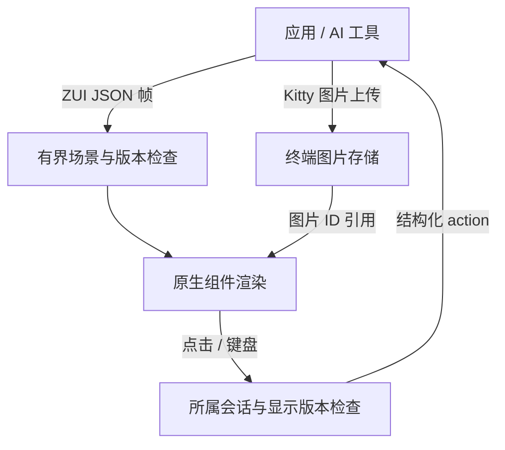
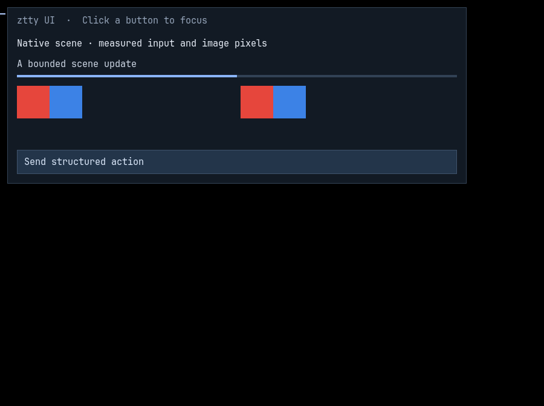

# ZUI/1：原生终端界面原型与验证记录

记录日期：2026-11-19（Asia/Taipei）。[实验分支 PR #11](https://github.com/LIghtJUNction/ztty/pull/11) 当前为草稿。协议核心和第一版 Linux 原生宿主已提交，后续输入边界修复与性能优化尚待最终构建验收。正式 0.3.1 发布单独推进，本实验不在其发布范围内。

## 已经做成什么

| 部分 | 当前结果 |
| --- | --- |
| 协议核心 | 独立 `ztty-ui` crate，`no_std + alloc`，无外部 crate 依赖，生产代码禁止 unsafe |
| 组件 | Column、Row、Text、Progress、Button、ImageRef 六类 |
| Linux 原生显示 | 文字、进度条、按钮及真实图片已经在 X11 窗口中显示 |
| 图片 | 引用现有 Kitty 图片 ID；两个组件共用一份 2,048 字节的服务端图像 pixmap |
| 交互 | 点击和键盘操作可返回带场景版本、节点及事件 ID 的结构化意图 |
| 第一版测试 | 104 项 zterm 测试、13 项协议测试、3 项 doctest；宿主 9 项库测试与首轮 18 组真实窗口/PTY 检查通过 |
| 进度更新优化 | 修改后的 18 项回归测试通过；匹配条件的前后性能测量尚未读取到结果 |

最后一轮构建期间，远端执行连接重连，服务端随后报告缺少 `code_mode runner`。当前保留最后确认的源码与报告，未把尚未读取的构建结果计为通过。

## ChatGPT 里的交互界面，对应哪个开放项目

OpenAI 文档将 ChatGPT 的工具交互界面建立在 **MCP Apps** 开放扩展上：工具可提供 UI 资源，宿主在受限 iframe 中运行界面，通过 JSON-RPC 消息桥通信。`apps-sdk-ui` 是可选的组件库，并非整个 ChatGPT 产品界面的源码。[OpenAI 文档](https://developers.openai.com/plugins/build/chatgpt-ui)；[MCP Apps 概览](https://apps.extensions.modelcontextprotocol.io/api/documents/overview.html)。

若目标是让模型生成结构化组件，再由宿主原生渲染，**A2UI** 的声明式组件与数据更新方式更接近本项目的方向。[A2UI v1 规范](https://github.com/a2ui-project/a2ui/blob/main/specification/v1_0/docs/a2ui_protocol.md)。

**json-render** 也提供多种渲染器，其中已经包含基于 Ink 的终端渲染器。因此，本工作没有“首次让 AI 生成终端 UI”的独创性结论。ZUI/1 的具体选择是：把有界场景放进终端字节流，复用 ztty 的原生渲染和现有图片存储。[json-render 渲染器文档](https://json-render.dev/docs/renderers)。

## 从字节流到界面

终端程序本来就向 PTY 输出字节。ZUI/1 为其中一种 APC 帧定义了结构化内容，终端验证完整场景后，把固定组件画出来。应用或模型负责描述内容；宿主负责字体、布局、裁剪和输入归属。



帧由前缀 `ESC _ ZUI;1;`、UTF-8 JSON 和 ST 终止符（`ESC` 后跟一个反斜杠）组成。Python 字节写法为 `b"\x1b_ZUI;1;"` 和 `b"\x1b\\"`。普通文字与 Kitty `_G` 图形继续使用原有解析路径。

应用先发送能力探测：

```json
{"v":1,"op":"capabilities"}
```

通用 zterm 消费者默认返回不支持，忽略场景修改。只有已连接的原生宿主显式启用能力后才返回支持；应用可在不支持或超时时继续输出文字。

取得 `last_rev` 后，使用更大的版本创建场景。以下示例假设首次返回的 `last_rev` 为 0：

```json
{"v":1,"op":"replace","surface":7,"rev":1,"events":true,"root":1,"nodes":[{"id":1,"type":"column","children":[2,3,4]},{"id":2,"type":"progress","value":2500,"label":"Building"},{"id":3,"type":"image","image_id":42,"alt":"Preview"},{"id":4,"type":"button","label":"Retry","action":"build.retry"}]}
```

图片 42 应先通过现有 Kitty 图形协议上传。ImageRef 保存图片 ID 和可选内容代次，不复制图片像素，不下载 URL，也不增加另一套图片解码器。

更新进度时可以只发送改变的字段：

```json
{"v":1,"op":"update","surface":7,"base_rev":1,"rev":2,"set":[{"id":2,"value":10000}]}
```

一次更新中的全部目标先通过检查，然后一起提交。错误字段、无效树、过期版本或不存在的节点不会留下半更新场景。按钮事件携带当时实际显示的场景版本；应用决定如何处理 `build.retry`，协议本身不会执行 shell 命令。

## 边界与当前范围

| 资源或状态 | v1 规则 |
| --- | --- |
| 单帧 JSON | 最大 65,536 字节 |
| 场景 | 一个 surface，最多 256 节点，深度最多 8 |
| 文字 | 场景累计最多 32,768 UTF-8 字节；单字符串最多 4,096 字节 |
| action | 最多 64 个 ASCII 字母、数字或 `._:-` |
| 进度值 | 0–10,000 的整数，10,000 表示 100% |
| 版本 | u64 单调递增；清除、RIS 和主/备用屏幕切换不重用旧版本 |
| 事件 | 场景显式开启 events；宿主还要检查会话输入权限、当前显示版本和完整手势 |
| 图片 | 当前终端内的 KGP 图片 ID；可选 generation 固定特定内容 |
| 不支持的宿主 | 能力探测返回不支持，保留文字回退 |

目前是 Linux 原生宿主、固定组件目录和一个有界浮层。它不预留终端行，也不把组件插入 scrollback；尚无表单编辑器、浏览器 DOM 或完整 MCP Apps/A2UI 兼容层。

## 真实窗口证据

下图来自第一版宿主的真实 X11 窗口验收场景，显示文字、进度条、两个图片引用和按钮。它不是设计稿，也不是生成图片。



原始截图 SHA-256：`3a806b9ae49af76a2e38e5962304cad6bfab297b7dcae65077db1e4a1d0fb8d4`。

首轮检查覆盖图片实际像素、图片内容更新、缓存共享、点击/键盘事件、旧场景失效、窗口尺寸变化、RIS、备用屏幕、只读观察和 PTY 结束等。XRes 验证两个引用共用一份 2,048 字节图像 pixmap。

24 次更新的 DSR 同步屏障中位数为 0.177 ms，最大值 2.312 ms。这个数字只描述该测试中的 PTY/DSR 往返同步，不代表最终像素显示延迟。

后续复核发现并修补了严格字形裁剪、跨标签页鼠标归属、窗口外释放恢复和演示程序清理等边界；这些修补尚需读取最终构建和窗口测试结果。

## 性能测量及可以支持的结论

测量环境为同一开发机，Intel Core i9-12900HX，Rust 1.100，固定 CPU 23。协议微基准运行 5 次，含分配计数钩子的成本。下表为优化前、已经取得的核心基线：

| 场景 | 中位时间 | 分配记录 |
| --- | ---: | --- |
| 创建并释放 256 节点场景 | 83.942 µs | 258 次分配、12 次重新分配；请求 138,461 字节 |
| 更新 256 节点中的一个进度值 | 5.918 µs | 3 次分配；请求 1,009 字节 |
| 能力请求解析 | 118.51 ns | 0 次分配 |
| 超过上限的帧长度拒绝 | 3.07 ns | 0 次分配 |
| 创建图片引用场景 | 634.05 ns | 3 次分配；请求 999 字节 |
| 已预热的逐字节帧收集 | 850.10 ns | 固定示例，分配成本随重复次数摊薄 |

“请求字节数”是分配调用请求的累计字节，不是同时存活内存，也不是 RSS。长度拒绝测试不包含读取完整帧的 I/O，图片引用测试不包含图片解码，全部微基准都不包含原生排版或显示耗时。

随后实现的数值快路径仅适用于整批 `id + value` 更新。它验证目标、类型、重复项、场景与版本后原地修改数值，保留标签分配和既有图结构；其他更新继续走完整事务路径。解析 entries 向量仍会分配。18 项回归测试通过，但修改后的匹配 A/B 测量还未完成读取，因此这里不填写加速倍数。

普通 VT 路径另做了 5 轮交替 A/B，共 10 次运行：

| 指标 | 原基线中位数 | 增加 ZUI 核心后中位数 |
| --- | ---: | ---: |
| ASCII 吞吐量 | 105.957 MiB/s | 101.288 MiB/s |
| 满历史区 ASCII 吞吐量 | 69.557 MiB/s | 68.306 MiB/s |
| SGR 吞吐量 | 54.763 MiB/s | 73.919 MiB/s |
| Unicode 吞吐量 | 50.704 MiB/s | 52.017 MiB/s |
| 初始核心堆统计 | 107,932 字节 | 107,932 字节 |
| 稳态分配次数 | 0 | 0 |

共享开发机的吞吐量波动明显。例如 ASCII 原基线范围 72.947–118.469 MiB/s，ZUI 核心范围 76.523–106.647 MiB/s。当前结果可确认这组测试中的初始核心堆统计和稳态分配未增加；不足以断言总体吞吐更快、更慢，或优于 Kitty/Ghostty。它也不测量模型推理、PTY、图片解码或屏幕呈现。

完整的源码标识、二进制哈希、各区间和未完成事项见[机器可读记录](native-ui-progress-2026-11-19.json)。

## 运行入口

实验分支提供 [examples/native_ui.py](../examples/native_ui.py)。在该分支完成构建后，可运行：

```bash
./target/release/ztty -e python3 examples/native_ui.py
```

示例先协商能力，再上传图片并创建场景。点击 Continue 或 Reset progress 会向示例返回事件，由示例更新进度。Esc 离开按钮焦点，再按 q 退出。当前系统安装的稳定候选不包含此实验界面，需要使用实验分支的构建产物。
