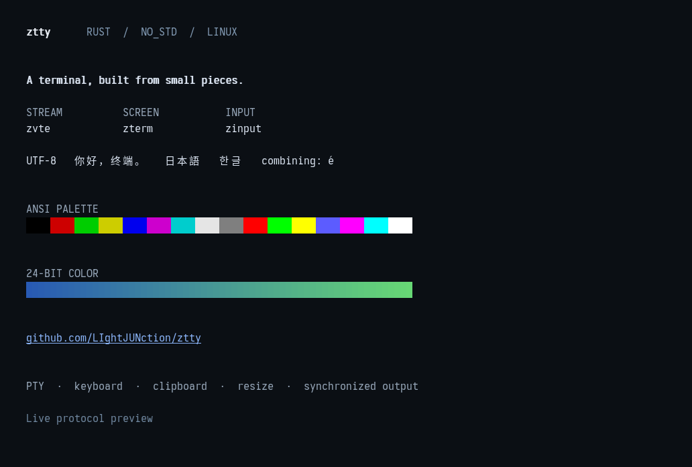

# Performance and validation record

Report date: **2026-11-18, Asia/Taipei**. Production Rust source:
[`9333047c0867756a73d71e29524ddef3d9f21544`](https://github.com/LIghtJUNction/ztty/commit/9333047c0867756a73d71e29524ddef3d9f21544).

The current implementation has a working Linux GUI, bounded screen/history
storage, and a production Rust dependency graph that does not link Rust `std`.
The recorded core benchmark processes a 1 KiB ASCII burst in a median 3.019 µs.
This measures parsing and screen updates only. It is not evidence of physical
key-to-screen latency or an overall win over Kitty or Ghostty.

## What each measurement means

| Layer | Measurement | Included | Excluded |
| --- | --- | --- | --- |
| Terminal core | Bytes per second; amortized feed time | Parsing, screen edits, dirty-row marking | PTY, window system, fonts, rendering, scanout |
| PTY response | Query round trip | Child write, PTY, terminal processing, reply, child read | Physical keyboard and display scanout |
| Terminal process | RSS and PSS | Process mappings and attributable shared pages | Child process and separate X server allocations |
| X graphics | XRes pixmap bytes and X server memory delta | Retained server-side buffers and observed server growth | Complete GPU/driver accounting |
| Visible response | Physical input to changed pixels | Input device, scheduler, application, compositor, scanout | Not measured in this report |

`no_std` controls the Rust runtime boundary. It does not itself prove low memory
or low latency. The frontend still uses the system C ABI, X11, Xft, font data,
and a retained pixmap; those costs must be included in whole-application claims.

## Recorded core benchmark

[Raw measurement and environment](measurements/core-2026-11-18.json).

| Setting | Value |
| --- | --- |
| Machine | Local execution environment, separate from the development PC |
| CPU | Intel Xeon Platinum 8573C; 9 logical CPUs exposed |
| Kernel / architecture | Linux 6.18.57 / x86_64 |
| Compiler | Rust 1.100.0, commit `0ef1bc386`, 2026-11-09 |
| Build | Release, fat LTO, one codegen unit |
| Screen | 120 columns × 32 rows |
| History case | 2,048 requested rows, filled before timing |
| Run timestamp | 2026-11-17 16:31:28 UTC / 2026-11-18 00:31:28 Asia/Taipei |

### Memory and throughput

| Metric | Measured result |
| --- | ---: |
| Cell size | 28 bytes |
| Initial terminal-core live heap | 107,676 bytes / 105.15 KiB |
| ASCII, no retained history | 202.116 MiB/s |
| ASCII, full retained history | 126.492 MiB/s |
| SGR color/control workload | 128.566 MiB/s |
| Mixed Unicode workload | 76.143 MiB/s |
| Allocations during the measured steady-state throughput loops | 0 |

The initial heap is counted from allocation layout sizes when constructing a
fresh `Terminal`. It excludes allocator metadata, code, stack storage, fonts,
window resources, and the rest of the process. The requested history capacity
does not allocate all history rows immediately. The 8 MiB history limit applies
to cell storage; it is not a limit on total process memory.

### Amortized update time

| Workload | p50 | p95 | p99 | Measured allocations |
| --- | ---: | ---: | ---: | ---: |
| Cursor-home + single ASCII overwrite | 34 ns | 36 ns | 69 ns | 0 |
| 1,024 ASCII bytes | 3.019 µs | 7.177 µs | 14.441 µs | 0 |

The harness records 10,000 samples. Each sample times 16 feed calls and divides
the elapsed time by 16; these percentiles describe **batch-amortized feed cost**,
not the distribution of isolated user key events. Throughput is the median of
seven runs of 4,096 feeds after warmup. `black_box` retains the workload and
screen result; allocation counters cover the timed loops.

This is one recorded run on shared infrastructure, without isolated CPU cores
or fixed clock control. The p99 tail is retained rather than presented as the
median. The development PC uses an i9-12900HX and a different kernel; its earlier
pre-optimization measurements are not used to calculate an optimization gain
against these Xeon results.

Reproduce the core measurement:

```sh
mkdir -p artifacts
cargo run --locked --release -p zterm --example benchmark \
  > artifacts/core-benchmark.json
```

## Whole-terminal measurements

The scripts for PTY round trips and ztty/Kitty runtime comparison are included.
A final completed runtime result was not retrieved before the development
connection became unavailable. This report therefore gives **no measured
whole-process RSS/PSS value, no PTY latency number, and no comparative speedup**.
Ghostty was not installed in the inspected development environment and was not
measured.

```sh
# Protocol checks plus 100 warmups and 1,000 PTY round trips:
xvfb-run -a -s '-screen 0 1600x1000x24' \
  ./target/release/ztty --geometry 120x32 \
  -e /usr/bin/python3 tests/pty_probe.py artifacts/pty-probe.json

# Three independent Xvfb sessions per available terminal:
python3 tools/measure_runtime.py
```

The runtime runner requests the same 120×32 grid, monospace size, 2,000 history
lines, fixed UTF-8/color content, and software rendering for each application.
It records actual window dimensions and font files, RSS/PSS, optional XRes
pixmap accounting, idle CPU ticks, and the PTY round-trip distribution. These
Xvfb measurements would characterize that environment; they would not establish
relative native GPU rendering or physical display latency.

## Functional validation

The following results were observed on the Linux development machine before
the connection became unavailable. Production sources were subsequently read
back from GitHub and verified against their committed blob hashes.

| Check | Result |
| --- | --- |
| Library unit tests | 40 passed: 10 zinput, 30 zterm |
| README doctests | 3 passed |
| Clippy, all targets, warnings denied | Passed |
| Release executable build | Passed |
| `zpty` capture example | Real PTY read/write, resize, controlling TTY, child exit, and unrelated-child ownership passed |
| Rust dependency/source audit | Every production crate is `no_std`; no `std` feature enabled |
| Release symbol audit | No Rust `std::` symbols found |
| GUI acceptance | 11 passed, 0 failed under Xvfb/X11 |
| Portable-core bare-metal target | Not run successfully; target library unavailable |

Independent consumers subsequently verified the published `zinput` and `zpty`
packages, both individually and together. Registry versions were pinned to
0.1.0, with no workspace path overrides; `no_std` library checks and executable
tests, including real PTY I/O, all passed. Their embedded VCS records match the
source commit above. See [the consumer report](measurements/registry-consumer-2026-11-18.json).
`zterm` also passed an independent package dry-run using registry dependencies;
actual registry publication remains pending.

The GUI acceptance covers legacy input, Kitty keyboard flags and repeat/release,
resize, ASCII/CJK selection, sanitized bracketed paste, lossless large paste
under backpressure, SGR mouse, gesture ownership, explicit OSC 8 opening, and
synchronized output across writes and Expose events. The large-paste fixture
delivered 139,276 bytes, including 12 delimiter bytes.

The original development-machine GUI JSON remains under `artifacts/` there.
The actual preview image was retrieved and is preserved below. No replacement
raw test log is invented from this summary. Detailed implemented and tested
protocol boundaries are in [protocols.md](protocols.md).



## Next measurements required for the project goal

1. Retrieve or rerun complete PTY/RSS/PSS measurements on the development PC
   after checking whether the existing owned job has finished.
2. Test real XWayland and input-method sessions, full-history and alternate-screen
   memory, interactive editing, and sustained TUI output.
3. Compare Kitty and Ghostty on the same hardware, fonts, content, window size,
   rendering conditions, and measurement definitions.
4. Measure visible input response separately from parser time, including
   compositor scheduling and display refresh. Report medians and tail latency.

The core result supports further low-latency engineering. Whole-application
claims require the remaining measurements and compatibility work.
