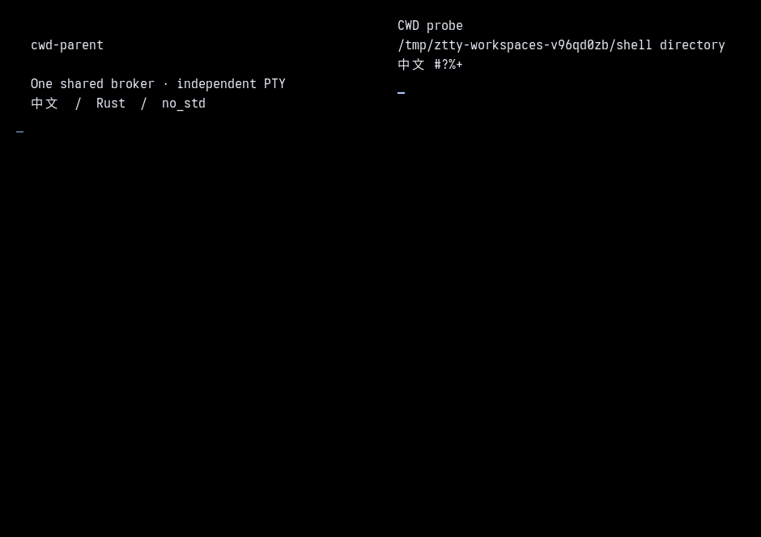

# ztty：修复 Bash 集成与会话输出续读

日期：2026-11-18（UTC+8）。

本轮修复当前开发分支的 Bash 集成语法错误，增加输出续读的会话身份校验与 PTY 读取终止标记，并补齐新标签页、分屏和新窗口的实际目录验收。固定源码 f2a49ec 通过 225 项 Rust 单元／集成测试、6 项文档测试、11 组 Bash 专项检查、四种 Shell 的真实 PTY 集成、17 项工作区 GUI 检查及三套 MCP 检查。[验收汇总](measurements/shell-resume-2026-11-18/summary.json)

交付仍在 [Draft PR #2](https://github.com/LIghtJUNction/ztty/pull/2)。这是继续开发的候选版本，未创建正式 Release。上一轮性能数据保留在[Unicode 整合报告](integration-unicode-2026-11-18.md)，本轮没有重新测量吞吐或 RSS。

## 1. 提交与构建身份

| 内容 | 提交 |
| --- | --- |
| Bash 脚本与首次加载验收修复 | [4b86136](https://github.com/LIghtJUNction/ztty/commit/4b8613689c4e8d774d148630523237cb18778e26) |
| MCP 身份校验、输出终止标记与回归 | [23ccc67](https://github.com/LIghtJUNction/ztty/commit/23ccc6718c274576e15f47a5aec817a2cdf41a02) |
| 后代 PTY 验收的失败清理完善；最终验证源码 | [f2a49ec](https://github.com/LIghtJUNction/ztty/commit/f2a49ec23a54ed3334d825087e1cd97fd00816af) |

Linux release 二进制大小为 **682,224 bytes**，SHA256 为 `a6e1254283d888954698c8e92a61eded6703417e6854d6a16421290a98ccdb6e`。实际执行 `ztty shell-integration bash` 的输出与已验证脚本逐字节一致，确认候选二进制包含修复。[构建身份](measurements/shell-resume-2026-11-18/binary.json) · [打包脚本核对](measurements/shell-resume-2026-11-18/embedded-bash.json)

## 2. Bash：修复脚本，也修复漏检路径

在上一轮提交 7bd5188 中，`shell/ztty.bash` 尾部存在重复拼接和无法配对的 `elif`；`bash -n` 在第 58 行失败，退出码为 2。原验收连续执行两次 `source`，没有独立核对第一次的退出状态，而脚本的加载标记可能使第二次提前返回，因此无法可靠排除第一次加载失败。[修复前语法记录](measurements/shell-resume-2026-11-18/bash-before.json)

修复删除损坏的重复片段，保留完整字符串或多项数组形式的 `PROMPT_COMMAND`，按原顺序运行已有钩子。捕获命令退出状态之后才输出终端控制标记；嵌套 Bash 继承已经带前缀的 `PS0` 时，不会重复添加 OSC 133 执行标记。[脚本](../shell/ztty.bash)

新的真实 PTY 验收先测未安装集成时的 Bash 行为，再比较字符串和数组钩子的退出状态传播。11 组检查覆盖语法、首次与重复加载、原钩子、非零退出码、DEBUG trap、嵌套 Shell、导出 PS0、非交互加载，以及含空格、中文和 `# % ? ; $` 的目录编码。相同验收对保存的旧脚本明确失败。现有四 Shell 验收也已增加 Bash 语法和两次 source 的独立成功检查，日常 Linux `make check` 会运行 Bash 专项验收。

[Bash 11 组结果](measurements/shell-resume-2026-11-18/bash.json) · [旧脚本被新验收拒绝](measurements/shell-resume-2026-11-18/bash-old-gate.json) · [验收代码](../tests/bash_integration.py)

## 3. 输出续读：字节位置必须对应同一个会话实例

旧版本可以稳定复现以下情况：会话输出 `OLD` 后返回游标 3；关闭它，再用同一个名字创建输出 `REPLACEMENT` 的新会话；旧 URI 加游标 3 被接受，得到 `LACEMENT`，且 `truncated=false`。URI 表示名字与命名空间，关闭后可以复用；它本身不能证明仍是原来的 PTY。[修复前实际 MCP 记录](measurements/shell-resume-2026-11-18/stale-cursor-before.json)

`session_read` 现在支持可选的 `expected_session`，由原始响应中的四个字段组成：

```python
identity = {key: created[key] for key in ("uri", "id", "created_at", "broker_pid")}
arguments = {
    "session": created["uri"],
    "cursor": next_cursor,
    "expected_session": identity,
}
```

服务器在读取输出、游标或屏幕内容之前核对四个字段。身份不同会返回 `session identity changed; start a new read`，错误不包含新会话的输出；缺字段、重复字段、额外字段、非法类型和越界数字也会被拒绝。重命名保留原 URI 和身份，因此仍可续读。

**兼容性边界：不传 `expected_session` 的旧调用仍被支持，也仍然没有实例校验。** 断线重连客户端应同时保存原身份与自己的 `next_cursor`，遇到身份不匹配时明确决定是否从零开始读取新会话。身份字段不是权限凭证；观察者权限和输入所有权继续由原有机制控制。

实现复用已有身份字段，校验时借用输入数据，没有新增会话常驻字段、观察者队列或依赖，输出保留上限保持原值。[身份校验实现](../src/session_identity.rs) · [接口说明](sessions.md#guarded-resume-and-output-termination)

## 4. 主进程退出与输出读完分别表示

新增 `output_eof` 表示本端 PTY 读取已经终止。实际验收通过门控控制后代进程的写入时间，观察到：

| 时刻 | 已读取文本 | running | exit_code | has_more | output_eof |
| --- | --- | --- | ---: | --- | --- |
| 直接子进程退出，后代仍持有 PTY | PREFIX | false | 7 | false | false |
| 后代写出尾部并结束，继续读取完成 | SUFFIX | false | 7 | false | true |

因此客户端使用 `output_eof && !has_more` 判断本端保留输出是否已经读尽，并继续检查 `truncated` 和 `exit_code`。核心的读取终止状态也包含不可恢复的读取错误；这一标记不保证异常情况下输出无损，也不表示命令成功。

MCP 回归还实际验证了两个只读观察者独立续读、stdio 重连、HTTP 跨传输续读、四字段逐项不匹配、11 类非法 guard、重命名、同名重建拒绝和旧接口兼容。[完整 MCP 会话日志](measurements/shell-resume-2026-11-18/mcp-sessions.log) · [三套 MCP 命令与退出状态](measurements/shell-resume-2026-11-18/mcp-gates.json)

## 5. 目录继承：验证真实快捷键与子进程

Linux 的 OSC 7 目录继承已有实现，本轮补的是实际输入到子进程的验收。测试通过 Ctrl+Shift+T/E/O/N 创建新标签、左右／上下分屏和新窗口，核对新子进程的实际 `cwd` 与 `PWD`，覆盖空格、中文及 URI 保留字符。

另有三种不可信或非法目录标记：远端主机名、无效百分号转义和编码 NUL。它们均回退到原启动目录。七个新增场景复用原有私有 Xvfb、真实 PTY、键盘事件和进程清理，工作区验收由 10 项扩展到 **17 项**。[实际结果](measurements/shell-resume-2026-11-18/workspaces.json) · [验收代码](../tests/workspaces.py)



截图已经目检：两侧文字清晰，右侧显示实际继承目录，界面保持黑底和留白。

## 6. 最终验收与复现

| 检查 | 结果与范围 |
| --- | --- |
| Rust 工作区单元／集成测试 | 225 项通过 |
| Rust 文档测试 | 6 项通过 |
| Bash 专项真实 PTY | 11 组通过，Bash 5.3.20 |
| 四 Shell 集成 | Bash 5.3.20、Zsh 5.9.2、Fish 4.9.3、Nushell 0.117.0 均通过；合计 30 个检查 |
| Linux 工作区实际 GUI | 17 项通过，含 7 项目录继承检查 |
| MCP 会话、传输和权限 | 三套通过 |
| 格式、严格 Clippy、release/no_std | 通过 |
| zterm/zinput/zgraphics 裸机检查 | 通过 |
| Windows GNU、macOS Intel/ARM 类型检查 | 通过 |

[构建与 Rust 命令记录](measurements/shell-resume-2026-11-18/gates.json) · [PTY/GUI 命令记录](measurements/shell-resume-2026-11-18/acceptance.json) · [四 Shell 结果](measurements/shell-resume-2026-11-18/shells.json) · [文件哈希清单](measurements/shell-resume-2026-11-18/manifest.json)

```sh
make check
cargo build --locked -p zterm --example shell_probe
python3 tests/shell_integration.py --artifacts artifacts/shell-integration --report artifacts/shell-integration/report.json
python3 tests/workspaces.py --binary ./target/release/ztty
```

本轮已验证的开发机二进制：

```text
/home/lightjunction/Documents/GITHUB/ztty/artifacts/integration-20261118/target/release/ztty
```

### 保留的边界

- Bash 5.1 以前的兼容分支未取得实际旧版本执行证据。
- MCP 仍采用有界请求／响应轮询；等待与 SSE 订阅需要把 broker 连接纳入异步事件循环，避免一条等待请求阻塞其他客户端。
- macOS 激活策略修复已经合入；最近一次可用原生记录来自修复前，修复后的原生像素／输入复验仍待完成。
- Windows 新工作区的 19 项原生功能 gate 已接入，但本轮没有该平台的运行证据；它与较早候选的 19 项可见像素检查是不同验收。
- 完整原生共享会话、Wayland、复杂文字布局以及正式发布仍按[项目清单](https://chatgpt.com/space/page_33438d764dec8191882dcdae0f86b1ff)推进。
