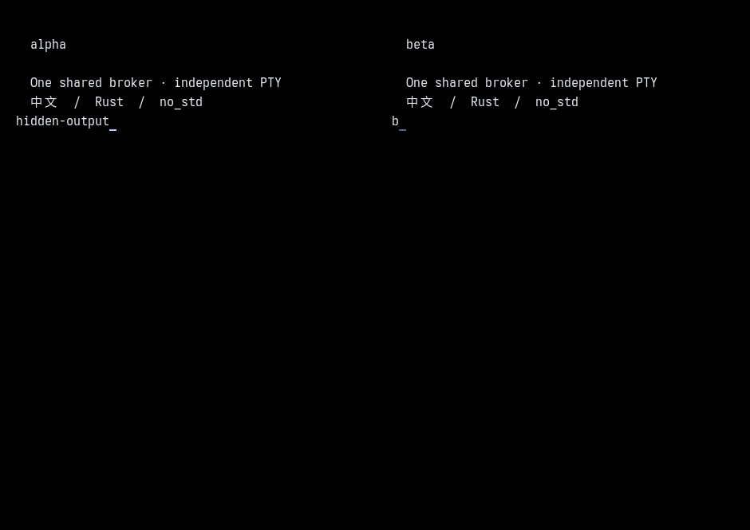

# Tabs, splits and input ownership

Linux sessions can share a native workspace window while keeping separate PTYs, terminal screens and histories. Tabs and splits reuse the existing broker, display connection and font cache. The layout tree contains session IDs; moving a pane never starts a replacement process.

## Open and arrange

```sh
ztty --name work -e /bin/bash
ztty --name build --split-right work -e /bin/bash
ztty --name logs --split-down build -e /bin/bash
ztty --name notes --tab work -e /bin/bash
ztty action work next-tab
ztty action build maximize
ztty action build move-window
ztty move build work right
```

The launch commands wait for their view to close; use separate shells or append `&` when issuing them from one shell. `--cwd PATH` sets a new session's working directory. Keyboard-created tabs and panes inherit the caller's shell environment and the active session's latest local OSC 7 directory, falling back to its initial directory. Remote OSC 7 hostnames do not become local directories.

| Shortcut | Action |
| --- | --- |
| Ctrl+Shift+T | New tab |
| Ctrl+Shift+E / O | Split right / below |
| Ctrl+Tab / Ctrl+Shift+Tab | Next / previous tab |
| Ctrl+Shift+PageUp / PageDown | Previous / next tab (additional bindings) |
| Ctrl+Shift+Left / Right | Previous / next pane |
| Ctrl+Shift+Up / Down | Swap with previous / next pane |
| Ctrl+Shift+Enter | Maximize / restore the focused pane |
| Ctrl+Alt+Shift+Equal / Minus | Grow / shrink the nearest split |
| Ctrl+Plus / Minus / 0 | Increase, decrease or reset font size |
| Ctrl+Shift+N / U | New window / move current pane to its own window |
| Ctrl+Shift+D / W | Detach / close the current view |
| Ctrl+Shift+G | Explicitly take input control |

Font zoom, Ctrl+Tab / Ctrl+Shift+Tab, and Ctrl+Alt+Shift+Equal / Minus also work
in the native Windows workspace. Zoom preserves the current window and PTYs;
Windows updates the font metrics for all panes. Ctrl+Shift+Equal/Minus and
Ctrl+Shift+0 are additional zoom/reset bindings; Ctrl+keypad Add/Subtract/0
also works, with Num Lock required for keypad 0. The shared-session commands and
lifecycle below use the Linux broker. macOS does not yet have workspace UI or
these font-size shortcuts.

The Linux workspace window title shows the active tab number. There is no permanent toolbar. Hidden tabs keep reading PTY output; their Xrender image uploads and full-size backing pixmaps are released and rebuilt when shown. A workspace is bounded to 32 tabs and 64 panes; the broker retains its separate 128-session limit.

## Session lifecycle and control

```sh
ztty list work
ztty info work
ztty rename work editing
ztty detach editing
ztty attach --observe editing
ztty control editing acquire --takeover
ztty control editing release
```

Session metadata includes a numeric ID, creation time in Unix milliseconds, input owner, PTY PID, window ID, workspace ID and visibility. Rename changes the short display name while preserving the creation URI. Detached sessions retain their PTY and output; their previous launch/attach waiters complete. The broker's IDs and live PTYs last only as long as the broker process.

Each trusted control identity owns input explicitly. Reads are available to observers; write, resize, rename and close require the current owner. Taking over another owner requires `takeover: true`; release and takeover discard unsent input from the previous owner. Already delivered PTY bytes cannot be recalled. A lost controller retains its ownership until an authorized operator explicitly takes over.

An observing view permits selection, copy and scrollback while suppressing keyboard input, paste, mouse reports, focus reports and PTY resize. Ctrl+Shift+G explicitly takes local control. Observer creation requests EWMH user-time zero so a cooperating window manager can map it without activation. Window-manager-specific focus behavior requires the native-desktop check.

## Save and restore a live workspace

```sh
ztty save-layout editing > workspace.json
ztty restore-layout workspace.json
```

The schema-2 JSON file records tab order, the binary split tree and ratios, active tab, focused session, maximization and window dimensions. It records the canonical URI, numeric session ID, creation timestamp and broker PID for every pane. Renaming a session preserves its URI and identity. Closing and recreating a session with the same name produces a different identity, so an old snapshot cannot silently attach to the replacement. URI-only schema-1 files are rejected explicitly. Restoring reparents existing views and preserves the PTYs and their processes. All referenced sessions must still exist and have an attached view on the same X display. The operation is available only to the local desktop controller.

Parsing and identity checks finish before changing live windows. The decoder rejects missing sessions, duplicate panes, unexpected fields, cycles, shared subtrees, invalid focus and excessive dimensions or depth. The file is limited to 64 KiB; layouts retain the 32-tab/64-pane limits. A PTY resize error after validation returns an error while preserving the new parent window and all live child views. Other views still complete their arrangement, the terminal model keeps its last accepted PTY dimensions, and an identical restore retries the failed resize. X server failure remains outside a system-wide transaction. Queued geometry and focus events cannot overwrite a newer layout request.

Snapshots do not contain process state or commands. They do not restart a stopped broker or recreate an exited shell. Startup templates and restoring detached views automatically remain separate work.

## Reproduce the acceptance

```sh
cargo test --locked --test layout --test workspace_state
cargo build --locked --release
python3 tests/workspaces.py --binary ./target/release/ztty
```

Thirteen snapshot tests additionally cover round-trip serialization, a 64-pane deeply nested layout, schema and dimension bounds, URI aliasing and malformed graphs. The real X11 acceptance also verifies that save/restore preserves three PTY PIDs and rejects invalid/nonlocal restore requests before changing the layout. A private marker-controlled ioctl shim forces PTY resize errors only in the owned test broker: all views and processes must survive, retain their accepted PTY dimensions, and recover on an identical restore after the fault is removed. A separate close/recreate case verifies that a reused canonical URI cannot rebind an old layout. The six layout tests cover geometry, tab/pane removal, focus, swap, resize, maximize, duplicate IDs and limits. The real X11 test starts a private Xvfb display and verifies PTY separation, native geometry, keyboard routing, hidden output, moving panes, rename, detach/reattach, observer input denial, explicit takeover and cleanup. It also exercises real shortcuts for new tabs, right/below splits and new windows, then checks the new child's actual cwd and PWD for percent-encoded spaces, Unicode and reserved URI characters. Remote hostnames, malformed escapes and encoded NUL fall back to the original launch directory. It saves actual split screenshots and a JSON result.

[Current 17-check workspace result](measurements/shell-resume-2026-11-18/workspaces.json) · [Actual cwd inheritance screenshot](measurements/shell-resume-2026-11-18/workspace-cwd.png) · [Current report](shell-resume-2026-11-18.md)

[Earlier layout restore result](measurements/layout-restore-x11-2026-11-18.json) · [Validation log](measurements/layout-restore-gates-2026-11-18.txt) · [Acceptance result](measurements/workspaces-x11-2026-11-18.json) · [Screenshot](assets/workspaces-x11-2026-11-18.png)



This acceptance group targets Linux X11. Windows tabs/splits have a separate 19-check native workspace gate whose current-source runtime acceptance is pending. macOS workspace parity, startup session templates and multiple simultaneous GUI views of one PTY remain separate work.
