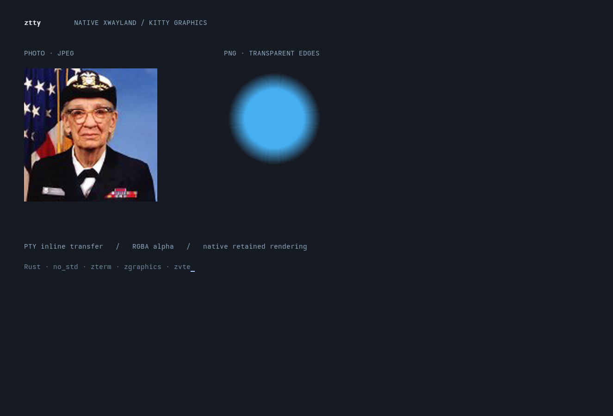

# ztty 0.2：原生平台、Kitty 图片与组件发布

日期：2026-11-18，Asia/Taipei。

**本轮已经完成 Linux 图片显示路径、macOS/Windows 原生后端，以及可复用组件的 crates.io 发布。** 在实际 Hyprland/XWayland 窗口里，现成的 `kitten icat` 能自动探测内联传输并显示照片和透明 PNG；Xvfb 的颜色、透明度、滚动、缩放、主备屏和删除验收通过。macOS 两种架构与 Windows x86_64 也完成了对应操作系统上的原生构建与运行检查。

生产源码来自 [7535aa2](https://github.com/LIghtJUNction/ztty/commit/7535aa29f1a2728a78a446ffea6784dcbc2aae92)。这一提交包含自动探测修复。此前的 [4b3829a](https://github.com/LIghtJUNction/ztty/commit/4b3829a0754643e0ff080772db9a1c1886c1fa12) 引入完整图形与原生平台实现，保留了用户已有的 Fcitx 5 事件路由修复；后续文档和证据提交不改变这份生产代码。

项目：[LIghtJUNction/ztty](https://github.com/LIghtJUNction/ztty)。最终原生制品构建：[Release candidate 44165748395](https://github.com/LIghtJUNction/ztty/actions/runs/44165748395)。报告与安装包归档：[Google Drive / ztty](https://drive.google.com/drive/folders/1XwquftPqNH9H6fjScYw6FPpn5QdxZZxa)。



## 三项图片验收

| 用户要求 | 实际结果 | 证据 |
| --- | --- | --- |
| 现成工具直接出图 | `kitten icat` 0.50.0 显示照片和透明 PNG，退出码均为 0；`--detect-support` 返回 `stream`，PNG 使用自动探测 | [真实桌面记录](https://github.com/LIghtJUNction/ztty/blob/main/docs/measurements/graphics-hyprland-2026-11-18.json) |
| 像素和生命周期正确 | 真实 PTY + Xvfb 窗口像素读回，RGB/RGBA/PNG、四档 alpha、裁剪、图层、分片、复用、替换、滚动、缩放、备用屏和删除均通过 | [7 组图像验收](https://github.com/LIghtJUNction/ztty/blob/main/docs/measurements/graphics-xvfb-2026-11-18.json) |
| 异常输入可恢复 | 坏图、超限尺寸、坏 Base64 和中断传输后仍可输出文字、输入按键并显示下一张有效图片；80 次中断上传后，热身后的前后 RSS 样本增量为 0 | [异常输入与恢复记录](https://github.com/LIghtJUNction/ztty/blob/main/docs/measurements/graphics-xvfb-2026-11-18.json) |

真实桌面使用 Hyprland 0.57.2 的 XWayland 服务。测试只创建、调整和截取自己的窗口，没有修改桌面配置。该会话正常的 X0 路径当时缺失，测试通过临时自有别名连接现有同用户 XWayland socket，并在结束时移除别名；原始记录保留了这一环境条件。

Xvfb 的像素测试不是协议回放：测试数据从真正的子进程 PTY 进入终端，再读取窗口颜色。透明度检查覆盖 alpha 0、64、128、255；图片滚动三行后检查位置变化，切换备用屏后检查主屏图片隐藏与恢复，删除后检查原区域已经重绘。0 字节 RSS 增量是这组恢复测试的采样结果，不是总内存或峰值为零的声明。

## 平台后端与已验证边界

| 平台 | 原生实现 | 本轮实际验证 |
| --- | --- | --- |
| Linux x86_64 | Linux PTY、X11/XWayland、Xft 文字、XRender 图片合成 | 12 项已有 GUI 回归、7 组图像测试、真实 Hyprland/XWayland 工具验收 |
| Linux ARM64 | 同一 Linux 后端 | 原生构建和 CLI 启动；未做 ARM64 图形桌面验收 |
| macOS Apple Silicon | Darwin `forkpty`、AppKit 窗口、CoreText/CoreGraphics | Apple SDK 原生构建、实际 AppKit/PTY、8 项会话及协议检查、应用包签名与结构检查 |
| macOS Intel | 同一 macOS 后端 | 原生 Intel 构建及同样的 8 项检查 |
| Windows x86_64 | ConPTY、Win32 窗口、GDI 文字、自己的 RGBA 合成 | 17 项原生检查，包括实际 ConPTY 查询往返、RGB/RGBA/PNG 窗口像素、透明度、滚动、裁剪、缩放、主备屏、删除和键盘恢复 |
| Windows ARM64 | 同一 Windows 后端 | PE 实际交叉链接、系统导入和完整运行包验证；未在 ARM64 Windows 执行 |

macOS 可以原生启动应用和 shell，不需要 X11；Windows 不需要 WSL。macOS 的原生像素读回及输入法/键盘验收仍未完成，报告明确保留 `pixel_readback: not_performed` 和 `ime_keyboard: not_performed`。Windows ARM64 的交叉构建也没有代替真实运行结果。

原生证据分别保存在 [macOS ARM64](https://github.com/LIghtJUNction/ztty/blob/main/docs/measurements/ztty-macos-aarch64.native-7535aa2.json)、[macOS Intel](https://github.com/LIghtJUNction/ztty/blob/main/docs/measurements/ztty-macos-x86_64.native-7535aa2.json)、[Windows x86_64](https://github.com/LIghtJUNction/ztty/blob/main/docs/measurements/ztty-windows-x86_64.native-7535aa2.json) 和 [Windows ARM64 交叉构建](https://github.com/LIghtJUNction/ztty/blob/main/docs/measurements/windows-arm64-cross-2026-11-18.json)。

## 已发布的可复用组件

| 组件 | 发布版本 | 职责 |
| --- | --- | --- |
| [zgraphics](https://crates.io/crates/zgraphics/0.1.0) | 0.1.0，新包 | Kitty 图片传输、PNG/RGB/RGBA 解码、存储、放置和删除 |
| [zpty](https://crates.io/crates/zpty/0.2.0) | 0.2.0 | Linux/macOS PTY、Windows ConPTY、有界 I/O 和子进程生命周期 |
| [zterm](https://crates.io/crates/zterm/0.2.0) | 0.2.0 | 字符屏幕、历史、图片锚点、模式、协议回复和变化记录 |
| [zinput](https://crates.io/crates/zinput/0.1.0) | 0.1.0，继续复用 | 键盘、鼠标、焦点及粘贴事件编码 |
| [zvte](https://crates.io/crates/zvte/0.1.3) | 0.1.3，继续复用 | 用户已有的 ANSI/VT 流式解析器 |

```sh
cargo add zvte@0.1.3 --no-default-features
cargo add zgraphics@0.1.0 --no-default-features
cargo add zpty@0.2.0 --no-default-features
cargo add zterm@0.2.0 --no-default-features
cargo add zinput@0.1.0 --no-default-features
```

四个 ztty 组件均已从 crates.io 重新下载，在工作区以外验证单独使用和组合使用；生成的 manifest 只有精确注册表版本，没有本地路径覆盖。验证覆盖 `no_std` 库编译、终端状态、事件编码、图片放置/删除和真正的 PTY 子进程。注册表校验和与 Cargo 下载包一致，发布者均为 LIghtJUNction，未被撤回。详见 [独立消费者结果](https://github.com/LIghtJUNction/ztty/blob/main/docs/measurements/registry-native-graphics-2026-11-18.json) 与 [发布回读](https://github.com/LIghtJUNction/ztty/blob/main/docs/measurements/registry-0.2-2026-11-18.json)。

## 图片实现与 no_std 边界

终端收到图片命令后，先收齐并验证图片，再保存一份 RGBA 像素；“放置”只记录图片 ID、字符行列、裁剪和层级。滚动时移动这些位置，绘制时将像素合成到窗口。这使协议、图片数据和窗口 API 可以分别复用，后续 Sixel 也可以复用图片存储和绘制路径。

`zgraphics` 实现 `a=q/t/T/p/d`、直接传输 `t=d`、RGB24/RGBA32/PNG100、zlib 压缩、分片、图片/放置 ID、裁剪、缩放、层级和删除。主屏与备用屏拥有独立场景。Linux 通过 XRender 合成，macOS 通过 CoreGraphics，Windows 直接合成到 DIB；没有嵌入 Kitty 的渲染器。

真实工具验收发现并修复了两类兼容问题。当前 Kitty 可以发送 128 KiB APC 分片，并省略 Base64 尾部填充，因此接收器改为有界流式解码。自动探测器还忽略较短的 DA1 回复，因此把数值为 6 的 VT102 标识写成等价的 `06`，维持原能力声明。两项都加入了回归测试，最终通过现成工具验证。

生产应用和依赖图保持 Rust `no_std`，动态存储使用 `alloc`。11 个生产 crate 的启用特性与源属性审计通过，Linux release 二进制没有 Rust `std::` 符号，`zinput/zgraphics/zterm` 在没有标准库的 `x86_64-unknown-none` 目标上通过检查。PNG 使用第三方 `zune-png/zune-core/zune-inflate` 的无标准库配置；这些不是用户自行编写的库。系统窗口、字体和 C ABI 仍属于运行时成本。证据见 [依赖审计](https://github.com/LIghtJUNction/ztty/blob/main/docs/measurements/no-std-graphics-2026-11-18.txt)。

默认每个场景最多保存 128 张图片、512 个放置，保留像素容量最多 32 MiB；单图最多 32 MiB，待完成传输最多 16 MiB。宽或高最多 8192 像素，同时必须满足字节限制。APC 暂存只需要 512 字节头部和 4096 字节编码数据。主备屏各自有配额，解码临时缓冲和平台显示缓存另行计入，因此这些数字不是整个进程的总内存上限。

## 性能与测试

同一台本地机器、绑定 CPU 0、三次交替运行的核心基准，图形版本与此前基线对比如下。该结果只包含解析和屏幕更新，不包含 PTY、渲染与显示器。

| 指标 | 基线 | 图形版本 |
| --- | ---: | ---: |
| ASCII 吞吐 | 313.713 MiB/s | 312.621 MiB/s |
| 满历史缓冲 ASCII 吞吐 | 209.947 MiB/s | 220.766 MiB/s |
| SGR 吞吐 | 172.967 MiB/s | 171.978 MiB/s |
| 混合 Unicode 吞吐 | 114.261 MiB/s | 108.145 MiB/s |
| 1 KiB 输入 p50 | 2.168 µs | 2.232 µs |
| 初始终端核心堆 | 107,676 B | 107,676 B |
| 已测稳态循环分配 | 0 | 0 |

图片存储按需分配，所以没有图片时的初始核心堆没有增长。三个核心测量运行的原始值、源文件摘要和计算口径在 [同机对照记录](https://github.com/LIghtJUNction/ztty/blob/main/docs/measurements/graphics-core-overhead-2026-11-18.json) 中。

这组样本中，混合 Unicode 吞吐下降约 5.35%，满历史缓冲的 ASCII 吞吐提高约 5.15%。只有三次交替运行，机器负载和频率没有固定；报告保留这些变化与波动，没有把细小差异解释成稳定的性能结论。

在 i9-12900HX 开发机上另做三次 120×32 软件 X11 整窗测量，图形版本进程 RSS 中位数约 **18.36 MiB**，PSS 约 **13.59 MiB**。XRes 另外观察到 **6,547,456 B** 服务器 pixmap 资源，不包含在进程 RSS/PSS 内，也不代表完整 GPU 内存。写一个字符并查询状态的 PTY 往返 p50 为 **16.456 µs**，p95 为 **34.915 µs**，p99 为 **101.634 µs**，均为三次运行相应分位数的中位数。

该运行时测量早于 DA1 序列化修复，使用已核对哈希的本地构建。它不是原生 macOS/Windows 性能，也不是物理键盘到显示像素的延迟。查询回复确认程序理解了终端状态，显示器何时呈现新帧需要另行测量。本轮没有重新比较 Kitty 或测试 Ghostty，因此不据此宣称已经整体超过它们。[完整性能与边界](https://github.com/LIghtJUNction/ztty/blob/main/docs/performance.md) 保留了旧版本的历史比较。

最终本地检查通过 **72 项库单元测试、4 项 doctest、严格 Clippy、Linux release 构建、依赖和符号审计、裸机目标检查**。[本地门禁记录](https://github.com/LIghtJUNction/ztty/blob/main/docs/measurements/local-gates-2026-11-18.txt) 包含对应提交和编译日志。裸机检查中 `zune-png 0.5.2` 有针对未来 Rust 的兼容性提示；当前固定 Rust 1.100.0 检查成功，正式平台构建通过。

## 安装包与运行

Google Drive 的 ztty 文件夹保存 0.2.0 候选包、SHA256SUMS、报告和图片证据；GitHub Release workflow 也保留对应构建制品。macOS 包为 `.app`，包含 ad-hoc 签名验证，但没有 Developer ID 签名或 Apple 公证。Windows 包携带固定版本的官方 ConPTY，解压后需要把配套文件保留在一起。

本轮正式发布的是上述 crates.io 组件。应用安装包是通过原生门禁的候选制品，未发布 `v0.2.0` GitHub Release，也未更新 AUR；现有 Linux 一键安装器仍跟随已发布应用版本。新功能可以使用候选包，或在开发机 `/home/lightjunction/Documents/GITHUB/ztty` 从源码构建。

```sh
cargo build --locked --release
./target/release/ztty
# 在 ztty 的 shell 内：
kitten icat --scale-up photo.jpg
kitten icat transparent.png
```

第一版按约定保留文件/共享内存传输和动画为后续工作，Sixel 尚未接入。原生 Wayland、专用 GPU 渲染、macOS 像素及输入法验收、Windows ARM64 原生验收、复杂文字塑形和历史重排仍需要各自实现或测量。Linux 的脏行绘制也尚未移植到 macOS/Windows 的所有绘制路径，不能把 Linux 的性能直接推广到其他平台。
